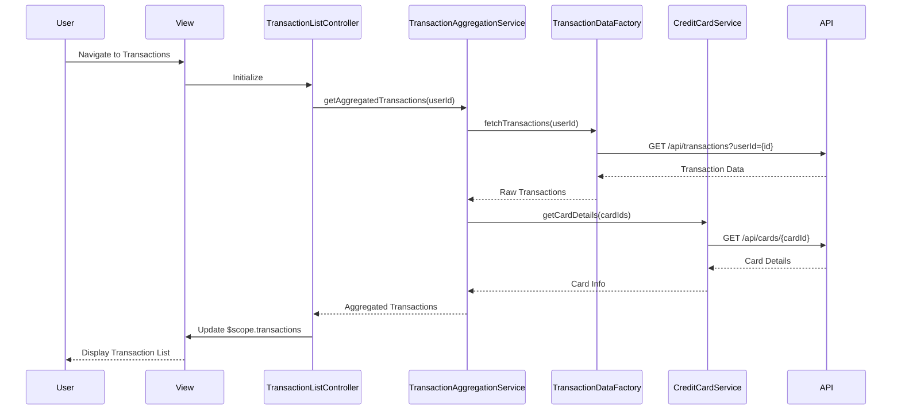

# Low-Level Design: Transaction Management and Monitoring
**Epic ID:** QE-8816

## a. Architecture Mapping

- **Transaction Module** → AngularJS Module (`creditCard.transactions`)
- **Transaction Controller** → AngularJS Controller (`TransactionListController`)
- **Transaction Aggregation Module** → AngularJS Service (`TransactionAggregationService`)
- **Transaction Data Service** → AngularJS Factory (`TransactionDataFactory`)
- **Credit Card Service** → AngularJS Service (`CreditCardService`)

**Recommended Folder Structure:**
```
/app
  /modules
    /transactions
      /controllers
        - transactionListController.js
      /services
        - transactionAggregationService.js
        - creditCardService.js
      /factories
        - transactionDataFactory.js
      /views
        - transaction-list.html
      /directives
        - transaction-item.directive.js
```

## b. Component Specifications

| Name | Artifact Type | Responsibility | Key Dependencies |
|------|---------------|----------------|------------------|
| TransactionListController | Controller | Manages transaction list view, handles user interactions, filters | TransactionAggregationService, $scope, $filter |
| TransactionAggregationService | Service | Aggregates transactions across multiple cards, applies sorting/filtering | TransactionDataFactory, CreditCardService |
| TransactionDataFactory | Factory | Fetches transaction data from REST API, handles pagination | $http, $q |
| CreditCardService | Service | Maps transactions to credit cards, provides card details | $http, $q |
| transactionItemDirective | Directive | Renders individual transaction item with details | None |

## c. Data Model

**Transaction Object:**
```javascript
{
  id: String,
  cardId: String,
  date: Date,
  merchant: String,
  amount: Number,
  category: String,
  description: String,
  status: String // 'posted', 'pending'
}
```

**CreditCard Object:**
```javascript
{
  id: String,
  cardNumber: String (masked),
  cardName: String,
  cardType: String
}
```

## d. Data Flow

User navigates to transaction view → TransactionListController initializes and calls TransactionAggregationService → Service fetches transaction data via TransactionDataFactory REST call (GET /api/transactions?userId={id}) → CreditCardService enriches transactions with card details (GET /api/cards/{cardId}) → Aggregated and sorted transaction list returned to controller → Controller binds data to $scope → View renders transaction list with ng-repeat → User interactions (filter, sort, detail view) trigger controller methods that update $scope and re-render UI.

## e. Primary Sequence Diagram



## f. Implementation Notes

- Use AngularJS dependency injection for all services and factories; register module as `angular.module('creditCard.transactions', [])`
- Implement pagination using $http with query parameters (page, limit) and ng-repeat with limitTo filter
- Use ES6 classes for services wrapped in AngularJS service registration: `angular.module('...').service('TransactionAggregationService', TransactionAggregationService)`
- REST API integration via $http with Promise-based error handling using $q
- Apply AngularJS filters for date formatting (date filter) and currency display (currency filter)

## g. Error Handling

HTTP interceptor captures API errors; controller displays user-friendly messages via Bootstrap alert component bound to $scope.errorMessage.

## h. Security Notes

Requires token-based auth via existing SSO; API calls include Authorization header with JWT token from AuthService.