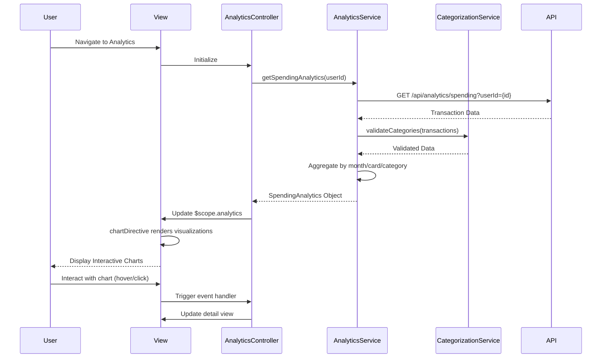

# Low-Level Design: Spending Analytics and Insights
**Epic ID:** QE-8817

## a. Architecture Mapping

- **Analytics Module** → AngularJS Module (`creditCard.analytics`)
- **Analytics Controller** → AngularJS Controller (`AnalyticsController`)
- **Analytics Engine** → AngularJS Service (`AnalyticsService`)
- **Transaction Categorization Service** → AngularJS Service (`CategorizationService`)
- **Data Visualization Library** → Third-party Directive wrapper (`chartDirective` wrapping Chart.js/D3.js)

**Recommended Folder Structure:**
```
/app
  /modules
    /analytics
      /controllers
        - analyticsController.js
      /services
        - analyticsService.js
        - categorizationService.js
      /directives
        - chart.directive.js
      /views
        - analytics-dashboard.html
```

## b. Component Specifications

| Name | Artifact Type | Responsibility | Key Dependencies |
|------|---------------|----------------|------------------|
| AnalyticsController | Controller | Manages analytics view, handles user interactions with charts | AnalyticsService, $scope |
| AnalyticsService | Service | Aggregates transaction data by month/card/category, processes analytics | $http, $q, CategorizationService |
| CategorizationService | Service | Assigns/validates transaction categories from 9 predefined types | None |
| chartDirective | Directive | Renders interactive charts using Chart.js, binds to scope data | Chart.js library |
| AnalyticsDataFactory | Factory | Fetches transaction data for analytics from REST API | $http, $q |

## c. Data Model

**SpendingAnalytics Object:**
```javascript
{
  userId: String,
  monthlyTrends: Array<{month: String, amount: Number}>,
  cardWiseSpend: Array<{cardId: String, cardName: String, amount: Number}>,
  categoryWiseSpend: Array<{category: String, amount: Number}>
}
```

**Category Enum:**
```javascript
['Food & Dining', 'Fuel', 'Shopping', 'Travel', 'Entertainment', 'Utilities', 'Healthcare', 'Education', 'Miscellaneous']
```

## d. Data Flow

User navigates to analytics view → AnalyticsController calls AnalyticsService.getSpendingAnalytics(userId) → Service fetches transaction data via REST API (GET /api/analytics/spending?userId={id}) → CategorizationService validates and enriches category data → AnalyticsService aggregates data into monthly trends, card-wise, and category-wise structures → Processed analytics object returned to controller → Controller binds data to $scope.analytics → chartDirective watches scope changes and renders interactive Chart.js visualizations → User interactions (hover, click) trigger chart events handled by directive callbacks updating controller scope.

## e. Primary Sequence Diagram



## f. Implementation Notes

- Use AngularJS module `angular.module('creditCard.analytics', [])` with DI for all components
- Integrate Chart.js via custom directive that watches $scope.chartData and re-renders on changes using $scope.$watch
- Implement CategorizationService as singleton with predefined category array; use Array.includes() for validation
- REST API returns pre-aggregated analytics data to optimize performance; fallback to client-side aggregation if needed
- Use ES6 arrow functions and template literals for cleaner code in service methods

## g. Error Handling

HTTP interceptor-based error handling with fallback to empty analytics object; user notified via Bootstrap toast component.

## h. Security Notes

Standard input validation and secure API calls assumed; token-based authentication inherited from app-level AuthService.