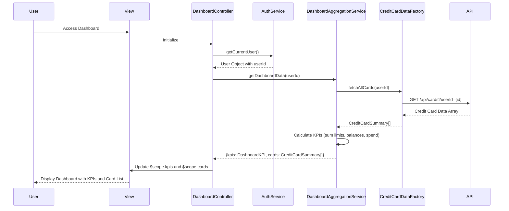

# Low-Level Design: Dashboard KPIs and Credit Card Overview
**Epic ID:** QE-8818

## a. Architecture Mapping

- **Dashboard Module** → AngularJS Module (`creditCard.dashboard`)
- **Dashboard Controller** → AngularJS Controller (`DashboardController`)
- **Data Aggregation Engine** → AngularJS Service (`DashboardAggregationService`)
- **Credit Card Data Service** → AngularJS Factory (`CreditCardDataFactory`)
- **User Authentication Service** → AngularJS Service (`AuthService`)

**Recommended Folder Structure:**
```
/app
  /modules
    /dashboard
      /controllers
        - dashboardController.js
      /services
        - dashboardAggregationService.js
        - authService.js
      /factories
        - creditCardDataFactory.js
      /views
        - dashboard.html
      /directives
        - kpi-card.directive.js
        - credit-card-item.directive.js
```

## b. Component Specifications

| Name | Artifact Type | Responsibility | Key Dependencies |
|------|---------------|----------------|------------------|
| DashboardController | Controller | Manages dashboard view, orchestrates data loading and KPI display | DashboardAggregationService, AuthService, $scope |
| DashboardAggregationService | Service | Aggregates credit card data, calculates KPIs (monthly spend, total limit, available credit, outstanding) | CreditCardDataFactory, $q |
| CreditCardDataFactory | Factory | Fetches credit card details and balances from REST API | $http, $q |
| AuthService | Service | Handles user authentication, provides user identity and token | $http, $window |
| kpiCardDirective | Directive | Renders individual KPI card with value and label | None |
| creditCardItemDirective | Directive | Renders individual credit card summary with key details | None |

## c. Data Model

**DashboardKPI Object:**
```javascript
{
  monthlySpend: Number,
  totalCreditLimit: Number,
  availableCredit: Number,
  outstandingAmount: Number
}
```

**CreditCardSummary Object:**
```javascript
{
  id: String,
  cardNumber: String (masked),
  cardName: String,
  cardType: String,
  creditLimit: Number,
  availableCredit: Number,
  outstandingBalance: Number,
  currentMonthSpend: Number
}
```

## d. Data Flow

User authenticates via AuthService → DashboardController initializes and calls DashboardAggregationService.getDashboardData(userId) → Service fetches all credit cards via CreditCardDataFactory REST call (GET /api/cards?userId={id}) → Factory returns array of CreditCardSummary objects → Service calculates aggregated KPIs by summing credit limits, available credit, outstanding amounts, and monthly spend across all cards → Service returns DashboardKPI object and card array to controller → Controller binds data to $scope.kpis and $scope.cards → View renders KPI cards using kpiCardDirective and credit card list using creditCardItemDirective with ng-repeat → Dashboard updates in real-time on data refresh.

## e. Primary Sequence Diagram



## f. Implementation Notes

- Register dashboard module as `angular.module('creditCard.dashboard', [])` with all components using AngularJS DI
- Use $q.all() to parallelize multiple API calls if card details come from different endpoints
- Implement responsive layout using Bootstrap grid system (col-md-3 for KPI cards, col-md-12 for card list)
- Use ES6 Array.reduce() for KPI aggregation logic in DashboardAggregationService
- Cache dashboard data in service for 5 minutes using $cacheFactory to optimize load time

## g. Error Handling

HTTP interceptor captures API failures; controller displays error state with retry button using try/catch and $scope.error binding.

## h. Security Notes

Requires token-based auth via existing SSO; AuthService injects JWT token into all API requests via $http interceptor.