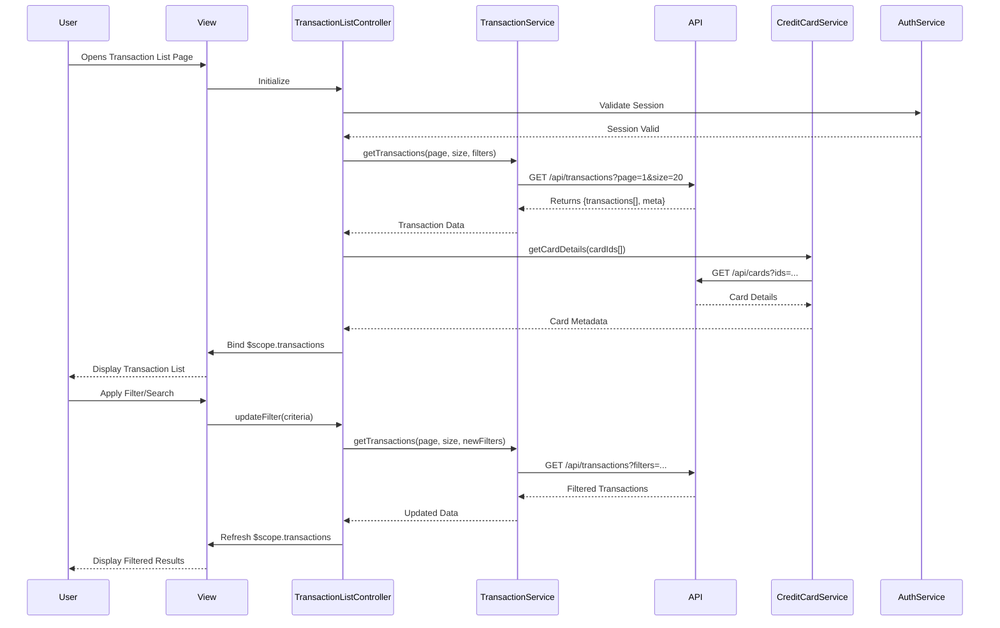

# Low-Level Design: Transaction Management and Viewing
**Epic ID:** QE-8831  
**Application Stack:** AngularJS 1.x, JavaScript ES6, HTML5, CSS3, Bootstrap, REST APIs, MVC Architecture

---

## a. Architecture Mapping

| HLD Component | AngularJS Artifact | Responsibility |
|---------------|-------------------|----------------|
| User Interface | transactionModule (Module) | Root module for transaction management feature |
| Transaction View Component | TransactionListController (Controller) | Manages transaction list view, search, filter, and pagination |
| User Service | AuthService (Factory) | Handles user authentication and authorization checks |
| Transaction Data Service | TransactionService (Service) | Retrieves transaction data from REST API with pagination and filtering |
| Credit Card Service | CreditCardService (Service) | Provides card metadata and card-transaction mapping |
| Database | REST API Endpoints | Backend data persistence layer |

**Recommended Folder Structure:**
```
app/
├── modules/
│   └── transactions/
│       ├── transactionModule.js
│       ├── controllers/
│       │   └── TransactionListController.js
│       ├── services/
│       │   ├── TransactionService.js
│       │   └── CreditCardService.js
│       ├── factories/
│       │   └── AuthService.js
│       ├── views/
│       │   └── transaction-list.html
│       └── directives/
│           └── transactionCard.directive.js
```

---

## b. Component Specifications

| Component Name | Artifact Type | Responsibility | Key Dependencies |
|----------------|---------------|----------------|------------------|
| transactionModule | Module | Registers all transaction-related components and routing | angular, ui.router |
| TransactionListController | Controller | Manages transaction list state, search, filter, pagination logic | TransactionService, CreditCardService, $scope |
| TransactionService | Service | Fetches transaction data via REST API with query params for pagination/filtering | $http, $q |
| CreditCardService | Service | Retrieves card details and maps transactions to cards | $http, $q |
| AuthService | Factory | Validates user session and authorization tokens | $http, $window |
| transactionCard | Directive | Renders individual transaction item with details | none |
| TransactionFilterComponent | Component | Provides UI controls for search and filter operations | TransactionListController |

---

## c. Data Model

**Transaction Model:**
```javascript
class Transaction {
  transactionId: String
  cardId: String
  amount: Number
  currency: String
  merchantName: String
  category: String
  transactionDate: Date
  description: String
  status: String // 'posted', 'pending'
}
```

**CreditCard Model:**
```javascript
class CreditCard {
  cardId: String
  cardNumber: String // masked
  cardType: String
  cardHolderName: String
}
```

**PaginationMeta Model:**
```javascript
class PaginationMeta {
  currentPage: Number
  pageSize: Number
  totalRecords: Number
  totalPages: Number
}
```

---

## d. Data Flow

User opens the transaction list view → TransactionListController initializes and calls TransactionService.getTransactions() with default pagination params → TransactionService sends GET request to /api/transactions?page=1&size=20 → Backend returns paginated transaction array with metadata → Controller binds data to $scope.transactions → View renders transaction list using ng-repeat with transactionCard directive → User applies search/filter → Controller updates query params and re-fetches data → UI updates with filtered results → User clicks on a transaction → Controller navigates to transaction detail view with transactionId.

---

## e. Primary Sequence Diagram



---

## f. Implementation Notes

- Use AngularJS $http service with promise-based pattern for all REST API calls; implement response interceptors for error handling.
- Leverage ES6 classes for service definitions and arrow functions for callbacks to maintain lexical scope.
- Implement pagination using ui-bootstrap pagination directive with two-way binding to controller state.
- Use AngularJS Dependency Injection for all services, factories, and controllers; register components in transactionModule.
- Apply Bootstrap grid system and responsive utilities for mobile-first transaction list layout.

---

## g. Error Handling

HTTP interceptor-based error handling with user-friendly toast notifications for API failures and session expiry redirects.

---

## h. Security Notes

Requires token-based authentication via existing SSO; all API calls include Authorization header with JWT token.