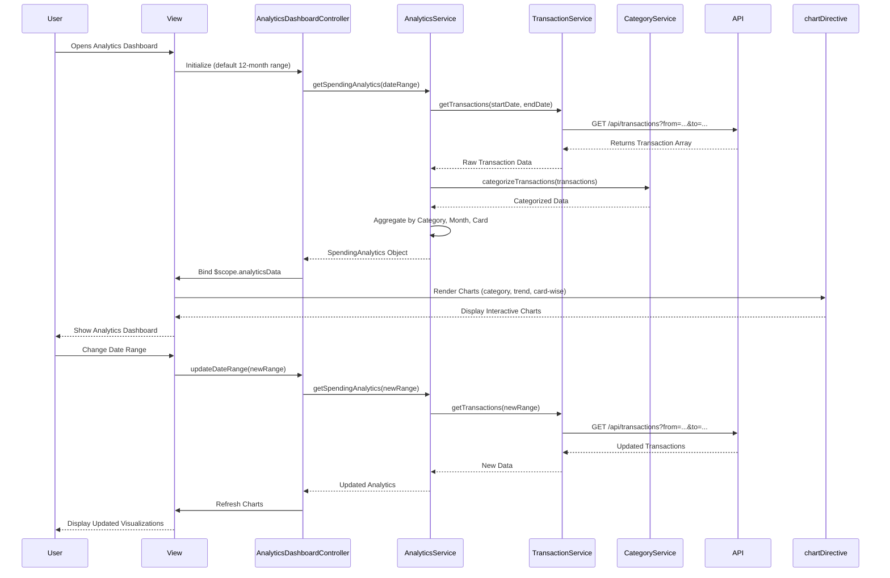

# Low-Level Design: Spending Analytics and Insights
**Epic ID:** QE-8832  
**Application Stack:** AngularJS 1.x, JavaScript ES6, HTML5, CSS3, Bootstrap, REST APIs, MVC Architecture

---

## a. Architecture Mapping

| HLD Component | AngularJS Artifact | Responsibility |
|---------------|-------------------|----------------|
| User Interface | analyticsModule (Module) | Root module for analytics and insights feature |
| Analytics Dashboard | AnalyticsDashboardController (Controller) | Manages analytics dashboard state and chart data |
| Analytics Engine | AnalyticsService (Service) | Aggregates and calculates spending data for visualizations |
| Transaction Service | TransactionService (Service) | Fetches raw transaction data for analytics processing |
| Category Classification Service | CategoryService (Service) | Provides category mappings and classification logic |
| Visualization Library | chartDirective (Directive) | Renders interactive charts using Chart.js or D3.js |

**Recommended Folder Structure:**
```
app/
├── modules/
│   └── analytics/
│       ├── analyticsModule.js
│       ├── controllers/
│       │   └── AnalyticsDashboardController.js
│       ├── services/
│       │   ├── AnalyticsService.js
│       │   ├── TransactionService.js
│       │   └── CategoryService.js
│       ├── directives/
│       │   └── chartDirective.js
│       └── views/
│           └── analytics-dashboard.html
```

---

## b. Component Specifications

| Component Name | Artifact Type | Responsibility | Key Dependencies |
|----------------|---------------|----------------|------------------|
| analyticsModule | Module | Registers analytics components and routing | angular, ui.router, chart.js |
| AnalyticsDashboardController | Controller | Manages dashboard state, date range selection, chart data binding | AnalyticsService, $scope, $filter |
| AnalyticsService | Service | Aggregates transaction data by category, card, and month for visualizations | TransactionService, CategoryService, $q |
| TransactionService | Service | Retrieves historical transaction data via REST API | $http |
| CategoryService | Service | Maps transactions to nine predefined categories | none |
| chartDirective | Directive | Renders pie/bar/line charts with interactive features using Chart.js | Chart.js library |
| DateRangeFilter | Component | Provides date range picker for filtering analytics data | AnalyticsDashboardController |

---

## c. Data Model

**SpendingAnalytics Model:**
```javascript
class SpendingAnalytics {
  categorySpend: Array<{category: String, amount: Number, percentage: Number}>
  monthlyTrend: Array<{month: String, totalSpend: Number}>
  cardWiseSpend: Array<{cardId: String, cardName: String, totalSpend: Number}>
  dateRange: {startDate: Date, endDate: Date}
}
```

**Category Model:**
```javascript
class Category {
  categoryId: String
  categoryName: String // 'Food & Dining', 'Fuel', 'Shopping', 'Travel', 'Entertainment', 'Utilities', 'Healthcare', 'Education', 'Miscellaneous'
  iconClass: String
}
```

**ChartConfig Model:**
```javascript
class ChartConfig {
  type: String // 'pie', 'bar', 'line'
  data: Object
  options: Object
}
```

---

## d. Data Flow

User navigates to analytics dashboard → AnalyticsDashboardController initializes with default 12-month date range → Controller calls AnalyticsService.getSpendingAnalytics(dateRange) → AnalyticsService fetches raw transactions via TransactionService.getTransactions(dateRange) → CategoryService categorizes each transaction into one of nine categories → AnalyticsService aggregates data by category, month, and card → Service returns SpendingAnalytics object → Controller binds data to $scope.analyticsData → chartDirective renders category pie chart, monthly trend line chart, and card-wise bar chart → User interacts with date range filter → Controller updates dateRange and re-fetches analytics data → Charts update with new data.

---

## e. Primary Sequence Diagram



---

## f. Implementation Notes

- Use Chart.js library integrated via chartDirective with AngularJS two-way data binding for reactive chart updates.
- Implement AnalyticsService aggregation logic using ES6 Array methods (map, reduce, filter) for efficient data processing.
- Apply AngularJS $filter service for date formatting and currency display in chart labels and tooltips.
- Use Bootstrap responsive grid to ensure charts adapt to mobile, tablet, and desktop viewports.
- Leverage AngularJS $q promises for chaining TransactionService and CategoryService calls in AnalyticsService.

---

## g. Error Handling

Try/catch blocks in AnalyticsService aggregation methods with fallback to empty chart state and user notification via toast.

---

## h. Security Notes

Standard input validation and secure API calls assumed; date range inputs sanitized to prevent injection attacks.