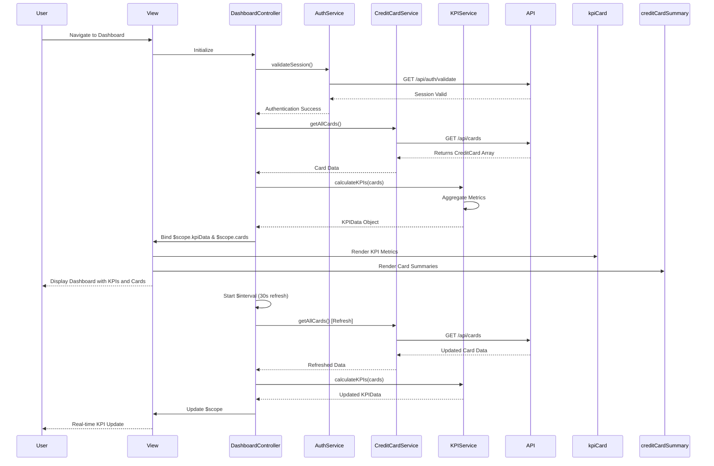

# Low-Level Design: Credit Card Portfolio and KPI Dashboard
**Epic ID:** QE-8833  
**Application Stack:** AngularJS 1.x, JavaScript ES6, HTML5, CSS3, Bootstrap, REST APIs, MVC Architecture

---

## a. Architecture Mapping

| HLD Component | AngularJS Artifact | Responsibility |
|---------------|-------------------|----------------|
| User Browser | dashboardModule (Module) | Root module for dashboard feature |
| Dashboard UI Layer | DashboardController (Controller) | Manages dashboard state and KPI data binding |
| User Authentication Service | AuthService (Factory) | Handles user authentication and session validation |
| Credit Card Data Service | CreditCardService (Service) | Retrieves credit card details, balances, and transaction summaries |
| KPI Calculation Engine | KPIService (Service) | Calculates KPIs (monthly spend, available credit, utilization) from card data |
| Data Store | REST API Endpoints | Backend data persistence and retrieval |

**Recommended Folder Structure:**
```
app/
├── modules/
│   └── dashboard/
│       ├── dashboardModule.js
│       ├── controllers/
│       │   └── DashboardController.js
│       ├── services/
│       │   ├── CreditCardService.js
│       │   └── KPIService.js
│       ├── factories/
│       │   └── AuthService.js
│       ├── views/
│       │   └── dashboard.html
│       └── directives/
│           ├── kpiCard.directive.js
│           └── creditCardSummary.directive.js
```

---

## b. Component Specifications

| Component Name | Artifact Type | Responsibility | Key Dependencies |
|----------------|---------------|----------------|------------------|
| dashboardModule | Module | Registers dashboard components and routing | angular, ui.router |
| DashboardController | Controller | Manages dashboard state, fetches KPI data, handles real-time refresh | CreditCardService, KPIService, $scope, $interval |
| CreditCardService | Service | Fetches all user credit cards and balances via REST API | $http, $q |
| KPIService | Service | Computes monthly spend, total credit limit, available credit, outstanding amount | none |
| AuthService | Factory | Validates user session and manages authentication tokens | $http, $window |
| kpiCard | Directive | Renders individual KPI metric with icon and value | none |
| creditCardSummary | Directive | Displays credit card details in card format | none |

---

## c. Data Model

**CreditCard Model:**
```javascript
class CreditCard {
  cardId: String
  cardNumber: String // masked (e.g., '**** 1234')
  cardType: String // 'Visa', 'MasterCard', 'Amex'
  cardHolderName: String
  creditLimit: Number
  availableCredit: Number
  outstandingAmount: Number
  monthlySpend: Number
  expiryDate: String
}
```

**KPIData Model:**
```javascript
class KPIData {
  totalMonthlySpend: Number
  totalCreditLimit: Number
  totalAvailableCredit: Number
  totalOutstanding: Number
  creditUtilization: Number // percentage
}
```

---

## d. Data Flow

User logs in and navigates to dashboard → DashboardController initializes → Controller calls AuthService.validateSession() → On success, controller invokes CreditCardService.getAllCards() → CreditCardService sends GET request to /api/cards → API returns array of CreditCard objects → Controller passes card data to KPIService.calculateKPIs(cards) → KPIService aggregates monthly spend, credit limits, available credit, and outstanding amounts → Service returns KPIData object → Controller binds KPIData to $scope.kpiData and cards to $scope.cards → View renders KPI cards using kpiCard directive and card summaries using creditCardSummary directive → $interval triggers periodic refresh every 30 seconds to update KPIs with latest data.

---

## e. Primary Sequence Diagram



---

## f. Implementation Notes

- Use AngularJS $http service with promise chaining for sequential API calls (auth validation → card data fetch).
- Implement real-time refresh using $interval service with 30-second polling; cancel interval on $scope.$destroy to prevent memory leaks.
- Apply ES6 arrow functions in KPIService for cleaner aggregation logic using Array.reduce() for summing card metrics.
- Use Bootstrap grid system with responsive breakpoints to ensure dashboard adapts to mobile, tablet, and desktop screens.
- Leverage AngularJS Dependency Injection to inject CreditCardService, KPIService, and AuthService into DashboardController.

---

## g. Error Handling

HTTP interceptor captures API errors; display user-friendly error messages via Bootstrap alert component with retry option.

---

## h. Security Notes

Requires token-based auth via existing SSO; all API requests include Authorization header with JWT token validated on backend.