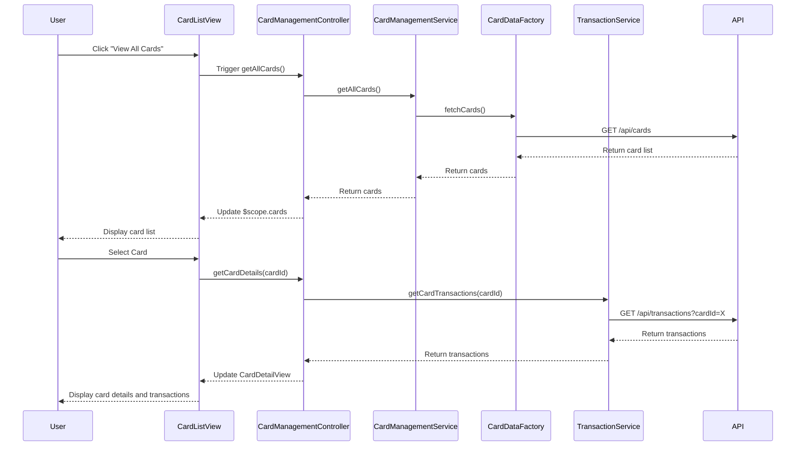

# Low-Level Design: Multiple Credit Card Management
**Epic ID:** QE-9140  
**Technology Stack:** AngularJS 1.x, JavaScript ES6, HTML5, CSS3, Bootstrap, REST APIs, MVC Architecture

---

## a. Architecture Mapping

- **User Interface** → AngularJS View (HTML templates with Bootstrap) + Controller (CardManagementController)
- **Card Management Service** → AngularJS Service (CardManagementService) for business logic and orchestration
- **Credit Card Data Repository** → REST API integration via AngularJS Factory (CardDataFactory)
- **Transaction Service** → REST API integration via AngularJS Service (TransactionService)
- **Data Aggregation Module** → AngularJS Service (DataAggregationService) for client-side aggregation logic

**Recommended Folder Structure:**
```
/app
  /modules
    /card-management
      /controllers
      /services
      /factories
      /views
      /directives
  /shared
    /services
    /filters
```

---

## b. Component Specifications

| Component Name | Artifact Type | Responsibility | Key Dependencies |
|----------------|---------------|----------------|------------------|
| CardManagementController | Controller | Manages card listing, switching, and user interactions | CardManagementService, DataAggregationService |
| CardManagementService | Service | Orchestrates card operations and business logic | CardDataFactory, TransactionService |
| CardDataFactory | Factory | Handles REST API calls for card data CRUD operations | $http, $q |
| TransactionService | Service | Retrieves card-wise transaction data from REST API | $http, $q |
| DataAggregationService | Service | Aggregates multi-card data for consolidated views | None |
| CardListView | View/Template | Displays all credit cards in a responsive grid | CardManagementController |
| CardDetailView | View/Template | Shows detailed information for a selected card | CardManagementController |
| CardSwitcherDirective | Directive | Provides UI component for switching between cards | CardManagementService |

---

## c. Data Model

**CreditCard Object:**
```javascript
{
  cardId: String,
  cardNumber: String (masked),
  cardHolderName: String,
  bankName: String,
  cardType: String,
  creditLimit: Number,
  availableCredit: Number,
  outstandingAmount: Number,
  expiryDate: String (YYYY-MM),
  isActive: Boolean
}
```

**CardTransaction Object:**
```javascript
{
  transactionId: String,
  cardId: String,
  amount: Number,
  category: String,
  merchantName: String,
  transactionDate: String (ISO 8601),
  description: String
}
```

---

## d. Data Flow

User selects "View Cards" from the dashboard → CardListView renders → CardManagementController invokes CardManagementService.getAllCards() → CardDataFactory makes GET /api/cards REST call → Response populates $scope.cards array → User clicks a card → CardManagementController calls CardManagementService.getCardDetails(cardId) and TransactionService.getCardTransactions(cardId) → DataAggregationService computes card-wise spend totals → CardDetailView updates with aggregated data and transaction list.

---

## e. Primary Sequence Diagram



---

## f. Implementation Notes

- Use AngularJS Dependency Injection to inject services and factories into controllers; follow strict DI annotation style for minification safety.
- Implement CardDataFactory using $http service with promise-based API calls; use $q for chaining and error propagation.
- Apply Bootstrap grid system (col-md-*, col-sm-*) for responsive card listing; use ng-repeat for dynamic card rendering.
- Leverage AngularJS filters for card number masking and date formatting in views.
- Implement card switching using ng-click with controller method to update $scope.selectedCard and trigger detail view refresh.

---

## g. Error Handling

Client-side HTTP interceptor captures API errors; display user-friendly notifications using Bootstrap alerts or toast service.

---

## h. Security Notes

Standard input validation and secure API calls assumed; card numbers displayed in masked format only.

---