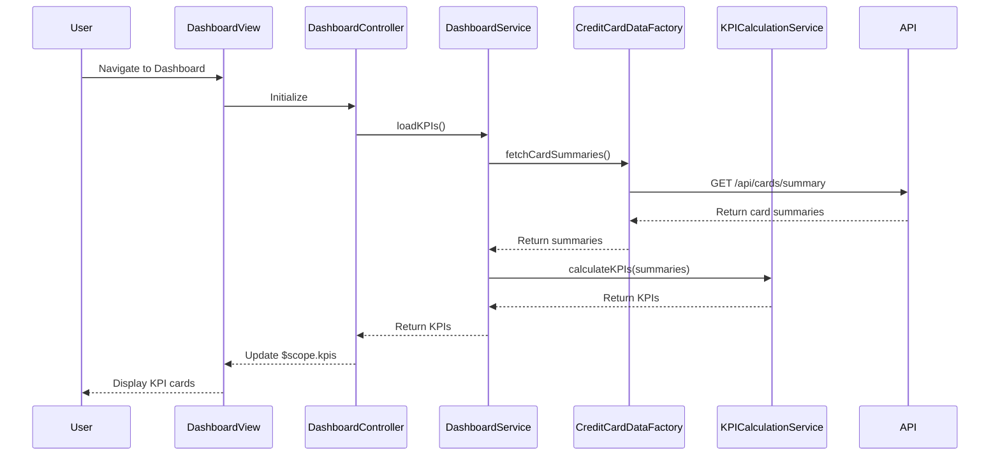

# Low-Level Design: Credit Card Dashboard and KPI Management
**Epic ID:** QE-9141  
**Technology Stack:** AngularJS 1.x, JavaScript ES6, HTML5, CSS3, Bootstrap, REST APIs, MVC Architecture

---

## a. Architecture Mapping

- **User Interface** → AngularJS View (dashboard.html with Bootstrap) + Controller (DashboardController)
- **Dashboard Service** → AngularJS Service (DashboardService) for orchestrating KPI data retrieval and business logic
- **Credit Card Data Service** → REST API integration via AngularJS Factory (CreditCardDataFactory)
- **KPI Calculation Engine** → AngularJS Service (KPICalculationService) for client-side KPI computation
- **Database** → Backend REST API endpoints (no direct client access)

**Recommended Folder Structure:**
```
/app
  /modules
    /dashboard
      /controllers
      /services
      /factories
      /views
  /shared
    /services
    /directives
```

---

## b. Component Specifications

| Component Name | Artifact Type | Responsibility | Key Dependencies |
|----------------|---------------|----------------|------------------|
| DashboardController | Controller | Manages dashboard state and user interactions | DashboardService, KPICalculationService |
| DashboardService | Service | Orchestrates data retrieval and KPI updates | CreditCardDataFactory, KPICalculationService |
| CreditCardDataFactory | Factory | Handles REST API calls for card and transaction data | $http, $q |
| KPICalculationService | Service | Computes monthly spend, available credit, outstanding amounts | None |
| DashboardView | View/Template | Displays KPI cards in responsive layout | DashboardController |
| KPICardDirective | Directive | Reusable component for rendering individual KPI metrics | None |
| RefreshService | Service | Manages real-time or periodic data refresh | $interval, DashboardService |

---

## c. Data Model

**DashboardKPI Object:**
```javascript
{
  monthlySpend: Number,
  totalCreditLimit: Number,
  availableCredit: Number,
  outstandingAmount: Number,
  lastUpdated: String (ISO 8601)
}
```

**CreditCardSummary Object:**
```javascript
{
  cardId: String,
  creditLimit: Number,
  availableCredit: Number,
  outstandingAmount: Number,
  currentMonthSpend: Number
}
```

---

## d. Data Flow

User navigates to dashboard → DashboardView loads → DashboardController calls DashboardService.loadKPIs() → CreditCardDataFactory makes GET /api/cards/summary REST call → KPICalculationService aggregates data (sum credit limits, compute available credit, calculate monthly spend from transactions) → DashboardController updates $scope.kpis → DashboardView renders KPI cards using KPICardDirective → RefreshService polls API every 30 seconds for real-time updates → UI updates automatically via two-way data binding.

---

## e. Primary Sequence Diagram



---

## f. Implementation Notes

- Use AngularJS $http service in CreditCardDataFactory with promise chaining for asynchronous API calls.
- Implement KPICalculationService using pure JavaScript functions for aggregation (Array.reduce for summing credit limits and spend).
- Apply Bootstrap grid (row, col-lg-3, col-md-6) for responsive KPI card layout; use ng-repeat with KPICardDirective for dynamic rendering.
- Leverage AngularJS $interval service in RefreshService for periodic data refresh (configurable interval).
- Use AngularJS filters (currency, number) for formatting KPI values in the view.

---

## g. Error Handling

HTTP interceptor handles API failures; display error messages using Bootstrap alert component with retry option.

---

## h. Security Notes

Requires token-based auth via existing SSO; API calls include authorization headers.

---