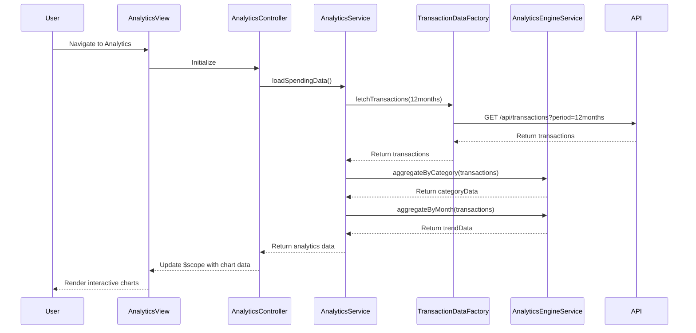

# Low-Level Design: Spending Analytics and Insights
**Epic ID:** QE-9142  
**Technology Stack:** AngularJS 1.x, JavaScript ES6, HTML5, CSS3, Bootstrap, REST APIs, MVC Architecture

---

## a. Architecture Mapping

- **User Interface** → AngularJS View (analytics.html with Bootstrap and Chart.js) + Controller (AnalyticsController)
- **Analytics Service** → AngularJS Service (AnalyticsService) for orchestrating analytics data retrieval and processing
- **Transaction Data Service** → REST API integration via AngularJS Factory (TransactionDataFactory)
- **Analytics Engine** → AngularJS Service (AnalyticsEngineService) for client-side data aggregation and chart data preparation
- **Data Storage** → Backend REST API endpoints (no direct client access)

**Recommended Folder Structure:**
```
/app
  /modules
    /analytics
      /controllers
      /services
      /factories
      /views
      /directives
  /shared
    /chart-directives
```

---

## b. Component Specifications

| Component Name | Artifact Type | Responsibility | Key Dependencies |
|----------------|---------------|----------------|------------------|
| AnalyticsController | Controller | Manages analytics view state and user interactions | AnalyticsService, AnalyticsEngineService |
| AnalyticsService | Service | Orchestrates transaction data retrieval and analytics workflow | TransactionDataFactory, AnalyticsEngineService |
| TransactionDataFactory | Factory | Handles REST API calls for categorized transaction history | $http, $q |
| AnalyticsEngineService | Service | Aggregates spending by category and time period; prepares chart data | None |
| AnalyticsView | View/Template | Displays interactive charts and spending breakdowns | AnalyticsController |
| CategoryChartDirective | Directive | Renders category-wise spending pie/bar chart using Chart.js | Chart.js library |
| TrendChartDirective | Directive | Renders monthly spend trend line chart using Chart.js | Chart.js library |

---

## c. Data Model

**Transaction Object:**
```javascript
{
  transactionId: String,
  cardId: String,
  amount: Number,
  category: String, // Food & Dining, Fuel, Shopping, Travel, Entertainment, Utilities, Healthcare, Education, Miscellaneous
  transactionDate: String (ISO 8601),
  merchantName: String
}
```

**CategorySpending Object:**
```javascript
{
  category: String,
  totalAmount: Number,
  transactionCount: Number,
  percentage: Number
}
```

**MonthlyTrend Object:**
```javascript
{
  month: String (YYYY-MM),
  totalSpend: Number
}
```

---

## d. Data Flow

User navigates to Analytics page → AnalyticsView loads → AnalyticsController calls AnalyticsService.loadSpendingData() → TransactionDataFactory makes GET /api/transactions?period=12months REST call → AnalyticsEngineService processes transactions to compute category-wise totals and monthly trends using Array.reduce and groupBy logic → AnalyticsController updates $scope.categoryData and $scope.trendData → CategoryChartDirective and TrendChartDirective render interactive charts using Chart.js → User interacts with charts (hover, click) to view detailed breakdowns.

---

## e. Primary Sequence Diagram



---

## f. Implementation Notes

- Use AngularJS $http service in TransactionDataFactory with caching enabled for performance optimization.
- Implement AnalyticsEngineService using ES6 Array methods (map, reduce, filter) for data aggregation and grouping by category/month.
- Integrate Chart.js library via custom AngularJS directives (CategoryChartDirective, TrendChartDirective) with isolated scope for reusability.
- Apply Bootstrap responsive grid for chart layout; use ng-show/ng-hide for conditional rendering of charts based on data availability.
- Leverage AngularJS $watch in directives to update charts dynamically when underlying data changes.

---

## g. Error Handling

HTTP interceptor captures API errors; display user-friendly error messages with retry button using Bootstrap modals.

---

## h. Security Notes

Standard input validation and secure API calls assumed; transaction data filtered by authenticated user context.

---