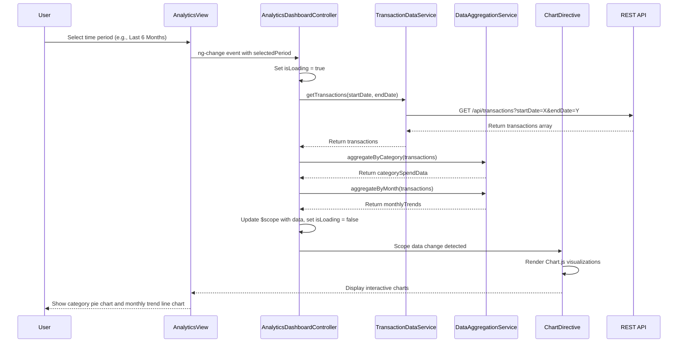

# Low-Level Design: QE-9143 - Spending Analytics and Category Insights

## a. Architecture Mapping

**HLD Component → AngularJS Artifact:**
- User Interface → AngularJS Module (`analytics.module.js`) + Main View (`analytics.html`)
- Analytics Dashboard Controller → AngularJS Controller (`AnalyticsDashboardController.js`)
- Transaction Data Service → AngularJS Service (`TransactionDataService.js`)
- Data Analytics Engine → AngularJS Factory (`AnalyticsEngineFactory.js`)
- Data Aggregation Module → AngularJS Service (`DataAggregationService.js`)
- Charting Library → External Directive Wrapper (`chartDirective.js` wrapping Chart.js)

**Recommended Folder Structure:**
```
app/
├── modules/
│   └── analytics/
│       ├── analytics.module.js
│       ├── controllers/
│       │   └── AnalyticsDashboardController.js
│       ├── services/
│       │   ├── TransactionDataService.js
│       │   └── DataAggregationService.js
│       ├── factories/
│       │   └── AnalyticsEngineFactory.js
│       ├── directives/
│       │   └── chartDirective.js
│       └── views/
│           └── analytics.html
├── assets/
│   ├── css/
│   │   └── analytics.css
│   └── js/
│       └── libs/chart.min.js
```

## b. Component Specifications

| Component Name | Artifact Type | Responsibility | Key Dependencies |
|---|---|---|---|
| analytics.module | Module | Declares analytics feature module and registers all components | angular, ui.router, chart.js |
| AnalyticsDashboardController | Controller | Manages analytics view state, handles user interactions, orchestrates data flow | TransactionDataService, DataAggregationService, AnalyticsEngineFactory, $scope |
| TransactionDataService | Service | Fetches raw transaction data from REST API with filtering by date range and category | $http, $q, API_CONFIG |
| DataAggregationService | Service | Aggregates transactions by category, month, and computes totals with cent-level precision | AnalyticsEngineFactory |
| AnalyticsEngineFactory | Factory | Provides reusable computation methods for trend analysis and pattern identification | - |
| chartDirective | Directive | Wraps Chart.js library to render interactive category and trend charts | Chart.js library |

## c. Data Model

**Transaction Model:**
```javascript
{
  transactionId: String,
  cardId: String,
  amount: Number,
  category: String, // One of: Food & Dining, Fuel, Shopping, Travel, Entertainment, Utilities, Healthcare, Education, Miscellaneous
  date: Date,
  description: String,
  merchantName: String
}
```

**CategorySpend Model:**
```javascript
{
  category: String,
  totalAmount: Number,
  transactionCount: Number,
  percentage: Number
}
```

**MonthlyTrend Model:**
```javascript
{
  month: String, // YYYY-MM format
  totalSpend: Number,
  categoryBreakdown: Array<CategorySpend>
}
```

**AnalyticsViewModel (Controller scope):**
```javascript
{
  transactions: Array<Transaction>,
  categorySpendData: Array<CategorySpend>,
  monthlyTrends: Array<MonthlyTrend>,
  selectedPeriod: String, // e.g., "last3months", "last6months", "last12months"
  chartConfig: Object,
  isLoading: Boolean,
  errorMessage: String
}
```

## d. Data Flow

User selects a time period filter on the analytics view → AnalyticsDashboardController captures the selection and invokes TransactionDataService.getTransactions(dateRange) → Service makes REST API call (GET /api/transactions?startDate=X&endDate=Y) → Raw transaction array is returned to controller → Controller passes data to DataAggregationService.aggregateByCategory() and .aggregateByMonth() → Aggregated CategorySpend and MonthlyTrend objects are computed with cent-accurate totals → Controller updates $scope.categorySpendData and $scope.monthlyTrends → chartDirective watches these scope variables and triggers Chart.js rendering → Interactive pie chart (category breakdown) and line chart (monthly trends) are displayed to user with drill-down capability.

## e. Primary Sequence Diagram



## f. Implementation Notes

- Use AngularJS 1.x module pattern with dependency injection for all services, factories, and controllers.
- Leverage ES6 arrow functions, const/let, and template literals for cleaner service and factory code.
- Implement REST API calls using $http service with promise-based error handling; wrap responses in $q for consistency.
- Integrate Chart.js via a custom AngularJS directive that watches scope data and re-renders charts on data change.
- Apply Bootstrap grid system (col-md-*, col-sm-*) for responsive layout of charts and category cards across mobile and desktop.

## g. Error Handling

HTTP interceptor captures API errors; controller displays user-friendly error messages via $scope.errorMessage with Bootstrap alert component.

## h. Security Notes

Requires token-based authentication via existing SSO; API endpoints validate user session and return only user-specific transaction data.