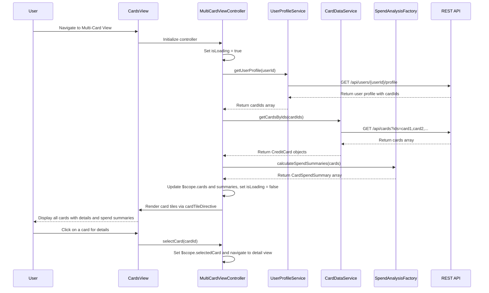

# Low-Level Design: QE-9144 - Multi-Card Management and Visualization

## a. Architecture Mapping

**HLD Component → AngularJS Artifact:**
- User Interface → AngularJS Module (`cards.module.js`) + Main View (`cards.html`)
- Multi-Card View Controller → AngularJS Controller (`MultiCardViewController.js`)
- User Profile Service → AngularJS Service (`UserProfileService.js`)
- Card Data Repository → AngularJS Service (`CardDataService.js`)
- Spend Analysis Engine → AngularJS Factory (`SpendAnalysisFactory.js`)

**Recommended Folder Structure:**
```
app/
├── modules/
│   └── cards/
│       ├── cards.module.js
│       ├── controllers/
│       │   └── MultiCardViewController.js
│       ├── services/
│       │   ├── UserProfileService.js
│       │   └── CardDataService.js
│       ├── factories/
│       │   └── SpendAnalysisFactory.js
│       ├── directives/
│       │   └── cardTileDirective.js
│       └── views/
│           ├── cards.html
│           └── card-detail.html
├── assets/
│   ├── css/
│   │   └── cards.css
│   └── images/
│       └── card-icons/
```

## b. Component Specifications

| Component Name | Artifact Type | Responsibility | Key Dependencies |
|---|---|---|---|
| cards.module | Module | Declares multi-card feature module and registers all card-related components | angular, ui.router |
| MultiCardViewController | Controller | Manages card list view, handles card selection, triggers spend analysis and comparison | UserProfileService, CardDataService, SpendAnalysisFactory, $scope, $state |
| UserProfileService | Service | Retrieves user profile and associated card IDs from REST API | $http, $q, API_CONFIG |
| CardDataService | Service | Fetches detailed card information (type, limits, balances, transactions) for multiple cards | $http, $q, API_CONFIG |
| SpendAnalysisFactory | Factory | Computes card-wise spending totals, utilization rates, and comparison metrics | - |
| cardTileDirective | Directive | Renders individual card tile with card details, balance, and quick actions | - |

## c. Data Model

**CreditCard Model:**
```javascript
{
  cardId: String,
  cardNumber: String, // Masked, e.g., "**** **** **** 1234"
  cardType: String, // e.g., "Visa", "MasterCard", "Amex"
  cardholderName: String,
  issuer: String,
  creditLimit: Number,
  availableCredit: Number,
  outstandingBalance: Number,
  currentMonthSpend: Number,
  expiryDate: String, // MM/YY
  status: String // "Active", "Blocked", "Expired"
}
```

**CardSpendSummary Model:**
```javascript
{
  cardId: String,
  totalSpend: Number,
  utilizationRate: Number, // (outstandingBalance / creditLimit) * 100
  transactionCount: Number,
  topCategory: String
}
```

**MultiCardViewModel (Controller scope):**
```javascript
{
  userId: String,
  cards: Array<CreditCard>,
  selectedCard: CreditCard,
  cardSpendSummaries: Array<CardSpendSummary>,
  comparisonMode: Boolean,
  isLoading: Boolean,
  errorMessage: String
}
```

## d. Data Flow

User navigates to multi-card view → MultiCardViewController initializes and calls UserProfileService.getUserProfile() → Service fetches user profile with associated cardIds via REST API (GET /api/users/{userId}/profile) → Controller receives cardIds and invokes CardDataService.getCardsByIds(cardIds) → Service makes batch API call (GET /api/cards?ids=card1,card2,...) → Array of CreditCard objects is returned → Controller passes cards to SpendAnalysisFactory.calculateSpendSummaries(cards) → Factory computes utilization rates and spend totals → Controller updates $scope.cards and $scope.cardSpendSummaries → cardTileDirective renders each card as a Bootstrap card component with details → User can click a card to view detailed spend breakdown or enable comparison mode to view side-by-side metrics.

## e. Primary Sequence Diagram



## f. Implementation Notes

- Use AngularJS 1.x module with ui.router for state management; define states for card list and card detail views.
- Implement CardDataService with caching using $cacheFactory to avoid redundant API calls when navigating between views.
- Use ES6 map/reduce functions in SpendAnalysisFactory for computing utilization rates and aggregating spend data.
- Render card tiles using Bootstrap card component (card, card-body, card-title) with responsive grid (col-lg-4, col-md-6, col-sm-12) to support up to 10+ cards.
- Apply AngularJS filters for formatting currency (| currency) and masking card numbers in the view layer.

## g. Error Handling

HTTP interceptor with $q.reject propagates API errors to controller; controller displays Bootstrap alert with retry option.

## h. Security Notes

Standard input validation and secure API calls assumed; card numbers are masked on client side and never stored in full.