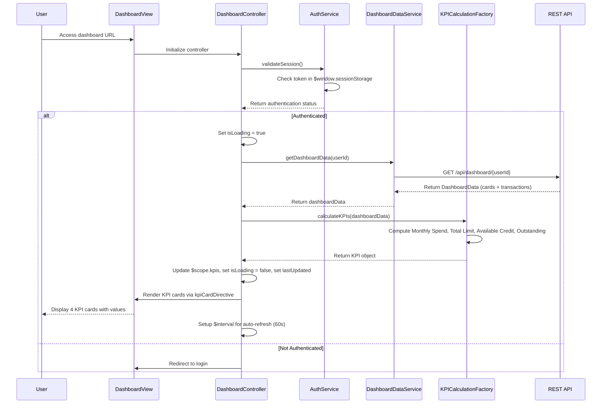

# Low-Level Design: QE-9145 - Credit Card Dashboard and KPI Management

## a. Architecture Mapping

**HLD Component → AngularJS Artifact:**
- User Browser / Dashboard UI Layer → AngularJS Module (`dashboard.module.js`) + Main View (`dashboard.html`)
- Authentication Service → AngularJS Service (`AuthService.js`)
- Dashboard Backend Service → AngularJS Service (`DashboardDataService.js`)
- Credit Card Data Source → REST API endpoints consumed by DashboardDataService
- KPI Calculation Engine → AngularJS Factory (`KPICalculationFactory.js`)

**Recommended Folder Structure:**
```
app/
├── modules/
│   └── dashboard/
│       ├── dashboard.module.js
│       ├── controllers/
│       │   └── DashboardController.js
│       ├── services/
│       │   ├── AuthService.js
│       │   └── DashboardDataService.js
│       ├── factories/
│       │   └── KPICalculationFactory.js
│       ├── directives/
│       │   └── kpiCardDirective.js
│       └── views/
│           └── dashboard.html
├── assets/
│   ├── css/
│   │   └── dashboard.css
```

## b. Component Specifications

| Component Name | Artifact Type | Responsibility | Key Dependencies |
|---|---|---|---|
| dashboard.module | Module | Declares dashboard feature module and registers all dashboard components | angular, ui.router |
| DashboardController | Controller | Manages dashboard view state, orchestrates KPI data retrieval and display | AuthService, DashboardDataService, KPICalculationFactory, $scope, $interval |
| AuthService | Service | Validates user authentication status and retrieves user session token | $http, $window, $q |
| DashboardDataService | Service | Fetches aggregated credit card data (balances, limits, transactions) from REST API | $http, $q, API_CONFIG |
| KPICalculationFactory | Factory | Computes Monthly Spend, Total Credit Limit, Available Credit, and Outstanding Amount KPIs | - |
| kpiCardDirective | Directive | Renders individual KPI card with value, label, and optional trend indicator | - |

## c. Data Model

**DashboardData Model:**
```javascript
{
  userId: String,
  cards: Array<{
    cardId: String,
    creditLimit: Number,
    availableCredit: Number,
    outstandingBalance: Number
  }>,
  currentMonthTransactions: Array<{
    transactionId: String,
    amount: Number,
    date: Date
  }>
}
```

**KPI Model:**
```javascript
{
  monthlySpend: Number,
  totalCreditLimit: Number,
  availableCredit: Number,
  outstandingAmount: Number
}
```

**DashboardViewModel (Controller scope):**
```javascript
{
  user: Object,
  kpis: KPI,
  lastUpdated: Date,
  isLoading: Boolean,
  errorMessage: String,
  autoRefreshEnabled: Boolean
}
```

## d. Data Flow

User accesses dashboard → DashboardController initializes and calls AuthService.validateSession() → Service checks authentication token validity → If valid, controller invokes DashboardDataService.getDashboardData(userId) → Service makes REST API call (GET /api/dashboard/{userId}) → API returns DashboardData object with cards and transactions → Controller passes data to KPICalculationFactory.calculateKPIs(dashboardData) → Factory computes all four KPIs (sum of card limits for Total Credit Limit, sum of available credit, sum of outstanding balances, sum of current month transaction amounts for Monthly Spend) → Controller updates $scope.kpis → kpiCardDirective renders each KPI in a Bootstrap card with formatted values → Controller sets up $interval for auto-refresh every 60 seconds to re-fetch data and update KPIs.

## e. Primary Sequence Diagram



## f. Implementation Notes

- Use AngularJS 1.x module with ui.router; define dashboard as default authenticated state with resolve to check AuthService before loading.
- Implement DashboardDataService with $http GET requests; use $q promises for error propagation and chaining.
- Use ES6 reduce function in KPICalculationFactory to sum card limits, available credit, outstanding balances, and transaction amounts.
- Render KPIs using Bootstrap card components (card, card-body) in a responsive grid (col-lg-3, col-md-6, col-sm-12) for 4 KPI tiles.
- Implement auto-refresh using $interval service; cancel interval on $scope.$on('$destroy') to prevent memory leaks.

## g. Error Handling

HTTP interceptor captures 401/403 errors and redirects to login; other API errors display user-friendly message via Bootstrap alert in dashboard view.

## h. Security Notes

Requires token-based auth via existing SSO; AuthService validates token on each dashboard load and API calls include Authorization header.