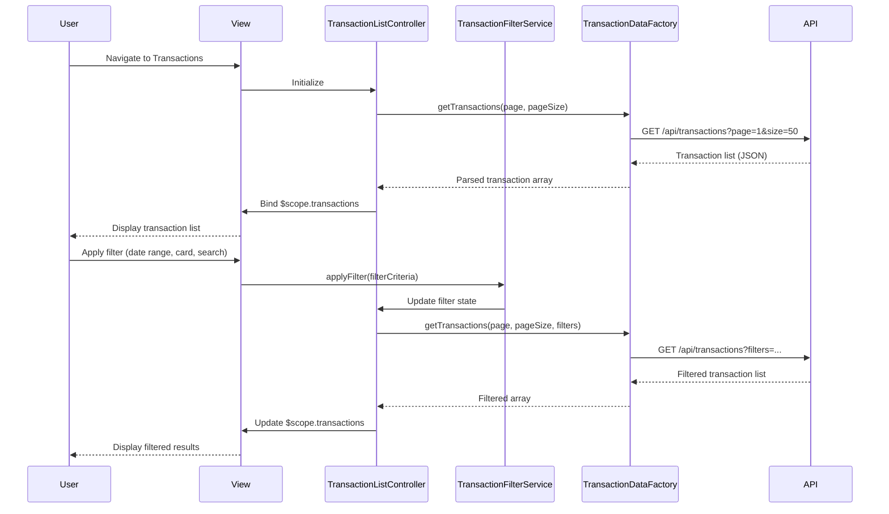

# Low-Level Design: Transaction Management and Monitoring
**Epic ID:** QE-9146  
**Application Stack:** AngularJS 1.x, JavaScript ES6, HTML5, CSS3, Bootstrap, REST APIs, MVC Architecture

---

## a. Architecture Mapping

| HLD Component | AngularJS Artifact | Purpose |
|---------------|-------------------|----------|
| Transaction UI Component | Module: `transactionModule`, Controller: `TransactionListController`, View: `transaction-list.html` | Display and manage transaction list interface |
| Search and Filter Engine | Service: `TransactionFilterService`, Directive: `transactionFilter` | Handle search, filter, and date range operations |
| Transaction Data Service | Factory: `TransactionDataFactory` | REST API integration for transaction retrieval |
| Credit Card Service | Factory: `CreditCardFactory` | Card-transaction mapping and card data retrieval |
| Category Service | Service: `CategoryService` | Transaction classification and category management |

**Recommended Folder Structure:**
```
app/
├── modules/
│   └── transactions/
│       ├── controllers/
│       ├── services/
│       ├── factories/
│       ├── directives/
│       └── views/
├── shared/
│   ├── services/
│   └── factories/
└── assets/
    ├── css/
    └── js/
```

---

## b. Component Specifications

| Component Name | Artifact Type | Responsibility | Key Dependencies |
|----------------|---------------|----------------|------------------|
| transactionModule | Module | Root module for transaction management features | ngRoute, ui.bootstrap |
| TransactionListController | Controller | Manage transaction list state, pagination, sorting | TransactionDataFactory, TransactionFilterService, $scope |
| TransactionDetailController | Controller | Display individual transaction details | TransactionDataFactory, $routeParams, $scope |
| TransactionDataFactory | Factory | REST API calls for transaction CRUD operations | $http, $q, API_ENDPOINTS |
| TransactionFilterService | Service | Apply search, filter, date range, card-wise filtering logic | $filter, CategoryService |
| CreditCardFactory | Factory | Retrieve credit card data and card-transaction mapping | $http, $q, API_ENDPOINTS |
| CategoryService | Service | Provide category classification and category list | $http, CATEGORY_CONSTANTS |
| transactionFilter | Directive | Render filter UI with search, date picker, card selector | TransactionFilterService, CreditCardFactory |
| transactionCard | Directive | Display individual transaction card with details | CategoryService |
| paginationControl | Directive | Handle pagination controls and page navigation | TransactionListController |

---

## c. Data Model

**Transaction Model:**
```javascript
{
  transactionId: String,
  cardId: String,
  cardName: String,
  merchantName: String,
  transactionDate: Date,
  amount: Number,
  category: String,
  description: String,
  transactionType: String  // 'debit' or 'credit'
}
```

**Filter Criteria Model:**
```javascript
{
  searchTerm: String,
  startDate: Date,
  endDate: Date,
  selectedCardIds: Array<String>,
  selectedCategories: Array<String>,
  sortBy: String,
  sortOrder: String  // 'asc' or 'desc'
}
```

**Pagination Model:**
```javascript
{
  currentPage: Number,
  pageSize: Number,
  totalRecords: Number,
  totalPages: Number
}
```

---

## d. Data Flow

User navigates to transaction list view → TransactionListController initializes and calls TransactionDataFactory.getTransactions() → Factory makes REST API call to backend → Response data is bound to $scope.transactions → User applies filters via transactionFilter directive → TransactionFilterService processes filter criteria and updates controller state → Controller requests filtered data from TransactionDataFactory with query parameters → Updated transaction list renders in view with pagination → User clicks transaction card → TransactionDetailController loads and displays full transaction details.

---

## e. Primary Sequence Diagram



---

## f. Implementation Notes

- Use AngularJS Dependency Injection to inject services and factories into controllers for testability and modularity.
- Implement server-side pagination with query parameters (page, pageSize, filters) to optimize performance for large datasets (10,000+ transactions).
- Use AngularJS $http service with interceptors for REST API calls, including authentication token injection and error handling.
- Apply AngularJS filters (date, currency, orderBy) in views for client-side data formatting and sorting.
- Leverage Bootstrap grid system and responsive utilities for mobile-first, responsive transaction list and detail views.

---

## g. Error Handling

HTTP interceptor-based error handling with user-friendly notifications via Bootstrap alerts for API failures, network errors, and validation issues.

---

## h. Security Notes

Requires token-based authentication via existing SSO; all API calls include Authorization header with JWT token.