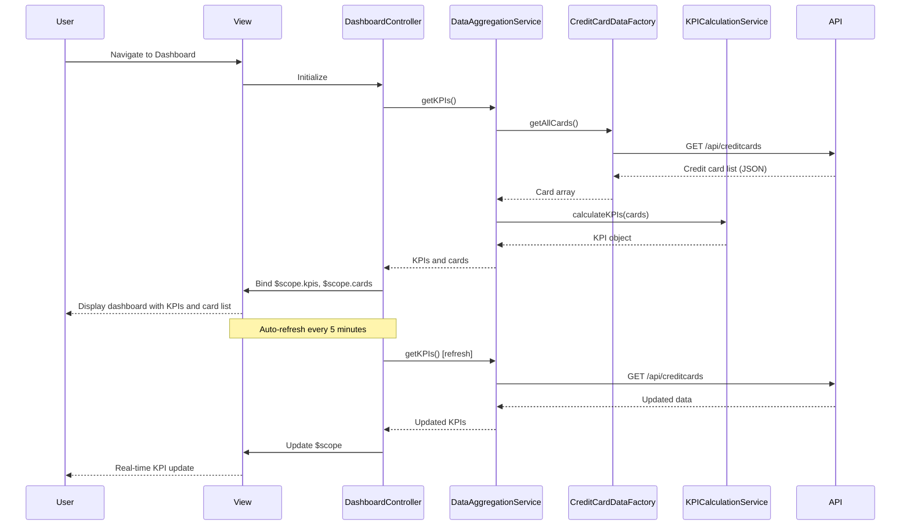

# Low-Level Design: Credit Card Portfolio Management and KPI Dashboard
**Epic ID:** QE-9147  
**Application Stack:** AngularJS 1.x, JavaScript ES6, HTML5, CSS3, Bootstrap, REST APIs, MVC Architecture

---

## a. Architecture Mapping

| HLD Component | AngularJS Artifact | Purpose |
|---------------|-------------------|----------|
| Dashboard UI Component | Module: `dashboardModule`, Controller: `DashboardController`, View: `dashboard.html` | Render KPI dashboard and card portfolio view |
| Authentication Service | Service: `AuthService` | Handle user authentication and session management |
| Data Aggregation Service | Service: `DataAggregationService` | Aggregate and calculate KPIs across multiple cards |
| Credit Card Data Service | Factory: `CreditCardDataFactory` | REST API integration for credit card data retrieval |
| KPI Calculation Engine | Service: `KPICalculationService` | Compute monthly spend, total credit, available credit, outstanding amounts |

**Recommended Folder Structure:**
```
app/
├── modules/
│   └── dashboard/
│       ├── controllers/
│       ├── services/
│       ├── views/
│       └── directives/
├── shared/
│   ├── services/
│   └── factories/
└── assets/
    ├── css/
    └── js/
```

---

## b. Component Specifications

| Component Name | Artifact Type | Responsibility | Key Dependencies |
|----------------|---------------|----------------|------------------|
| dashboardModule | Module | Root module for dashboard features | ngRoute, ui.bootstrap, chart.js |
| DashboardController | Controller | Manage dashboard state, KPI display, card list | DataAggregationService, CreditCardDataFactory, $scope, $interval |
| AuthService | Service | Authenticate user, manage session tokens | $http, $window, $q |
| DataAggregationService | Service | Aggregate data from multiple cards and invoke KPI calculations | CreditCardDataFactory, KPICalculationService |
| CreditCardDataFactory | Factory | REST API calls to retrieve credit card information | $http, $q, API_ENDPOINTS |
| KPICalculationService | Service | Calculate monthly spend, total credit limit, available credit, outstanding amount | None |
| kpiCard | Directive | Render individual KPI card with icon, label, value | None |
| creditCardList | Directive | Display list of credit cards with summary info | CreditCardDataFactory |
| refreshDashboard | Directive | Auto-refresh dashboard data at intervals | DashboardController, $interval |

---

## c. Data Model

**Credit Card Model:**
```javascript
{
  cardId: String,
  cardName: String,
  cardType: String,  // 'Visa', 'MasterCard', 'Amex'
  cardNumber: String,  // masked, e.g., '**** **** **** 1234'
  creditLimit: Number,
  availableCredit: Number,
  outstandingAmount: Number,
  monthlySpend: Number,
  expiryDate: String,
  status: String  // 'active', 'blocked', 'expired'
}
```

**KPI Model:**
```javascript
{
  totalMonthlySpend: Number,
  totalCreditLimit: Number,
  totalAvailableCredit: Number,
  totalOutstandingAmount: Number,
  cardCount: Number
}
```

---

## d. Data Flow

User logs in and navigates to dashboard → AuthService validates session token → DashboardController initializes and calls DataAggregationService.getKPIs() → DataAggregationService calls CreditCardDataFactory.getAllCards() → Factory makes REST API call to retrieve all user credit cards → Response data passed to KPICalculationService for aggregation → Calculated KPIs and card list bound to $scope → View renders KPI cards and credit card list → Auto-refresh directive triggers periodic data reload every 5 minutes → Updated KPIs re-render in real-time.

---

## e. Primary Sequence Diagram



---

## f. Implementation Notes

- Use AngularJS $interval service to implement auto-refresh functionality (every 5 minutes) for real-time KPI updates.
- Implement lazy loading and caching strategy in CreditCardDataFactory to minimize API calls and improve 2-second load time target.
- Use AngularJS Dependency Injection for all services, factories, and controllers to ensure modularity and testability.
- Leverage Bootstrap grid system (col-md-3 for KPI cards, col-md-12 for card list) for responsive layout across desktop, tablet, and mobile.
- Apply AngularJS currency and number filters in views for consistent KPI value formatting.

---

## g. Error Handling

HTTP interceptor captures API errors; user notified via Bootstrap alert modals with retry option for failed data loads.

---

## h. Security Notes

Requires token-based authentication via existing SSO; AuthService manages JWT token lifecycle and injects Authorization header in all API requests.