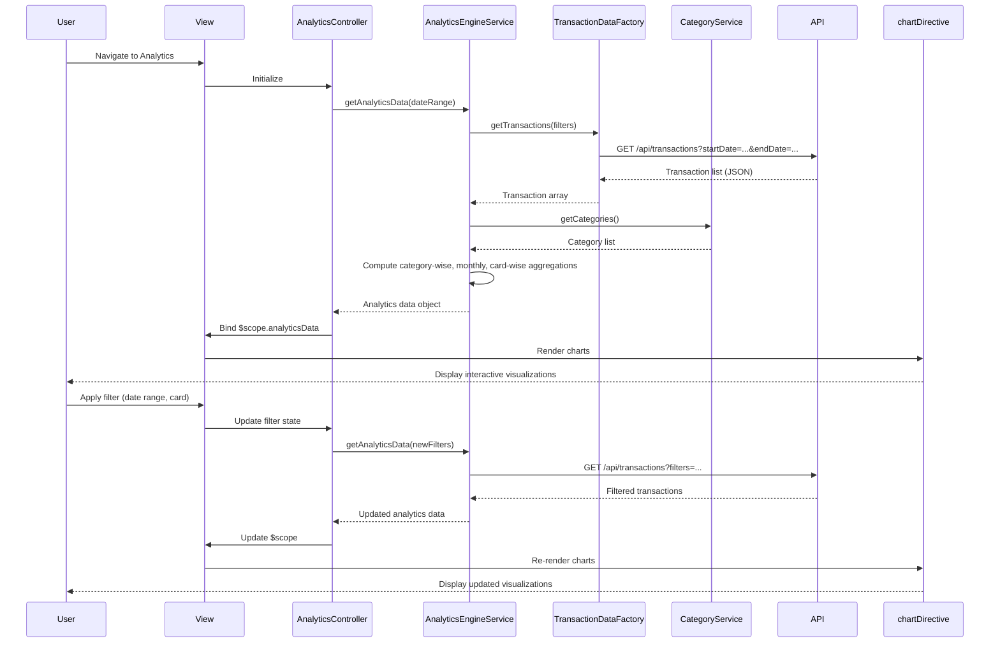

# Low-Level Design: Spending Analytics and Insights
**Epic ID:** QE-9148  
**Application Stack:** AngularJS 1.x, JavaScript ES6, HTML5, CSS3, Bootstrap, REST APIs, MVC Architecture

---

## a. Architecture Mapping

| HLD Component | AngularJS Artifact | Purpose |
|---------------|-------------------|----------|
| Analytics UI Component | Module: `analyticsModule`, Controller: `AnalyticsController`, View: `analytics.html` | Render analytics dashboard with interactive charts |
| Analytics Engine | Service: `AnalyticsEngineService` | Process and aggregate transaction data for visualization |
| Transaction Service | Factory: `TransactionDataFactory` | REST API integration for raw transaction data retrieval |
| Category Service | Service: `CategoryService` | Provide category classification and category list |
| Visualization Library | External Library: Chart.js (wrapped in Directive: `chartDirective`) | Render interactive charts and graphs |

**Recommended Folder Structure:**
```
app/
├── modules/
│   └── analytics/
│       ├── controllers/
│       ├── services/
│       ├── directives/
│       └── views/
├── shared/
│   ├── services/
│   └── factories/
└── assets/
    ├── css/
    └── js/
        └── chart.min.js
```

---

## b. Component Specifications

| Component Name | Artifact Type | Responsibility | Key Dependencies |
|----------------|---------------|----------------|------------------|
| analyticsModule | Module | Root module for analytics and insights features | ngRoute, ui.bootstrap, chart.js |
| AnalyticsController | Controller | Manage analytics state, chart data, filters | AnalyticsEngineService, TransactionDataFactory, CategoryService, $scope |
| AnalyticsEngineService | Service | Aggregate transaction data, compute category-wise spend, monthly trends, card-wise breakdowns | TransactionDataFactory, CategoryService |
| TransactionDataFactory | Factory | REST API calls to retrieve transaction data for analytics | $http, $q, API_ENDPOINTS |
| CategoryService | Service | Provide 9 predefined categories and classification logic | CATEGORY_CONSTANTS |
| chartDirective | Directive | Wrap Chart.js library for AngularJS integration and render charts | Chart.js, $timeout |
| categoryChart | Directive | Render category-wise spending pie/bar chart | chartDirective, AnalyticsEngineService |
| trendChart | Directive | Render monthly spend trend line chart | chartDirective, AnalyticsEngineService |
| cardComparisonChart | Directive | Render card-wise spend comparison bar chart | chartDirective, AnalyticsEngineService |
| analyticsFilter | Directive | Render filter controls for date range, card selection | AnalyticsController |

---

## c. Data Model

**Analytics Data Model:**
```javascript
{
  categoryWiseSpend: Array<{category: String, amount: Number, percentage: Number}>,
  monthlyTrend: Array<{month: String, amount: Number}>,
  cardWiseSpend: Array<{cardId: String, cardName: String, amount: Number}>,
  totalSpend: Number,
  dateRange: {startDate: Date, endDate: Date}
}
```

**Category Model:**
```javascript
{
  categoryId: String,
  categoryName: String,  // 'Food & Dining', 'Fuel', 'Shopping', 'Travel', 'Entertainment', 'Utilities', 'Healthcare', 'Education', 'Miscellaneous'
  icon: String,
  color: String  // for chart visualization
}
```

**Chart Configuration Model:**
```javascript
{
  chartType: String,  // 'pie', 'bar', 'line'
  labels: Array<String>,
  datasets: Array<{label: String, data: Array<Number>, backgroundColor: Array<String>}>,
  options: Object  // Chart.js options for interactivity, drill-down
}
```

---

## d. Data Flow

User navigates to analytics view → AnalyticsController initializes and calls AnalyticsEngineService.getAnalyticsData() → Service calls TransactionDataFactory.getTransactions() with date range filter → Factory makes REST API call to retrieve transaction data → Response data processed by AnalyticsEngineService to compute category-wise spend, monthly trends, and card-wise breakdowns → Processed data bound to $scope.analyticsData → chartDirective renders interactive charts using Chart.js → User interacts with chart (drill-down, hover) → Chart updates dynamically → User applies date/card filters → Controller triggers data refresh and chart re-render.

---

## e. Primary Sequence Diagram



---

## f. Implementation Notes

- Integrate Chart.js library via chartDirective to provide interactive, responsive charts with drill-down and hover capabilities.
- Use AngularJS $watch to monitor filter changes and trigger automatic chart re-rendering without full page reload.
- Implement data aggregation logic in AnalyticsEngineService using ES6 array methods (map, reduce, filter) for efficient processing.
- Cache category metadata in CategoryService to avoid repeated API calls; categories are static (9 predefined).
- Apply Bootstrap responsive grid for chart layout (col-md-6 for side-by-side charts, col-md-12 for full-width trend chart).

---

## g. Error Handling

HTTP interceptor-based error handling with user notifications via Bootstrap alerts; fallback to cached data if API fails during refresh.

---

## h. Security Notes

Requires token-based authentication via existing SSO; all transaction data API calls include Authorization header with JWT token.