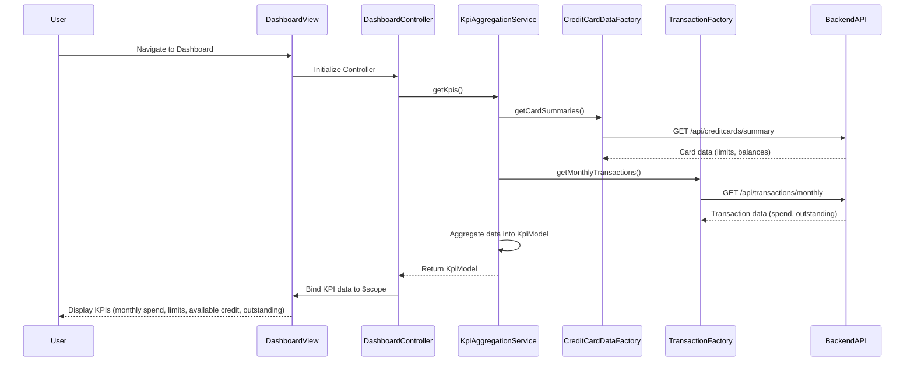

# Low-Level Design: QE-9149 - Dashboard and KPI Management

## a. Architecture Mapping

**HLD Component → AngularJS Artifact Mapping:**

- User Interface Dashboard → AngularJS Module (`app.dashboard`) + Controller (`DashboardController`) + View Template (`dashboard.html`)
- Dashboard Controller → AngularJS Controller (`DashboardController`) managing KPI display logic
- KPI Aggregation Engine → AngularJS Service (`KpiAggregationService`) for data aggregation
- Credit Card Data Service → AngularJS Factory (`CreditCardDataFactory`) for REST API calls
- Transaction Service → AngularJS Factory (`TransactionFactory`) for transaction REST API calls
- Data Repository → Backend REST API endpoints (consumed by factories)

**Recommended Folder Structure:**
```
app/
├── modules/
│   └── dashboard/
│       ├── dashboard.module.js
│       ├── dashboard.controller.js
│       ├── dashboard.html
│       └── dashboard.css
├── services/
│   ├── kpi-aggregation.service.js
│   ├── creditcard-data.factory.js
│   └── transaction.factory.js
├── models/
│   └── kpi.model.js
└── app.js
```

## b. Component Specifications

| Component Name | Artifact Type | Responsibility | Key Dependencies |
|----------------|---------------|----------------|------------------|
| DashboardModule | Module | Register dashboard module and configure routes | angular, ui.router |
| DashboardController | Controller | Orchestrate KPI data retrieval and bind to view | KpiAggregationService, $scope |
| KpiAggregationService | Service | Aggregate KPI data from multiple sources | CreditCardDataFactory, TransactionFactory, $q |
| CreditCardDataFactory | Factory | Fetch credit card balances and limits via REST API | $http, API_CONFIG |
| TransactionFactory | Factory | Fetch monthly spend and outstanding amounts via REST API | $http, API_CONFIG |
| DashboardView | HTML Template | Display KPIs in responsive layout using Bootstrap grid | Bootstrap CSS, AngularJS directives |
| KpiModel | Model | Define structure for KPI data objects | None |

## c. Data Model

**KPI Model (`kpi.model.js`):**
```javascript
class KpiModel {
  constructor() {
    this.monthlySpend = 0;           // Number (currency)
    this.totalCreditLimit = 0;       // Number (currency)
    this.availableCredit = 0;        // Number (currency)
    this.outstandingAmount = 0;      // Number (currency)
    this.lastUpdated = null;         // Date
    this.utilizationRate = 0;        // Number (percentage)
  }
}
```

**Credit Card Summary Model:**
```javascript
class CreditCardSummary {
  constructor() {
    this.cardId = '';                // String
    this.cardNumber = '';            // String (masked)
    this.creditLimit = 0;            // Number
    this.currentBalance = 0;         // Number
    this.availableCredit = 0;        // Number
  }
}
```

## d. Data Flow

User navigates to the dashboard view → `DashboardController` initializes and invokes `KpiAggregationService.getKpis()` → Service makes parallel REST API calls via `CreditCardDataFactory.getCardSummaries()` and `TransactionFactory.getMonthlyTransactions()` → Backend APIs return card data and transaction data → Service aggregates data into `KpiModel` object (calculating totals, available credit, utilization) → Controller receives aggregated KPI object via promise resolution → Controller binds KPI data to `$scope` → View template renders KPIs in responsive Bootstrap grid with two-way data binding → User sees monthly spend, total credit limit, available credit, and outstanding amount displayed in real-time.

## e. Primary Sequence Diagram



## f. Implementation Notes

- Use AngularJS 1.x module pattern with dependency injection for all controllers, services, and factories
- Implement `$q.all()` in `KpiAggregationService` for parallel REST API calls to meet 2-second load time NFR
- Apply Bootstrap responsive grid (col-xs, col-sm, col-md) in dashboard.html for mobile and desktop support
- Use `$http` interceptor for global error handling and loading state management
- Implement ES6 classes for model definitions and arrow functions for promise chaining

## g. Error Handling

HTTP interceptor-based error handling with user-friendly toast notifications for API failures and retry logic for transient errors.

## h. Security Notes

Requires token-based authentication via existing SSO; all API calls include Authorization header with JWT token.