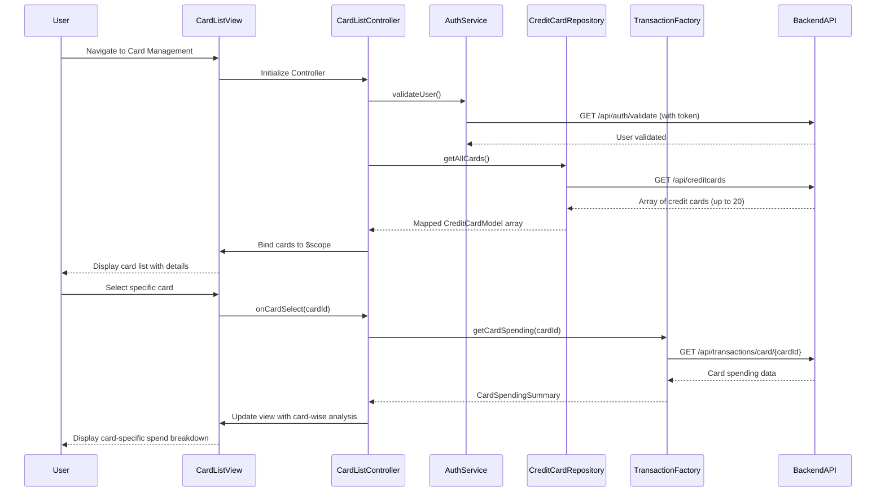

# Low-Level Design: QE-9150 - Multiple Credit Card Management

## a. Architecture Mapping

**HLD Component → AngularJS Artifact Mapping:**

- User Interface Card List → AngularJS Module (`app.cardManagement`) + Controller (`CardListController`) + View Template (`card-list.html`)
- Card Management Controller → AngularJS Controller (`CardManagementController`) managing card operations
- User Authentication Service → AngularJS Service (`AuthService`) for token validation
- Credit Card Data Repository → AngularJS Factory (`CreditCardRepository`) for card data REST API calls
- Transaction Service → AngularJS Factory (`TransactionFactory`) for card-specific spending data
- Card Details View → AngularJS Directive (`cardDetailsDirective`) for reusable card detail component

**Recommended Folder Structure:**
```
app/
├── modules/
│   └── card-management/
│       ├── card-management.module.js
│       ├── card-list.controller.js
│       ├── card-management.controller.js
│       ├── card-list.html
│       └── card-management.css
├── directives/
│   └── card-details.directive.js
├── services/
│   ├── auth.service.js
│   ├── creditcard-repository.factory.js
│   └── transaction.factory.js
├── models/
│   └── creditcard.model.js
└── app.js
```

## b. Component Specifications

| Component Name | Artifact Type | Responsibility | Key Dependencies |
|----------------|---------------|----------------|------------------|
| CardManagementModule | Module | Register card management module and configure routes | angular, ui.router |
| CardListController | Controller | Display list of all user credit cards with filtering | CreditCardRepository, AuthService, $scope |
| CardManagementController | Controller | Manage card selection and card-wise spend analysis | TransactionFactory, CreditCardRepository, $scope |
| AuthService | Service | Validate user authentication and card ownership | $http, $window, JWT_CONFIG |
| CreditCardRepository | Factory | Fetch all user credit cards via REST API | $http, API_CONFIG |
| TransactionFactory | Factory | Fetch card-specific spending data via REST API | $http, API_CONFIG |
| CardDetailsDirective | Directive | Reusable component to display individual card details | None |
| CreditCardModel | Model | Define structure for credit card data objects | None |

## c. Data Model

**Credit Card Model (`creditcard.model.js`):**
```javascript
class CreditCardModel {
  constructor() {
    this.cardId = '';                // String (unique identifier)
    this.cardNumber = '';            // String (masked, e.g., "****1234")
    this.cardType = '';              // String (Visa, MasterCard, Amex)
    this.cardHolderName = '';        // String
    this.creditLimit = 0;            // Number (currency)
    this.currentBalance = 0;         // Number (currency)
    this.availableCredit = 0;        // Number (currency)
    this.outstandingAmount = 0;      // Number (currency)
    this.expiryDate = '';            // String (MM/YY)
    this.isActive = true;            // Boolean
  }
}
```

**Card Spending Summary Model:**
```javascript
class CardSpendingSummary {
  constructor() {
    this.cardId = '';                // String
    this.monthlySpend = 0;           // Number (currency)
    this.categoryBreakdown = [];     // Array of {category: String, amount: Number}
    this.transactionCount = 0;       // Number
  }
}
```

## d. Data Flow

User navigates to card management view → `CardListController` initializes and calls `AuthService.validateUser()` to verify authentication → Upon successful validation, controller invokes `CreditCardRepository.getAllCards()` → Factory makes REST API call to `/api/creditcards` with user token → Backend returns array of credit card objects → Controller maps response to `CreditCardModel` instances and binds to `$scope.cards` → View renders card list using `ng-repeat` with `cardDetailsDirective` for each card → User selects a card → `CardManagementController` invokes `TransactionFactory.getCardSpending(cardId)` → Backend returns card-specific spending data → Controller updates view with card-wise spend analysis including category breakdown and transaction count.

## e. Primary Sequence Diagram



## f. Implementation Notes

- Use AngularJS 1.x dependency injection for all components; register module with `angular.module('app.cardManagement', ['ui.router'])`
- Implement pagination or virtual scrolling in card list if user has more than 20 cards to maintain performance
- Use `$http` service with caching enabled (`cache: true`) for `CreditCardRepository.getAllCards()` to meet 1-second retrieval NFR
- Apply Bootstrap card components and responsive grid for card display; use `ng-repeat` with `track by cardId` for efficient rendering
- Implement ES6 classes for models and arrow functions in promise handlers for cleaner code

## g. Error Handling

HTTP interceptor captures API errors; display user-friendly error messages via toast notifications; implement try/catch in controllers for local error handling.

## h. Security Notes

Requires token-based authentication via existing SSO; AuthService validates JWT token on every card data request; card numbers are masked on frontend.