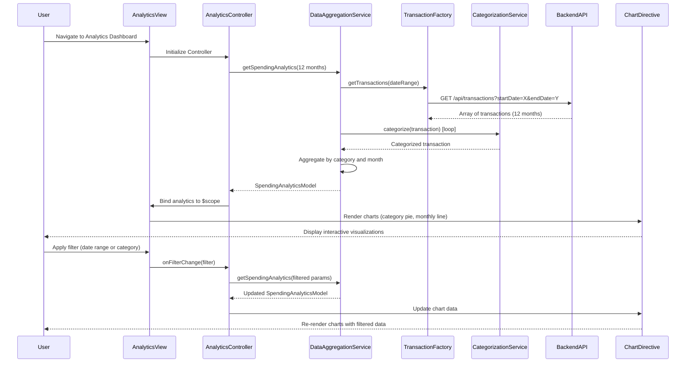

# Low-Level Design: QE-9151 - Analytics and Spending Insights

## a. Architecture Mapping

**HLD Component → AngularJS Artifact Mapping:**

- User Interface Analytics Dashboard → AngularJS Module (`app.analytics`) + Controller (`AnalyticsController`) + View Template (`analytics.html`)
- Analytics Controller → AngularJS Controller (`AnalyticsController`) managing analytics data and user interactions
- Transaction Service → AngularJS Factory (`TransactionFactory`) for raw transaction data REST API calls
- Categorization Engine → AngularJS Service (`CategorizationService`) for transaction classification logic
- Data Aggregation Service → AngularJS Service (`DataAggregationService`) for computing trends and summaries
- Visualization Component → AngularJS Directive (`spendingChartDirective`) using Chart.js or D3.js for interactive charts

**Recommended Folder Structure:**
```
app/
├── modules/
│   └── analytics/
│       ├── analytics.module.js
│       ├── analytics.controller.js
│       ├── analytics.html
│       └── analytics.css
├── directives/
│   └── spending-chart.directive.js
├── services/
│   ├── categorization.service.js
│   ├── data-aggregation.service.js
│   └── transaction.factory.js
├── models/
│   └── spending-analytics.model.js
└── app.js
```

## b. Component Specifications

| Component Name | Artifact Type | Responsibility | Key Dependencies |
|----------------|---------------|----------------|------------------|
| AnalyticsModule | Module | Register analytics module and configure routes | angular, ui.router, chart.js |
| AnalyticsController | Controller | Orchestrate analytics data retrieval and manage user filters | DataAggregationService, $scope, $filter |
| TransactionFactory | Factory | Fetch raw transaction data (up to 12 months) via REST API | $http, API_CONFIG |
| CategorizationService | Service | Classify transactions into predefined categories | None |
| DataAggregationService | Service | Aggregate transaction data by category and month | TransactionFactory, CategorizationService, $q |
| SpendingChartDirective | Directive | Render interactive charts for category-wise and monthly spending | Chart.js or D3.js library |
| SpendingAnalyticsModel | Model | Define structure for analytics data objects | None |

## c. Data Model

**Spending Analytics Model (`spending-analytics.model.js`):**
```javascript
class SpendingAnalyticsModel {
  constructor() {
    this.totalSpend = 0;                    // Number (currency)
    this.categoryBreakdown = [];            // Array of CategorySpend objects
    this.monthlyTrends = [];                // Array of MonthlySpend objects
    this.dateRange = { start: null, end: null }; // Object with Date properties
  }
}

class CategorySpend {
  constructor() {
    this.category = '';                     // String (Food & Dining, Fuel, Shopping, etc.)
    this.amount = 0;                        // Number (currency)
    this.percentage = 0;                    // Number (percentage of total)
    this.transactionCount = 0;              // Number
  }
}

class MonthlySpend {
  constructor() {
    this.month = '';                        // String (YYYY-MM)
    this.totalAmount = 0;                   // Number (currency)
    this.categoryBreakdown = [];            // Array of {category: String, amount: Number}
  }
}
```

**Transaction Model:**
```javascript
class TransactionModel {
  constructor() {
    this.transactionId = '';                // String
    this.cardId = '';                       // String
    this.amount = 0;                        // Number (currency)
    this.category = '';                     // String (predefined category)
    this.merchant = '';                     // String
    this.transactionDate = null;            // Date
    this.description = '';                  // String
  }
}
```

## d. Data Flow

User navigates to analytics dashboard → `AnalyticsController` initializes and invokes `DataAggregationService.getSpendingAnalytics(dateRange)` with default 12-month range → Service calls `TransactionFactory.getTransactions(dateRange)` → Factory makes REST API call to `/api/transactions?startDate=X&endDate=Y` → Backend returns array of transactions → Service iterates through transactions and invokes `CategorizationService.categorize(transaction)` to classify each into predefined categories (Food & Dining, Fuel, Shopping, Travel, Entertainment, Utilities, Healthcare, Education, Miscellaneous) → Service aggregates data by category and month into `SpendingAnalyticsModel` → Controller receives analytics object via promise → Controller binds data to `$scope.analytics` → View renders data using `spendingChartDirective` which creates interactive Chart.js visualizations (pie chart for category breakdown, line chart for monthly trends) → User interacts with filters (date range, category selection) → Controller updates data aggregation and chart directive re-renders with filtered data.

## e. Primary Sequence Diagram



## f. Implementation Notes

- Use AngularJS 1.x module pattern with dependency injection; integrate Chart.js library via `angular-chart.js` wrapper for AngularJS compatibility
- Implement lazy loading for transaction data using `$http` with pagination parameters to handle large datasets efficiently
- Apply AngularJS `$filter` service for client-side date range and category filtering to support interactive drill-down without additional API calls
- Use ES6 classes for model definitions and `Array.reduce()` for aggregation logic in `DataAggregationService`
- Implement `spendingChartDirective` with isolated scope and two-way binding for chart data updates; use Chart.js options for responsive and interactive charts

## g. Error Handling

HTTP interceptor-based error handling with try/catch blocks in aggregation service; display user-friendly error messages via toast notifications for API failures.

## h. Security Notes

Standard input validation and secure API calls assumed; all transaction data requests include JWT token in Authorization header for authentication.