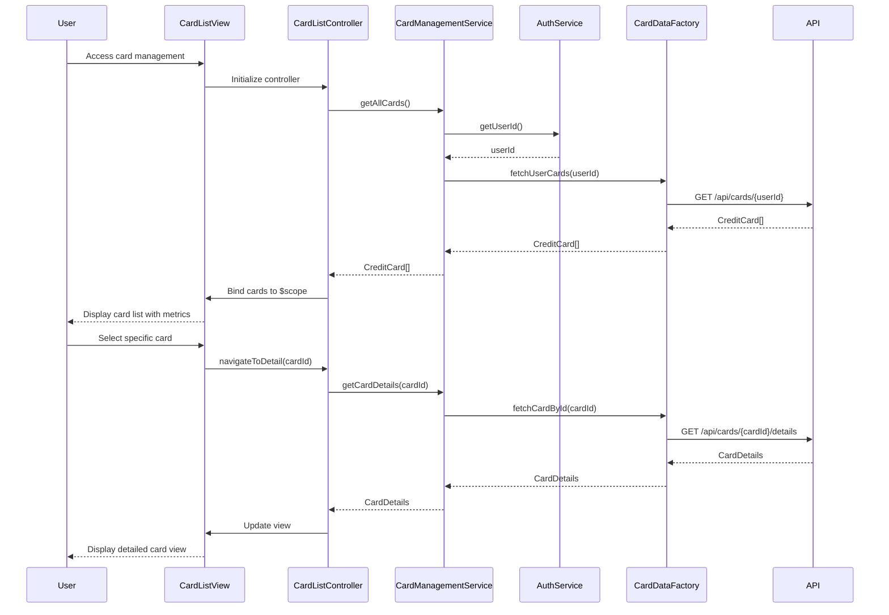

# Low-Level Design: Multiple Credit Card Management
**Epic ID:** QE-9152

## a. Architecture Mapping

- **Card Management Module** → AngularJS Module (`app.cardManagement`)
- **Card List Controller** → AngularJS Controller (`CardListController`) - Manages card display and selection
- **Card Detail Controller** → AngularJS Controller (`CardDetailController`) - Handles individual card view
- **Card Comparison Controller** → AngularJS Controller (`CardComparisonController`) - Manages side-by-side card comparison
- **Card Management Service** → AngularJS Service (`CardManagementService`) - Orchestrates card data operations
- **Card Data Repository** → AngularJS Factory (`CardDataFactory`) - Handles REST API calls for card data
- **Authentication Service** → AngularJS Service (`AuthService`) - Manages user authentication state
- **Card Analytics Service** → AngularJS Service (`CardAnalyticsService`) - Provides card-wise spending analysis

**Recommended Folder Structure:**
```
/app
  /modules
    /card-management
      /controllers (CardListController, CardDetailController, CardComparisonController)
      /services (CardManagementService, CardAnalyticsService)
      /factories (CardDataFactory)
      /directives (cardSummary, cardComparison)
      /views (card-list.html, card-detail.html, card-comparison.html)
      card-management.module.js
  /shared
    /services (AuthService)
    /filters
```

## b. Component Specifications

| Component Name | Artifact Type | Responsibility | Key Dependencies |
|----------------|---------------|----------------|------------------|
| CardListController | Controller | Displays paginated list of user's credit cards with summary metrics | CardManagementService, $scope, $location |
| CardDetailController | Controller | Shows detailed view of selected card including limits, balances, and transactions | CardManagementService, CardAnalyticsService, $routeParams |
| CardComparisonController | Controller | Enables side-by-side comparison of selected cards | CardManagementService, $scope |
| CardManagementService | Service | Orchestrates card retrieval, filtering, sorting, and selection logic | CardDataFactory, AuthService, $q |
| CardDataFactory | Factory | Executes REST API calls to retrieve card data from repository | $http, $q |
| AuthService | Service | Provides authenticated user context and card associations | $http, $window |
| CardAnalyticsService | Service | Retrieves and processes card-wise spending data | $http, $q |
| cardSummary | Directive | Reusable component displaying card summary tile | None |
| cardComparison | Directive | Reusable component for rendering card comparison view | None |

## c. Data Model

**CreditCard Model:**
```javascript
{
  cardId: String,
  userId: String,
  cardNumber: String (masked),
  cardType: String,
  cardName: String,
  creditLimit: Number,
  availableCredit: Number,
  outstandingAmount: Number,
  lastUpdated: Date
}
```

**CardSummaryMetrics Model:**
```javascript
{
  cardId: String,
  monthlySpend: Number,
  utilizationPercent: Number,
  transactionCount: Number
}
```

## d. Data Flow

User authenticates and accesses card management view → CardListController initializes and calls CardManagementService.getAllCards() → CardManagementService invokes AuthService to get userId, then calls CardDataFactory.fetchUserCards(userId) → CardDataFactory executes GET /api/cards/{userId} REST call → Response returns array of CreditCard objects → CardManagementService caches and returns data to controller → Controller binds card list to $scope → View renders card tiles using cardSummary directive with two-way data binding → User selects card → CardDetailController fetches detailed card data and analytics via CardAnalyticsService → UI updates with card-specific transaction history and metrics.

## e. Primary Sequence Diagram



## f. Implementation Notes

- Use AngularJS Dependency Injection for all services, factories, and controllers; register components via `angular.module().controller/service/factory` pattern
- Implement pagination using ng-repeat with limitTo filter and custom pagination directive to handle 10+ cards efficiently
- Use $http interceptor pattern for adding authentication tokens to all API requests and handling 401/403 responses
- Leverage $q promises for asynchronous card data retrieval with .then() chaining for sequential operations
- Apply ES6 arrow functions and const/let in service implementations; use ES6 template literals for API endpoint construction

## g. Error Handling

HTTP interceptor captures API errors (4xx/5xx), displays user-friendly notifications via toast service, and logs errors to console; controllers use try/catch for synchronous operations.

## h. Security Notes

Requires token-based auth via existing SSO; card numbers masked on client-side; all API calls include JWT in Authorization header.