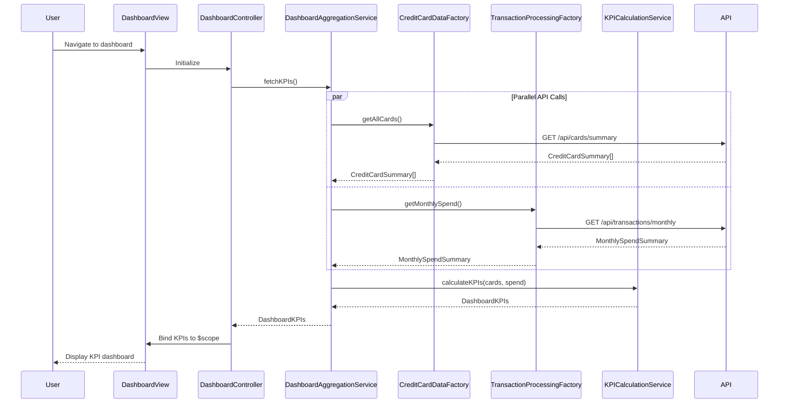

# Low-Level Design: Dashboard KPIs and Credit Overview
**Epic ID:** QE-9153

## a. Architecture Mapping

- **Dashboard Module** → AngularJS Module (`app.dashboard`)
- **Dashboard Controller** → AngularJS Controller (`DashboardController`) - Manages KPI display and real-time updates
- **Dashboard Aggregation Service** → AngularJS Service (`DashboardAggregationService`) - Orchestrates KPI calculation and data aggregation
- **Credit Card Data Service** → AngularJS Factory (`CreditCardDataFactory`) - Fetches card balances and limits via REST
- **Transaction Processing Service** → AngularJS Factory (`TransactionProcessingFactory`) - Retrieves monthly spend data via REST
- **KPI Calculation Engine** → AngularJS Service (`KPICalculationService`) - Computes aggregated KPIs client-side
- **KPI Widget Directive** → AngularJS Directive (`kpiWidget`) - Reusable component for rendering individual KPI tiles

**Recommended Folder Structure:**
```
/app
  /modules
    /dashboard
      /controllers (DashboardController)
      /services (DashboardAggregationService, KPICalculationService)
      /factories (CreditCardDataFactory, TransactionProcessingFactory)
      /directives (kpiWidget, dashboardGrid)
      /views (dashboard.html)
      dashboard.module.js
  /shared
    /services (AuthService, CacheService)
```

## b. Component Specifications

| Component Name | Artifact Type | Responsibility | Key Dependencies |
|----------------|---------------|----------------|------------------|
| DashboardController | Controller | Initializes dashboard view, triggers KPI refresh, and binds data to view | DashboardAggregationService, $scope, $interval |
| DashboardAggregationService | Service | Coordinates data retrieval from multiple sources and triggers KPI calculation | CreditCardDataFactory, TransactionProcessingFactory, KPICalculationService, $q |
| CreditCardDataFactory | Factory | Executes REST API calls to retrieve card balances, limits, and outstanding amounts | $http, $q |
| TransactionProcessingFactory | Factory | Executes REST API calls to retrieve current month transaction totals | $http, $q |
| KPICalculationService | Service | Aggregates data across multiple cards to compute total credit limit, available credit, outstanding amount, monthly spend | None |
| kpiWidget | Directive | Renders individual KPI tile with value, label, and trend indicator | None |
| dashboardGrid | Directive | Responsive grid layout for KPI widgets using Bootstrap grid system | None |

## c. Data Model

**DashboardKPIs Model:**
```javascript
{
  totalCreditLimit: Number,
  totalAvailableCredit: Number,
  totalOutstandingAmount: Number,
  monthlySpendTotal: Number,
  creditUtilizationPercent: Number,
  cardCount: Number,
  lastUpdated: Date
}
```

**CreditCardSummary Model:**
```javascript
{
  cardId: String,
  creditLimit: Number,
  availableCredit: Number,
  outstandingAmount: Number
}
```

**MonthlySpendSummary Model:**
```javascript
{
  userId: String,
  month: String,
  totalSpend: Number,
  transactionCount: Number
}
```

## d. Data Flow

User navigates to dashboard → DashboardController initializes and calls DashboardAggregationService.fetchKPIs() → Service concurrently invokes CreditCardDataFactory.getAllCards() and TransactionProcessingFactory.getMonthlySpend() using $q.all() → Both factories execute REST calls (GET /api/cards/summary and GET /api/transactions/monthly) → Responses return CreditCardSummary[] and MonthlySpendSummary → DashboardAggregationService passes data to KPICalculationService.calculateKPIs() → Service aggregates totals across all cards and computes derived metrics → Aggregated DashboardKPIs object returned to controller → Controller binds KPIs to $scope → View renders KPI widgets using kpiWidget directive with responsive Bootstrap grid → $interval triggers periodic refresh every 30 seconds for real-time updates.

## e. Primary Sequence Diagram



## f. Implementation Notes

- Use $q.all() to execute parallel REST calls for card data and transaction data, reducing total load time to meet 3-second requirement
- Implement $interval service for periodic KPI refresh every 30 seconds; cancel interval on $scope.$destroy to prevent memory leaks
- Apply Bootstrap responsive grid classes (col-xs-*, col-sm-*, col-md-*, col-lg-*) in dashboardGrid directive for cross-device compatibility
- Use AngularJS $http service with response caching enabled for CreditCardDataFactory to optimize repeated requests
- Leverage ES6 array methods (reduce, map) in KPICalculationService for aggregating card data

## g. Error Handling

$http interceptor handles API failures; fallback displays cached KPIs with "stale data" indicator; user notified via toast on refresh failure.

## h. Security Notes

Standard input validation and secure API calls assumed; JWT token included in all API requests via $http interceptor.