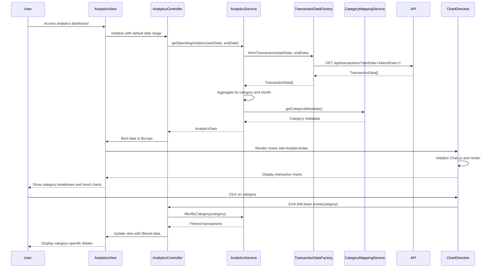

# Low-Level Design: Spending Analytics and Insights
**Epic ID:** QE-9154

## a. Architecture Mapping

- **Analytics Module** → AngularJS Module (`app.analytics`)
- **Analytics Controller** → AngularJS Controller (`AnalyticsController`) - Manages analytics view and user interactions
- **Analytics Service Layer** → AngularJS Service (`AnalyticsService`) - Orchestrates data retrieval and aggregation
- **Transaction Data Service** → AngularJS Factory (`TransactionDataFactory`) - Fetches categorized transaction history via REST
- **Category Classification Engine** → AngularJS Service (`CategoryMappingService`) - Provides category metadata and mappings
- **Data Visualization Library** → External Library (Chart.js or D3.js) integrated via AngularJS directive (`analyticsChart`)
- **Chart Directive** → AngularJS Directive (`analyticsChart`) - Wraps visualization library for AngularJS integration

**Recommended Folder Structure:**
```
/app
  /modules
    /analytics
      /controllers (AnalyticsController)
      /services (AnalyticsService, CategoryMappingService)
      /factories (TransactionDataFactory)
      /directives (analyticsChart, categoryBreakdown, trendChart)
      /views (analytics-dashboard.html)
      analytics.module.js
  /shared
    /services (DateRangeService)
```

## b. Component Specifications

| Component Name | Artifact Type | Responsibility | Key Dependencies |
|----------------|---------------|----------------|------------------|
| AnalyticsController | Controller | Manages analytics view, handles date range selection, and triggers chart rendering | AnalyticsService, $scope, $filter |
| AnalyticsService | Service | Aggregates transaction data by category and time period, prepares data for visualization | TransactionDataFactory, CategoryMappingService, $q |
| TransactionDataFactory | Factory | Executes REST API calls to retrieve categorized transaction history for specified date range | $http, $q |
| CategoryMappingService | Service | Provides predefined category list (Food & Dining, Fuel, Shopping, Travel, Entertainment, Utilities, Healthcare, Education, Miscellaneous) and color mappings | None |
| analyticsChart | Directive | Wraps Chart.js/D3.js to render interactive charts with drill-down capability | Chart.js or D3.js library |
| categoryBreakdown | Directive | Displays category-wise spending breakdown in tabular or pie chart format | analyticsChart |
| trendChart | Directive | Renders monthly spend trend line chart | analyticsChart |

## c. Data Model

**TransactionData Model:**
```javascript
{
  transactionId: String,
  cardId: String,
  amount: Number,
  category: String,
  transactionDate: Date,
  description: String
}
```

**CategorySpendSummary Model:**
```javascript
{
  category: String,
  totalSpend: Number,
  transactionCount: Number,
  percentOfTotal: Number
}
```

**MonthlyTrendData Model:**
```javascript
{
  month: String,
  totalSpend: Number,
  categoryBreakdown: Object
}
```

**AnalyticsData Model:**
```javascript
{
  dateRange: { startDate: Date, endDate: Date },
  categorySpendSummary: CategorySpendSummary[],
  monthlyTrend: MonthlyTrendData[],
  totalSpend: Number
}
```

## d. Data Flow

User accesses analytics dashboard and selects date range (default: last 12 months) → AnalyticsController calls AnalyticsService.getSpendingAnalytics(startDate, endDate) → AnalyticsService invokes TransactionDataFactory.fetchTransactions(startDate, endDate) → Factory executes GET /api/transactions?startDate=X&endDate=Y → API returns TransactionData[] with pre-categorized transactions → AnalyticsService aggregates data by category using array reduce, calculates totals and percentages, and groups by month for trend analysis → CategoryMappingService provides category metadata for chart rendering → AnalyticsService returns AnalyticsData object to controller → Controller binds data to $scope and triggers chart directives → analyticsChart directive initializes Chart.js with data and renders interactive visualizations → User clicks on category in chart → Directive emits drill-down event → Controller filters transactions by selected category and updates view.

## e. Primary Sequence Diagram



## f. Implementation Notes

- Integrate Chart.js via bower/npm; wrap in AngularJS directive using link function to access DOM element for chart initialization
- Use AngularJS $filter service for date formatting and currency display in charts and tables
- Implement lazy loading for transaction data using pagination if dataset exceeds 1000 transactions to maintain 3-second load time
- Leverage ES6 Map and Set for efficient category aggregation and duplicate removal in AnalyticsService
- Use $scope.$watch on date range selector to trigger automatic chart refresh when user changes date range

## g. Error Handling

$http interceptor captures API errors; analytics view displays error message with retry button; partial data rendered if available.

## h. Security Notes

Standard input validation and secure API calls assumed; date range inputs sanitized to prevent injection attacks.