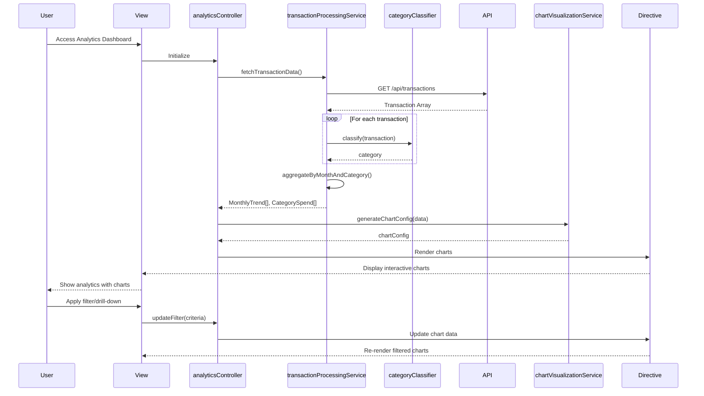

# Low-Level Design: QE-9155 - Transaction Analytics and Category-wise Spending Insights

## a. Architecture Mapping

- **Analytics UI** → AngularJS View Template (HTML5 + Bootstrap) with interactive chart directives
- **Analytics Controller** → AngularJS Controller (`analyticsController.js`) managing view state and user interactions
- **Transaction Processing Engine** → AngularJS Service (`transactionProcessingService.js`) for data aggregation and processing
- **Category Classification Engine** → AngularJS Factory (`categoryClassifier.js`) for transaction categorization logic
- **Visualization Service** → AngularJS Service (`chartVisualizationService.js`) wrapping chart library (e.g., Chart.js/D3.js)
- **Transaction Data Source** → REST API integration via AngularJS `$http` service
- **Dashboard KPI System** → Shared AngularJS Service (`kpiService.js`) for cross-module data consistency

**Recommended Folder Structure:**
```
/app
  /modules
    /analytics
      /controllers
        analyticsController.js
      /services
        transactionProcessingService.js
        chartVisualizationService.js
      /factories
        categoryClassifier.js
      /views
        analytics.html
      /directives
        categoryChart.directive.js
        trendChart.directive.js
  /shared
    /services
      kpiService.js
      apiService.js
```

## b. Component Specifications

| Component Name | Artifact Type | Responsibility | Key Dependencies |
|----------------|---------------|----------------|------------------|
| analyticsController | Controller | Manages analytics view state, handles user interactions (filtering, drill-down), coordinates data flow | transactionProcessingService, chartVisualizationService, kpiService |
| transactionProcessingService | Service | Fetches transaction data from REST API, aggregates by month/category, processes historical data | $http, categoryClassifier, apiService |
| categoryClassifier | Factory | Classifies transactions into 9 predefined categories based on merchant/transaction metadata | None (pure logic) |
| chartVisualizationService | Service | Generates interactive chart configurations, handles chart rendering and updates | Chart.js/D3.js library |
| categoryChart.directive | Directive | Renders category-wise spending breakdown chart with interactive filtering | chartVisualizationService |
| trendChart.directive | Directive | Renders monthly spend trend line chart with drill-down capability | chartVisualizationService |
| kpiService | Service (Shared) | Provides monthly spend KPI data for validation and consistency | $http, apiService |
| apiService | Service (Shared) | Centralized REST API communication with error handling | $http |

## c. Data Model

**Transaction Model:**
```javascript
{
  transactionId: String,
  cardId: String,
  amount: Number,
  date: Date,
  merchantName: String,
  merchantCategory: String,
  category: String, // One of 9 categories
  description: String
}
```

**CategorySpend Model:**
```javascript
{
  category: String, // Food & Dining, Fuel, Shopping, Travel, Entertainment, Utilities, Healthcare, Education, Miscellaneous
  totalAmount: Number,
  transactionCount: Number,
  percentage: Number
}
```

**MonthlyTrend Model:**
```javascript
{
  month: String, // YYYY-MM format
  totalSpend: Number,
  categoryBreakdown: Array<CategorySpend>
}
```

## d. Data Flow

User accesses analytics view → analyticsController initializes and calls transactionProcessingService → Service fetches transaction data via REST API ($http) → categoryClassifier categorizes each transaction into one of 9 categories → transactionProcessingService aggregates data by month and category, creates MonthlyTrend and CategorySpend objects → chartVisualizationService generates chart configurations → categoryChart and trendChart directives render interactive visualizations → User applies filters/drill-down → Controller updates view model → Directives re-render charts with filtered data.

## e. Primary Sequence Diagram



## f. Implementation Notes

- Use AngularJS dependency injection to inject transactionProcessingService, chartVisualizationService, and categoryClassifier into analyticsController
- Implement categoryClassifier as a stateless factory with rule-based classification logic (merchant name/category code mapping)
- Leverage Chart.js or D3.js for visualization; wrap in AngularJS service for testability and reusability
- Use $http interceptor for centralized API error handling and loading state management
- Implement client-side caching (e.g., $cacheFactory) for transaction data to improve performance on filter/drill-down operations

## g. Error Handling

Centralized error handling via $http interceptor with user-friendly notifications for API failures; try/catch blocks in classification logic with fallback to "Miscellaneous" category.

## h. Security Notes

Standard input validation and secure API calls assumed; requires token-based auth via existing SSO for API access.