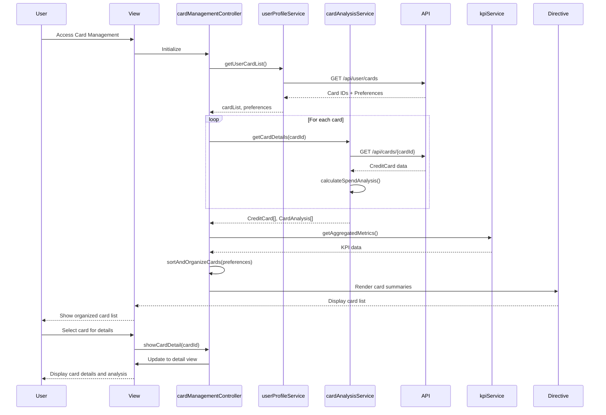

# Low-Level Design: QE-9156 - Credit Card Management and Monitoring

## a. Architecture Mapping

- **User Interface** → AngularJS View Template (HTML5 + Bootstrap) with card list and detail views
- **Card Management Controller** → AngularJS Controller (`cardManagementController.js`) managing card display and user actions
- **Card Analysis Engine** → AngularJS Service (`cardAnalysisService.js`) for card-wise spend calculation and comparison
- **Card Data Repository** → REST API integration via AngularJS `$http` service
- **User Profile Service** → AngularJS Service (`userProfileService.js`) for user-specific card associations
- **Dashboard KPI System** → Shared AngularJS Service (`kpiService.js`) for aggregated metrics

**Recommended Folder Structure:**
```
/app
  /modules
    /card-management
      /controllers
        cardManagementController.js
      /services
        cardAnalysisService.js
        userProfileService.js
      /views
        card-list.html
        card-detail.html
      /directives
        cardSummary.directive.js
  /shared
    /services
      kpiService.js
      apiService.js
```

## b. Component Specifications

| Component Name | Artifact Type | Responsibility | Key Dependencies |
|----------------|---------------|----------------|------------------|
| cardManagementController | Controller | Manages card list/detail views, handles sorting/filtering, coordinates card operations | cardAnalysisService, userProfileService, kpiService |
| cardAnalysisService | Service | Fetches card data from API, calculates card-wise spend, performs card comparison analysis | $http, apiService |
| userProfileService | Service | Retrieves user's card associations and preferences (sorting, organization) | $http, apiService |
| cardSummary.directive | Directive | Renders individual card summary with key metrics (balance, limit, spend) | cardAnalysisService |
| kpiService | Service (Shared) | Provides aggregated KPI metrics for consistency with dashboard | $http, apiService |
| apiService | Service (Shared) | Centralized REST API communication with error handling | $http |

## c. Data Model

**CreditCard Model:**
```javascript
{
  cardId: String,
  cardNumber: String, // Masked (last 4 digits)
  cardType: String, // Visa, MasterCard, etc.
  cardName: String,
  creditLimit: Number,
  availableCredit: Number,
  outstandingAmount: Number,
  currentBalance: Number,
  monthlySpend: Number,
  issuer: String
}
```

**CardAnalysis Model:**
```javascript
{
  cardId: String,
  monthlySpend: Number,
  utilizationRate: Number, // (outstandingAmount / creditLimit) * 100
  spendTrend: String, // "increasing", "decreasing", "stable"
  comparisonRank: Number // Rank among user's cards by spend
}
```

**UserCardPreferences Model:**
```javascript
{
  userId: String,
  sortBy: String, // "spend", "limit", "name", "balance"
  sortOrder: String, // "asc", "desc"
  favoriteCards: Array<String> // Array of cardIds
}
```

## d. Data Flow

User accesses card management interface → cardManagementController initializes and calls userProfileService to retrieve user's card list and preferences → cardAnalysisService fetches detailed card data for each card via REST API → Service calculates card-wise spend analysis and utilization rates → kpiService provides aggregated metrics for validation → Controller organizes and sorts cards based on user preferences → cardSummary directive renders each card with metrics → User selects a card for details → Controller updates view to show card-specific information and comparison analysis.

## e. Primary Sequence Diagram



## f. Implementation Notes

- Use AngularJS dependency injection for cardAnalysisService, userProfileService, and kpiService in cardManagementController
- Implement cardAnalysisService with promise-based API calls ($q) for parallel card data fetching to meet 1-second NFR
- Store user preferences in userProfileService with local caching to reduce API calls on view refresh
- Use ng-repeat with track by cardId in view template for efficient card list rendering
- Implement cardSummary directive with isolated scope for reusability and encapsulation

## g. Error Handling

$http interceptor-based error handling with user notifications for API failures; graceful degradation if individual card data fetch fails (show partial list).

## h. Security Notes

Requires token-based auth via existing SSO; card numbers displayed masked (last 4 digits only); secure API calls with HTTPS.