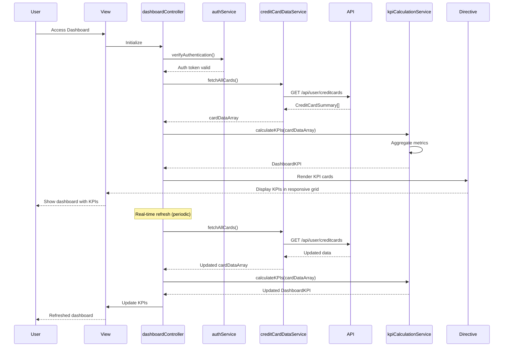

# Low-Level Design: QE-9157 - Credit Card Dashboard and KPI Management

## a. Architecture Mapping

- **User Interface Layer** → AngularJS View Template (HTML5 + Bootstrap) with responsive grid layout
- **Dashboard Controller** → AngularJS Controller (`dashboardController.js`) managing dashboard state and KPI display
- **KPI Calculation Engine** → AngularJS Service (`kpiCalculationService.js`) for aggregating and computing KPIs
- **Credit Card Data Service** → AngularJS Service (`creditCardDataService.js`) for fetching card data via REST API
- **Authentication Service** → AngularJS Service (`authService.js`) for user authentication and session management
- **Credit Card Database** → REST API backend integration via `$http`

**Recommended Folder Structure:**
```
/app
  /modules
    /dashboard
      /controllers
        dashboardController.js
      /services
        kpiCalculationService.js
        creditCardDataService.js
      /views
        dashboard.html
      /directives
        kpiCard.directive.js
  /shared
    /services
      authService.js
      apiService.js
```

## b. Component Specifications

| Component Name | Artifact Type | Responsibility | Key Dependencies |
|----------------|---------------|----------------|------------------|
| dashboardController | Controller | Manages dashboard view state, handles real-time data refresh, coordinates KPI display | kpiCalculationService, creditCardDataService, authService |
| kpiCalculationService | Service | Aggregates card data, calculates monthly spend, total credit limit, available credit, outstanding amounts | creditCardDataService |
| creditCardDataService | Service | Fetches all user credit card data from REST API, handles data caching | $http, apiService, authService |
| authService | Service (Shared) | Manages user authentication, session tokens, and secure API access | $http, $window (for token storage) |
| kpiCard.directive | Directive | Renders individual KPI metric card (monthly spend, credit limit, etc.) with responsive layout | None |
| apiService | Service (Shared) | Centralized REST API communication with error handling and loading state | $http |

## c. Data Model

**CreditCardSummary Model:**
```javascript
{
  cardId: String,
  creditLimit: Number,
  availableCredit: Number,
  outstandingAmount: Number,
  currentMonthSpend: Number
}
```

**DashboardKPI Model:**
```javascript
{
  totalCreditLimit: Number,
  totalAvailableCredit: Number,
  totalOutstandingAmount: Number,
  monthlySpend: Number,
  cardCount: Number,
  utilizationRate: Number, // (totalOutstandingAmount / totalCreditLimit) * 100
  lastUpdated: Date
}
```

## d. Data Flow

User authenticates via authService → dashboardController initializes and verifies authentication → Controller calls creditCardDataService to fetch all user's credit card data via REST API → kpiCalculationService receives card data array and aggregates metrics (sum credit limits, available credit, outstanding amounts, monthly spend) → Calculated DashboardKPI object returned to dashboardController → Controller updates view model → kpiCard directives render individual KPI metrics in responsive grid → Real-time refresh triggered by $interval service → Process repeats to update KPIs.

## e. Primary Sequence Diagram



## f. Implementation Notes

- Use AngularJS dependency injection to inject kpiCalculationService, creditCardDataService, and authService into dashboardController
- Implement real-time refresh using $interval service (e.g., every 30 seconds) to meet NFR; cancel interval on scope destruction
- Leverage Bootstrap grid system (col-xs, col-sm, col-md, col-lg) in view template for responsive layout across devices
- Use $cacheFactory in creditCardDataService to cache card data and reduce API calls during refresh cycles
- Implement kpiCard directive with isolated scope and one-way binding (@) for KPI value display

## g. Error Handling

Centralized $http interceptor for API error handling with user-friendly toast notifications; retry logic for transient failures during real-time refresh.

## h. Security Notes

Requires token-based auth via existing SSO; authService manages JWT tokens stored in sessionStorage; all API calls include Authorization header.