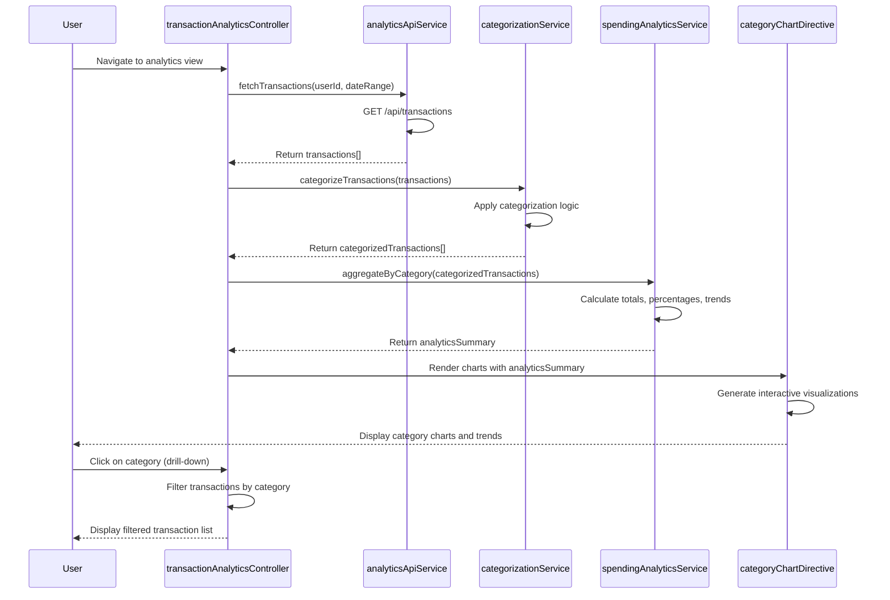

# Low-Level Design: Transaction Analytics and Category-wise Spending
**Epic ID:** QE-9158

## a. Architecture Mapping

**AngularJS Artifact Mapping:**
- User Web Client → AngularJS Module: `transactionAnalyticsModule`
- Analytics API Gateway → Service: `analyticsApiService` (handles REST API calls)
- Transaction Processing System → Factory: `transactionDataFactory` (data retrieval and caching)
- Categorization Engine → Service: `categorizationService` (client-side category assignment logic)
- Analytics Service → Service: `spendingAnalyticsService` (aggregation and calculation)
- Data Visualization Library → Directive: `categoryChartDirective`, `trendGraphDirective` (chart rendering)
- Historical Data Store → Factory: `historicalDataFactory` (12-month data management)
- Main Controller → Controller: `transactionAnalyticsController` (orchestrates view logic)

**Recommended Folder Structure:**
```
app/
├── modules/
│   └── transaction-analytics/
│       ├── controllers/
│       │   └── transactionAnalyticsController.js
│       ├── services/
│       │   ├── analyticsApiService.js
│       │   ├── categorizationService.js
│       │   └── spendingAnalyticsService.js
│       ├── factories/
│       │   ├── transactionDataFactory.js
│       │   └── historicalDataFactory.js
│       ├── directives/
│       │   ├── categoryChartDirective.js
│       │   └── trendGraphDirective.js
│       ├── views/
│       │   └── transaction-analytics.html
│       └── transactionAnalyticsModule.js
```

## b. Component Specifications

| Component Name | Artifact Type | Responsibility | Key Dependencies |
|----------------|---------------|----------------|------------------|
| transactionAnalyticsModule | Module | Registers all analytics components and configures routing | angular, ngRoute |
| transactionAnalyticsController | Controller | Orchestrates view state, handles user interactions, triggers data refresh | analyticsApiService, spendingAnalyticsService, $scope |
| analyticsApiService | Service | Makes REST API calls to Analytics API Gateway, handles responses | $http, $q |
| transactionDataFactory | Factory | Retrieves and caches transaction data, manages data lifecycle | analyticsApiService, $cacheFactory |
| categorizationService | Service | Applies categorization logic to transactions (9 categories) | transactionDataFactory |
| spendingAnalyticsService | Service | Aggregates spending by category, calculates trends and distributions | categorizationService, historicalDataFactory |
| historicalDataFactory | Factory | Manages 12-month historical data retrieval and storage | analyticsApiService, localStorageService |
| categoryChartDirective | Directive | Renders interactive pie/bar charts for category-wise spending | Chart.js or D3.js, spendingAnalyticsService |
| trendGraphDirective | Directive | Renders time-series trend graphs for spending patterns | Chart.js or D3.js, spendingAnalyticsService |

## c. Data Model

**Transaction Model:**
```javascript
class Transaction {
  id: String
  cardId: String
  amount: Number
  currency: String
  merchantName: String
  merchantCode: String
  category: String // One of 9 predefined categories
  transactionDate: Date
  description: String
  status: String
}
```

**Category Model:**
```javascript
class SpendingCategory {
  name: String // Food & Dining, Fuel, Shopping, Travel, Entertainment, Utilities, Healthcare, Education, Miscellaneous
  totalSpend: Number
  transactionCount: Number
  percentage: Number
  transactions: Array<Transaction>
}
```

**Analytics Summary Model:**
```javascript
class AnalyticsSummary {
  userId: String
  period: String // e.g., "2026-11"
  categories: Array<SpendingCategory>
  totalSpend: Number
  startDate: Date
  endDate: Date
}
```

## d. Data Flow

User navigates to transaction analytics view → transactionAnalyticsController initializes and calls analyticsApiService to fetch raw transactions → transactionDataFactory retrieves and caches data → categorizationService processes transactions and assigns one of 9 predefined categories based on merchant codes and descriptions → spendingAnalyticsService aggregates categorized data, calculates spending totals, percentages, and trends using historicalDataFactory for 12-month historical context → Processed analytics summary is bound to $scope → categoryChartDirective and trendGraphDirective render interactive visualizations (pie charts, bar graphs, trend lines) within 1 second → User interacts with charts to drill down into specific categories → Controller updates view to display filtered transaction list for selected category and time period.

## e. Primary Sequence Diagram



## f. Implementation Notes

- Use AngularJS dependency injection to inject services and factories into controllers and directives for testability and modularity.
- Implement ES6 classes for models (Transaction, SpendingCategory, AnalyticsSummary) with proper encapsulation and methods.
- Use $http interceptors for centralized API error handling and authentication token injection.
- Leverage Chart.js or D3.js within directives for rendering interactive visualizations; ensure chart updates use directive watchers on scope data changes.
- Implement client-side caching using $cacheFactory for transaction data to minimize API calls and improve performance; cache TTL set to 5 minutes.

## g. Error Handling

Use $http interceptor to catch API errors globally; display user-friendly notifications via toastr or custom notification service; wrap service logic in try/catch blocks for client-side errors.

## h. Security Notes

Requires token-based authentication via existing SSO; all API calls include Authorization header with JWT token; standard input validation and secure API calls assumed.