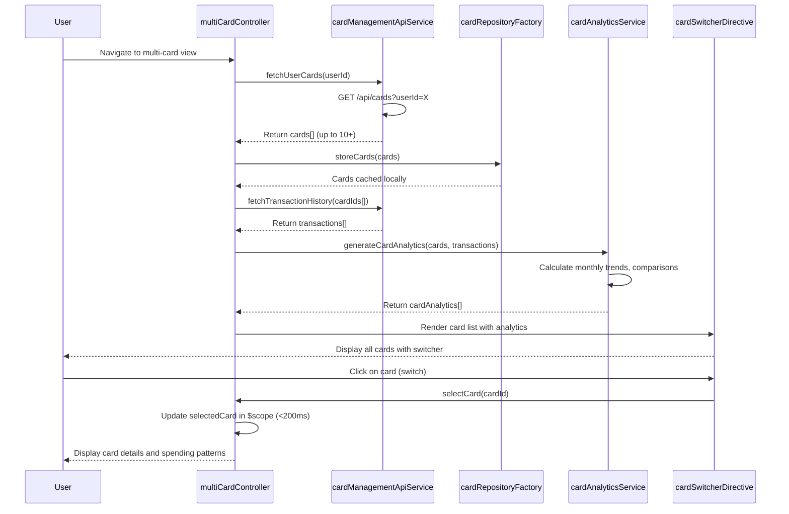

# Low-Level Design: Multi-Card Management and Monitoring
**Epic ID:** QE-9159

## a. Architecture Mapping

**AngularJS Artifact Mapping:**
- User Web Client → AngularJS Module: `multiCardModule`
- Card Management API → Service: `cardManagementApiService` (REST API integration)
- Card Repository Service → Factory: `cardRepositoryFactory` (card data management)
- User Profile Service → Service: `userProfileService` (user-card associations)
- Transaction History Database → Factory: `transactionHistoryFactory` (transaction retrieval)
- Analytics Engine → Service: `cardAnalyticsService` (card-wise spend analysis)
- Multi-Card UI Component → Controller: `multiCardController` + Directive: `cardSwitcherDirective`

**Recommended Folder Structure:**
```
app/
├── modules/
│   └── multi-card/
│       ├── controllers/
│       │   └── multiCardController.js
│       ├── services/
│       │   ├── cardManagementApiService.js
│       │   ├── userProfileService.js
│       │   └── cardAnalyticsService.js
│       ├── factories/
│       │   ├── cardRepositoryFactory.js
│       │   └── transactionHistoryFactory.js
│       ├── directives/
│       │   ├── cardSwitcherDirective.js
│       │   └── cardDetailsDirective.js
│       ├── views/
│       │   └── multi-card.html
│       └── multiCardModule.js
```

## b. Component Specifications

| Component Name | Artifact Type | Responsibility | Key Dependencies |
|----------------|---------------|----------------|------------------|
| multiCardModule | Module | Registers multi-card components and configures routing | angular, ngRoute |
| multiCardController | Controller | Manages card list, handles card selection, orchestrates analytics display | cardManagementApiService, cardAnalyticsService, $scope |
| cardManagementApiService | Service | Makes REST API calls to Card Management API for card operations | $http, $q |
| cardRepositoryFactory | Factory | Stores and manages card data locally, supports minimum 10 cards per user | cardManagementApiService, localStorageService |
| userProfileService | Service | Retrieves user profile and user-card associations | $http |
| transactionHistoryFactory | Factory | Fetches transaction history for selected card from database | cardManagementApiService |
| cardAnalyticsService | Service | Processes card-wise spend analysis and monthly trends for comparative analytics | transactionHistoryFactory |
| cardSwitcherDirective | Directive | Renders card list UI with instant switching capability (<200ms) | cardRepositoryFactory |
| cardDetailsDirective | Directive | Displays card-specific details and spending patterns | cardAnalyticsService |

## c. Data Model

**Card Model:**
```javascript
class CreditCard {
  cardId: String
  userId: String
  cardNumber: String // Masked, e.g., "**** **** **** 1234"
  cardType: String // Visa, MasterCard, etc.
  cardholderName: String
  expiryDate: String
  creditLimit: Number
  availableCredit: Number
  outstandingAmount: Number
  status: String // Active, Inactive, Blocked
}
```

**Card Spend Analytics Model:**
```javascript
class CardSpendAnalytics {
  cardId: String
  monthlySpend: Number
  monthlyTrends: Array<MonthlyTrend> // 12-month rolling data
  topCategories: Array<CategorySpend>
  comparisonRank: Number // Rank among user's cards by spend
}
```

**Monthly Trend Model:**
```javascript
class MonthlyTrend {
  month: String // "2026-11"
  totalSpend: Number
  transactionCount: Number
}
```

## d. Data Flow

User navigates to multi-card view → multiCardController calls cardManagementApiService to authenticate and retrieve user's card list → cardRepositoryFactory fetches card details from Card Repository Service via userProfileService → transactionHistoryFactory retrieves transaction history for all cards → cardAnalyticsService processes data to generate card-wise spend analysis and 12-month rolling trends → multiCardController binds card list and analytics to $scope → cardSwitcherDirective renders card list with instant switching UI → User clicks on a card → Directive triggers card selection event (<200ms response) → Controller updates $scope with selected card details → cardDetailsDirective displays card-specific information, spending patterns, and comparative analytics → User can view monthly trends and compare performance across cards.

## e. Primary Sequence Diagram



## f. Implementation Notes

- Use AngularJS dependency injection for all services, factories, and directives to ensure modularity and testability.
- Implement client-side card data caching in cardRepositoryFactory using localStorageService to achieve <200ms card switching; pre-fetch all card data on initial load.
- Use ES6 classes for CreditCard, CardSpendAnalytics, and MonthlyTrend models with getter/setter methods for encapsulation.
- Implement cardSwitcherDirective with ng-repeat for card list rendering and ng-click for instant card selection without API calls.
- Ensure data isolation by filtering transaction data per card at the service layer; enforce user authentication checks in cardManagementApiService.

## g. Error Handling

Use $http interceptor for centralized API error handling; display user notifications via toastr; wrap controller logic in try/catch for client-side exceptions.

## h. Security Notes

Requires token-based auth via existing SSO; all API calls include JWT in Authorization header; card data isolation enforced at API and service layers; standard input validation and secure API calls assumed.