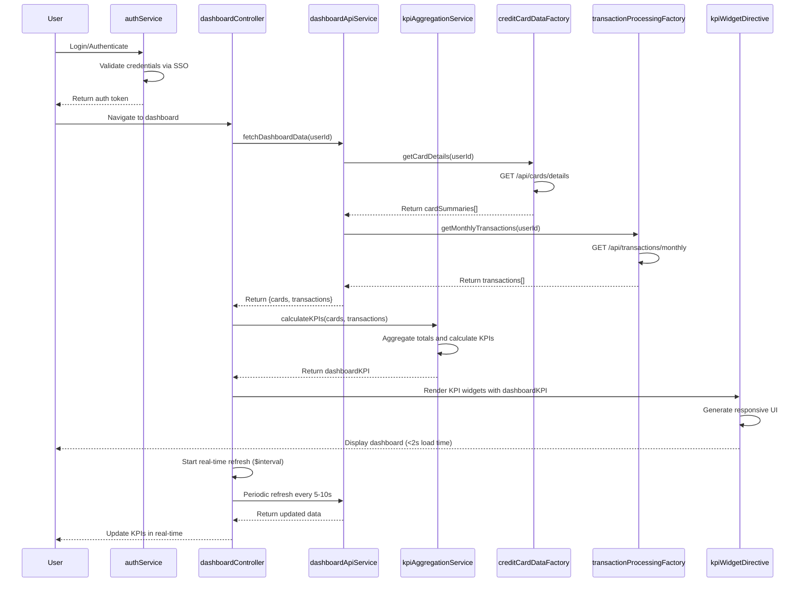

# Low-Level Design: Dashboard KPIs and Financial Overview
**Epic ID:** QE-9160

## a. Architecture Mapping

**AngularJS Artifact Mapping:**
- User Web Client → AngularJS Module: `dashboardModule`
- Authentication Service → Service: `authService` (SSO integration and session management)
- Dashboard API Gateway → Service: `dashboardApiService` (REST API calls)
- KPI Aggregation Service → Service: `kpiAggregationService` (calculates KPIs from raw data)
- Credit Card Data Source → Factory: `creditCardDataFactory` (card details and limits)
- Transaction Processing System → Factory: `transactionProcessingFactory` (transaction data)
- Dashboard UI Component → Controller: `dashboardController` + Directive: `kpiWidgetDirective`

**Recommended Folder Structure:**
```
app/
├── modules/
│   └── dashboard/
│       ├── controllers/
│       │   └── dashboardController.js
│       ├── services/
│       │   ├── authService.js
│       │   ├── dashboardApiService.js
│       │   └── kpiAggregationService.js
│       ├── factories/
│       │   ├── creditCardDataFactory.js
│       │   └── transactionProcessingFactory.js
│       ├── directives/
│       │   └── kpiWidgetDirective.js
│       ├── views/
│       │   └── dashboard.html
│       └── dashboardModule.js
```

## b. Component Specifications

| Component Name | Artifact Type | Responsibility | Key Dependencies |
|----------------|---------------|----------------|------------------|
| dashboardModule | Module | Registers dashboard components and configures routing | angular, ngRoute |
| dashboardController | Controller | Orchestrates dashboard view, triggers KPI refresh, manages real-time updates | dashboardApiService, kpiAggregationService, $scope, $interval |
| authService | Service | Handles user authentication, validates session, manages SSO tokens | $http, $window |
| dashboardApiService | Service | Makes REST API calls to Dashboard API Gateway for data retrieval | $http, $q, authService |
| kpiAggregationService | Service | Calculates monthly spend, total credit limit, available credit, outstanding amounts | creditCardDataFactory, transactionProcessingFactory |
| creditCardDataFactory | Factory | Fetches and caches credit card details, limits, and balances | dashboardApiService |
| transactionProcessingFactory | Factory | Retrieves transaction data for monthly spend calculation | dashboardApiService |
| kpiWidgetDirective | Directive | Renders individual KPI widgets with responsive design for desktop and mobile | kpiAggregationService |

## c. Data Model

**Dashboard KPI Model:**
```javascript
class DashboardKPI {
  userId: String
  monthlySpend: Number
  totalCreditLimit: Number
  availableCredit: Number
  outstandingAmount: Number
  creditUtilization: Number // Percentage
  lastUpdated: Date
}
```

**Credit Card Summary Model:**
```javascript
class CreditCardSummary {
  cardId: String
  creditLimit: Number
  availableCredit: Number
  outstandingAmount: Number
  currentBalance: Number
}
```

**Monthly Spend Model:**
```javascript
class MonthlySpend {
  month: String // "2026-11"
  totalSpend: Number
  transactionCount: Number
  cardBreakdown: Array<{cardId: String, spend: Number}>
}
```

## d. Data Flow

User authenticates via authService and navigates to dashboard → dashboardController initializes and calls dashboardApiService to fetch data → dashboardApiService routes request to Dashboard API Gateway → creditCardDataFactory retrieves card details, limits, and balances from Credit Card Data Source → transactionProcessingFactory fetches transaction data from Transaction Processing System → kpiAggregationService receives raw data and calculates monthly spend (current month transactions sum), total credit limit (sum across all cards), available credit (sum of available credit per card), and outstanding amounts (sum of balances) → Aggregated KPIs are bound to $scope → kpiWidgetDirective renders responsive KPI widgets (monthly spend, total credit limit, available credit, outstanding amount) on dashboard → Dashboard loads within 2 seconds → Real-time refresh triggered every 5-10 seconds via $interval to update KPIs → UI updates reflect latest financial data.

## e. Primary Sequence Diagram



## f. Implementation Notes

- Use AngularJS dependency injection to inject authService, dashboardApiService, and kpiAggregationService into dashboardController for modularity.
- Implement ES6 classes for DashboardKPI, CreditCardSummary, and MonthlySpend models with validation methods.
- Use $http interceptor to inject authentication token from authService into all API requests and handle 401 errors globally.
- Implement real-time data refresh using $interval service (5-10 second polling) to meet near real-time NFR; consider WebSocket upgrade for true real-time updates if needed.
- Use Bootstrap grid system and CSS3 media queries in kpiWidgetDirective template for responsive design across desktop and mobile devices; ensure dashboard loads within 2 seconds by optimizing API calls and minimizing DOM manipulations.

## g. Error Handling

Use $http interceptor to catch API errors globally; display user-friendly error messages via toastr or notification service; wrap service calculations in try/catch blocks for client-side error handling.

## h. Security Notes

Requires token-based authentication via existing SSO; all API calls include JWT token in Authorization header; standard input validation and secure API calls assumed.