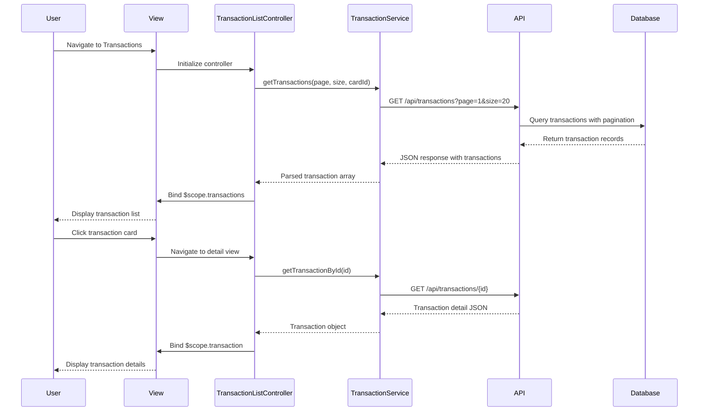

# Low-Level Design: Transaction Management and Viewing
**Epic ID:** QE-9161  
**Application Stack:** AngularJS 1.x, JavaScript ES6, HTML5, CSS3, Bootstrap, REST APIs, MVC Architecture

---

## a. Architecture Mapping

| HLD Component | AngularJS Artifact | Responsibility |
|---------------|-------------------|----------------|
| Web Application Frontend | Module: `transactionModule` | Root module for transaction management features |
| Transaction Listing Interface | Controller: `TransactionListController` | Manages transaction list view and pagination |
| Transaction Details View | Controller: `TransactionDetailController` | Handles individual transaction detail display |
| Transaction Service API Integration | Service: `TransactionService` | REST API calls for transaction data retrieval |
| Multi-card Aggregation Logic | Service: `CardAggregationService` | Aggregates transactions across multiple cards |
| Authentication Integration | Factory: `AuthInterceptor` | Injects auth tokens into API requests |

**Recommended Folder Structure:**
```
/app
  /modules
    /transactions
      /controllers
        - transactionListController.js
        - transactionDetailController.js
      /services
        - transactionService.js
        - cardAggregationService.js
      /views
        - transaction-list.html
        - transaction-detail.html
      /directives
        - transactionCard.directive.js
  /shared
    /interceptors
      - authInterceptor.js
```

---

## b. Component Specifications

| Component Name | Artifact Type | Responsibility | Key Dependencies |
|----------------|---------------|----------------|------------------|
| `transactionModule` | Module | Root module for transaction features | `ngRoute`, `ngResource` |
| `TransactionListController` | Controller | Fetch and display paginated transaction list | `TransactionService`, `$scope`, `$routeParams` |
| `TransactionDetailController` | Controller | Display single transaction details | `TransactionService`, `$scope`, `$routeParams` |
| `TransactionService` | Service | REST API integration for transaction CRUD operations | `$http`, `API_BASE_URL` |
| `CardAggregationService` | Service | Aggregate and filter transactions by card | `TransactionService` |
| `AuthInterceptor` | Factory | Attach authentication tokens to HTTP requests | `$q`, `$window`, `AuthService` |
| `transactionCard` | Directive | Reusable transaction card UI component | `$compile` |

---

## c. Data Model

**Transaction Model:**
```javascript
{
  transactionId: String,
  cardId: String,
  amount: Number,
  merchant: String,
  date: Date (ISO 8601),
  category: String,
  description: String,
  status: String // 'pending', 'completed', 'failed'
}
```

**Card Model (for aggregation):**
```javascript
{
  cardId: String,
  cardName: String,
  last4Digits: String,
  cardType: String // 'Visa', 'MasterCard', etc.
}
```

**Pagination Model:**
```javascript
{
  currentPage: Number,
  pageSize: Number,
  totalRecords: Number,
  totalPages: Number
}
```

---

## d. Data Flow

User navigates to transaction list view → `TransactionListController` initializes and calls `TransactionService.getTransactions()` with pagination params → Service makes GET request to `/api/transactions?page=1&size=20&cardId=xyz` → API returns JSON response with transaction array and pagination metadata → Controller binds data to `$scope.transactions` → View renders transaction cards using `ng-repeat` and `transactionCard` directive → User clicks transaction → `TransactionDetailController` fetches single transaction via `TransactionService.getTransactionById(id)` → Detail view displays full transaction information.

---

## e. Primary Sequence Diagram



---

## f. Implementation Notes

- Use AngularJS `$http` service with promise-based pattern for all API calls; implement pagination using query params.
- Leverage Dependency Injection for all controllers and services; register components using `.controller()`, `.service()`, and `.factory()` methods.
- Implement `AuthInterceptor` as HTTP interceptor via `$httpProvider.interceptors.push()` to inject bearer tokens automatically.
- Use `ng-repeat` with `track by transactionId` for efficient DOM rendering of large transaction lists.
- Apply Bootstrap grid system and responsive utilities for mobile-first transaction card layout.

---

## g. Error Handling

HTTP interceptor captures API errors (4xx/5xx); display user-friendly error messages via Bootstrap alert components and log errors to console.

---

## h. Security Notes

Requires token-based auth via existing SSO; all API calls include Authorization header with JWT token.

---