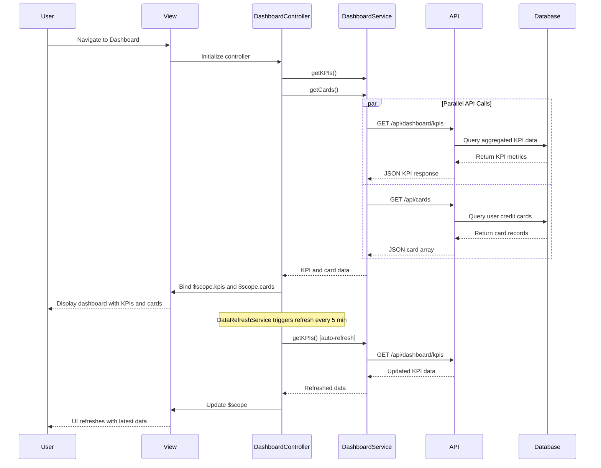

# Low-Level Design: Dashboard KPIs and Credit Card Overview
**Epic ID:** QE-9162  
**Application Stack:** AngularJS 1.x, JavaScript ES6, HTML5, CSS3, Bootstrap, REST APIs, MVC Architecture

---

## a. Architecture Mapping

| HLD Component | AngularJS Artifact | Responsibility |
|---------------|-------------------|----------------|
| Web Application Frontend | Module: `dashboardModule` | Root module for dashboard features |
| Dashboard KPI Display | Controller: `DashboardController` | Manages KPI data and view binding |
| Credit Card Overview Interface | Controller: `CardOverviewController` | Displays multi-card summary |
| Dashboard Service API Integration | Service: `DashboardService` | REST API calls for KPI and card data |
| Data Refresh Logic | Service: `DataRefreshService` | Handles periodic data refresh |
| KPI Card Components | Directive: `kpiCard` | Reusable KPI display widget |

**Recommended Folder Structure:**
```
/app
  /modules
    /dashboard
      /controllers
        - dashboardController.js
        - cardOverviewController.js
      /services
        - dashboardService.js
        - dataRefreshService.js
      /views
        - dashboard.html
        - card-overview.html
      /directives
        - kpiCard.directive.js
        - creditCardSummary.directive.js
  /shared
    /interceptors
      - authInterceptor.js
```

---

## b. Component Specifications

| Component Name | Artifact Type | Responsibility | Key Dependencies |
|----------------|---------------|----------------|------------------|
| `dashboardModule` | Module | Root module for dashboard functionality | `ngRoute`, `ngResource` |
| `DashboardController` | Controller | Fetch and display KPI metrics (spend, limit, available, outstanding) | `DashboardService`, `$scope`, `$interval` |
| `CardOverviewController` | Controller | Display multiple credit card summary | `DashboardService`, `$scope` |
| `DashboardService` | Service | REST API integration for KPI and card data | `$http`, `API_BASE_URL` |
| `DataRefreshService` | Service | Auto-refresh dashboard data at intervals | `$interval`, `DashboardService` |
| `kpiCard` | Directive | Reusable KPI card component with icon and value | `$compile` |
| `creditCardSummary` | Directive | Credit card summary card with limit/balance info | `$compile` |

---

## c. Data Model

**Dashboard KPI Model:**
```javascript
{
  monthlySpend: Number,
  totalCreditLimit: Number,
  availableCredit: Number,
  outstandingAmount: Number,
  lastUpdated: Date (ISO 8601)
}
```

**Credit Card Model:**
```javascript
{
  cardId: String,
  cardName: String,
  last4Digits: String,
  cardType: String, // 'Visa', 'MasterCard', etc.
  creditLimit: Number,
  availableCredit: Number,
  outstandingBalance: Number,
  monthlySpend: Number
}
```

---

## d. Data Flow

User navigates to dashboard → `DashboardController` initializes and calls `DashboardService.getKPIs()` and `DashboardService.getCards()` → Service makes parallel GET requests to `/api/dashboard/kpis` and `/api/cards` → API returns JSON with KPI metrics and card array → Controller binds data to `$scope.kpis` and `$scope.cards` → View renders KPI cards using `kpiCard` directive and card summaries using `creditCardSummary` directive → `DataRefreshService` triggers refresh every 5 minutes via `$interval` → Updated data re-binds to scope and UI updates automatically.

---

## e. Primary Sequence Diagram



---

## f. Implementation Notes

- Use AngularJS `$http` service for REST API calls; implement parallel requests using `$q.all()` for simultaneous KPI and card data fetch.
- Leverage `$interval` service in `DataRefreshService` to auto-refresh data every 5 minutes; cancel interval on scope destroy to prevent memory leaks.
- Implement reusable directives (`kpiCard`, `creditCardSummary`) with isolated scope and two-way binding for dynamic data updates.
- Use Bootstrap grid (col-md-3, col-sm-6, col-xs-12) for responsive KPI card layout across devices.
- Apply AngularJS filters (currency, number) for formatting KPI values in templates.

---

## g. Error Handling

HTTP interceptor-based error handling with try/catch blocks in service methods; display Bootstrap alert for API failures.

---

## h. Security Notes

Requires token-based auth via existing SSO; all API endpoints secured with JWT authentication.

---