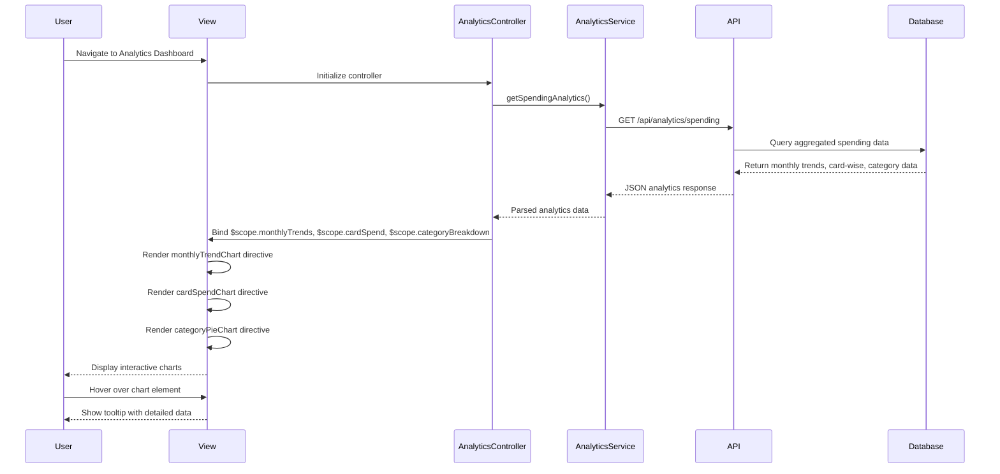

# Low-Level Design: Spending Analytics and Insights
**Epic ID:** QE-9163  
**Application Stack:** AngularJS 1.x, JavaScript ES6, HTML5, CSS3, Bootstrap, REST APIs, MVC Architecture

---

## a. Architecture Mapping

| HLD Component | AngularJS Artifact | Responsibility |
|---------------|-------------------|----------------|
| Web Application Frontend | Module: `analyticsModule` | Root module for analytics features |
| Analytics Dashboard Interface | Controller: `AnalyticsController` | Manages analytics view and chart data |
| Monthly Spend Trend Visualization | Directive: `monthlyTrendChart` | Line chart for monthly spend trends |
| Card-wise Spend Analysis | Directive: `cardSpendChart` | Bar chart for card-wise spending |
| Category-wise Spending Breakdown | Directive: `categoryPieChart` | Pie chart for 9-category breakdown |
| Analytics Service API Integration | Service: `AnalyticsService` | REST API calls for aggregated analytics data |
| Data Aggregation Logic | Service: `DataAggregationService` | Client-side data processing and filtering |

**Recommended Folder Structure:**
```
/app
  /modules
    /analytics
      /controllers
        - analyticsController.js
      /services
        - analyticsService.js
        - dataAggregationService.js
      /views
        - analytics-dashboard.html
      /directives
        - monthlyTrendChart.directive.js
        - cardSpendChart.directive.js
        - categoryPieChart.directive.js
  /shared
    /libs
      - chart.js (or D3.js)
```

---

## b. Component Specifications

| Component Name | Artifact Type | Responsibility | Key Dependencies |
|----------------|---------------|----------------|------------------|
| `analyticsModule` | Module | Root module for analytics and insights | `ngRoute`, `chart.js` or `angular-chart.js` |
| `AnalyticsController` | Controller | Fetch analytics data and manage chart configurations | `AnalyticsService`, `DataAggregationService`, `$scope` |
| `AnalyticsService` | Service | REST API integration for spending analytics | `$http`, `API_BASE_URL` |
| `DataAggregationService` | Service | Client-side aggregation and filtering of spending data | None |
| `monthlyTrendChart` | Directive | Line chart directive for monthly spend trends | `Chart.js`, `$compile` |
| `cardSpendChart` | Directive | Bar chart directive for card-wise spend analysis | `Chart.js`, `$compile` |
| `categoryPieChart` | Directive | Pie chart directive for 9-category spending breakdown | `Chart.js`, `$compile` |

---

## c. Data Model

**Monthly Spend Trend Model:**
```javascript
{
  month: String, // 'YYYY-MM'
  totalSpend: Number
}
```

**Card-wise Spend Model:**
```javascript
{
  cardId: String,
  cardName: String,
  totalSpend: Number
}
```

**Category-wise Spend Model:**
```javascript
{
  category: String, // 'Food & Dining', 'Fuel', 'Shopping', 'Travel', 'Entertainment', 'Utilities', 'Healthcare', 'Education', 'Miscellaneous'
  amount: Number,
  percentage: Number
}
```

**Analytics Response Model:**
```javascript
{
  monthlyTrends: Array<MonthlySpendTrend>,
  cardwiseSpend: Array<CardwiseSpend>,
  categoryBreakdown: Array<CategorywiseSpend>
}
```

---

## d. Data Flow

User navigates to analytics dashboard → `AnalyticsController` initializes and calls `AnalyticsService.getSpendingAnalytics()` → Service makes GET request to `/api/analytics/spending` → API returns JSON with monthly trends, card-wise spend, and category breakdown → Controller processes data using `DataAggregationService` if needed → Data bound to `$scope.monthlyTrends`, `$scope.cardSpend`, `$scope.categoryBreakdown` → View renders three chart directives (`monthlyTrendChart`, `cardSpendChart`, `categoryPieChart`) → Each directive uses Chart.js to render interactive visualizations → User interacts with charts (hover, click) to view detailed insights.

---

## e. Primary Sequence Diagram



---

## f. Implementation Notes

- Use Chart.js library integrated via `angular-chart.js` wrapper for declarative chart rendering in AngularJS templates.
- Implement chart directives with isolated scope accepting data and config objects; use `$watch` to update charts on data changes.
- Leverage `DataAggregationService` for client-side filtering (e.g., date range, card selection) to avoid repeated API calls.
- Apply responsive chart options (`maintainAspectRatio: false`, `responsive: true`) for mobile/tablet compatibility.
- Use AngularJS `ng-if` to conditionally render charts only after data is loaded to prevent rendering errors.

---

## g. Error Handling

HTTP interceptor captures API errors; display user-friendly error message via Bootstrap alert if analytics data fails to load.

---

## h. Security Notes

Standard input validation and secure API calls assumed; analytics endpoints protected by JWT authentication.

---