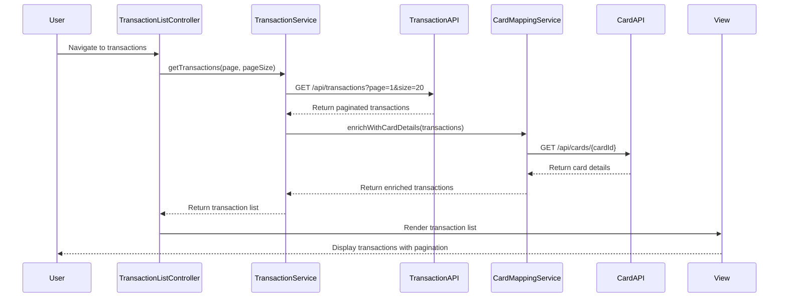

# Low-Level Design: Transaction Management and Monitoring
**Epic ID:** QE-9164

## a. Architecture Mapping

- **TransactionModule** (AngularJS Module) - Main module encapsulating all transaction management functionality
- **TransactionListController** (Controller) - Manages transaction list view, pagination, and user interactions
- **TransactionDetailController** (Controller) - Handles individual transaction detail display
- **TransactionService** (Service) - Interfaces with Transaction Processing Service REST API for data retrieval
- **CardMappingService** (Service) - Interfaces with Credit Card Service REST API to map transactions to cards
- **SearchFilterService** (Factory) - Implements client-side search and filter logic with caching
- **TransactionListDirective** (Directive) - Renders paginated transaction list with responsive layout
- **TransactionDetailDirective** (Directive) - Renders transaction detail view

**Recommended Folder Structure:**
```
/app
  /modules
    /transaction
      /controllers
      /services
      /directives
      /views
      /models
```

## b. Component Specifications

| Component Name | Artifact Type | Responsibility | Key Dependencies |
|----------------|---------------|----------------|------------------|
| TransactionModule | Module | Root module for transaction management feature | ngRoute, ngResource |
| TransactionListController | Controller | Manages list view, pagination state, filter/search triggers | TransactionService, SearchFilterService, $scope |
| TransactionDetailController | Controller | Loads and displays single transaction details | TransactionService, CardMappingService, $routeParams |
| TransactionService | Service | Fetches transaction data from REST API with pagination support | $http, $q |
| CardMappingService | Service | Retrieves card details and maps transactions to cards | $http, $q |
| SearchFilterService | Factory | Applies search/filter criteria, maintains filter state | $filter |
| TransactionListDirective | Directive | Renders transaction table with pagination controls | TransactionListController |
| TransactionDetailDirective | Directive | Renders transaction detail card layout | TransactionDetailController |

## c. Data Model

**Transaction Model:**
```javascript
{
  transactionId: String,
  cardId: String,
  amount: Number,
  currency: String,
  merchantName: String,
  category: String,
  transactionDate: Date,
  status: String,
  description: String
}
```

**Card Model:**
```javascript
{
  cardId: String,
  cardNumber: String (masked),
  cardType: String,
  cardHolderName: String
}
```

**PaginationState Model:**
```javascript
{
  currentPage: Number,
  pageSize: Number,
  totalRecords: Number,
  totalPages: Number
}
```

## d. Data Flow

User navigates to transaction list view → TransactionListController initializes and calls TransactionService.getTransactions(page, pageSize) → TransactionService sends GET request to Transaction Processing Service API → Response returns paginated transaction array → CardMappingService enriches transactions with card details via Credit Card Service API → SearchFilterService applies any active filters client-side → TransactionListDirective renders table with pagination controls → User clicks transaction row → TransactionDetailController loads via $routeParams.transactionId → TransactionDetailDirective displays full transaction details → User applies search/filter → SearchFilterService updates criteria and triggers re-render within 500ms.

## e. Primary Sequence Diagram



## f. Implementation Notes

- Use AngularJS $http service with interceptors for API calls; implement response caching for repeated card detail lookups to optimize performance
- Leverage ES6 Promises ($q service) for asynchronous transaction and card data retrieval with proper error propagation
- Implement client-side pagination state management in controller; server-side pagination via query parameters (page, size)
- Use AngularJS $filter service for client-side search/filter operations to meet 500ms performance requirement
- Apply Bootstrap responsive grid (col-xs, col-sm, col-md) for transaction list and detail views across devices

## g. Error Handling

HTTP interceptor captures API errors (4xx, 5xx) and displays user-friendly notifications via Bootstrap alert components; client-side validation with try/catch blocks.

## h. Security Notes

Requires token-based authentication via existing SSO; all API calls include Authorization header with bearer token.