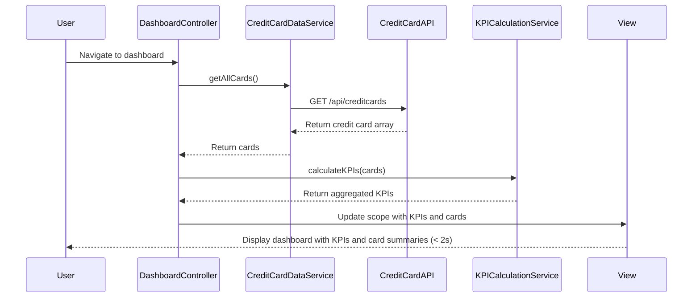

# Low-Level Design: Dashboard KPIs and Credit Card Overview
**Epic ID:** QE-9165

## a. Architecture Mapping

- **DashboardModule** (AngularJS Module) - Main module for dashboard functionality
- **DashboardController** (Controller) - Manages dashboard state and KPI data orchestration
- **CreditCardDataService** (Service) - Interfaces with Credit Card Data Service REST API
- **KPICalculationService** (Factory) - Computes aggregated KPIs (available credit, total limits, outstanding)
- **DashboardKPIDirective** (Directive) - Renders individual KPI cards with responsive layout
- **CardSummaryDirective** (Directive) - Renders credit card summary tiles

**Recommended Folder Structure:**
```
/app
  /modules
    /dashboard
      /controllers
      /services
      /directives
      /views
      /models
```

## b. Component Specifications

| Component Name | Artifact Type | Responsibility | Key Dependencies |
|----------------|---------------|----------------|------------------|
| DashboardModule | Module | Root module for dashboard feature | ngRoute, ngResource |
| DashboardController | Controller | Orchestrates data loading, KPI calculation, and view updates | CreditCardDataService, KPICalculationService, $scope, $timeout |
| CreditCardDataService | Service | Fetches all credit card details, balances, and limits from REST API | $http, $q |
| KPICalculationService | Factory | Aggregates monthly spend, total credit limit, available credit, outstanding amounts | None (pure calculation logic) |
| DashboardKPIDirective | Directive | Renders KPI metric card (label, value, icon) with Bootstrap styling | None |
| CardSummaryDirective | Directive | Renders individual credit card summary tile with key metrics | None |

## c. Data Model

**CreditCard Model:**
```javascript
{
  cardId: String,
  cardNumber: String (masked),
  cardType: String,
  cardHolderName: String,
  creditLimit: Number,
  currentBalance: Number,
  outstandingAmount: Number,
  monthlySpend: Number
}
```

**DashboardKPI Model:**
```javascript
{
  totalCreditLimit: Number,
  totalAvailableCredit: Number,
  totalOutstanding: Number,
  totalMonthlySpend: Number,
  cardCount: Number
}
```

## d. Data Flow

User navigates to dashboard → DashboardController initializes and calls CreditCardDataService.getAllCards() → CreditCardDataService sends GET request to Credit Card Data Service API → API returns array of credit card objects with balances and limits → KPICalculationService.calculateKPIs(cards) computes aggregated metrics (totalCreditLimit = sum of all card limits, totalAvailableCredit = sum of (creditLimit - outstandingAmount) per card, totalOutstanding = sum of all outstanding amounts, totalMonthlySpend = sum of all monthly spends) → DashboardController updates $scope with KPIs and card array → DashboardKPIDirective and CardSummaryDirective render responsive layout with Bootstrap grid → Dashboard loads within 2 seconds.

## e. Primary Sequence Diagram



## f. Implementation Notes

- Use AngularJS $http service with Promise-based API calls; implement response caching with $cacheFactory to optimize repeated dashboard loads
- KPICalculationService uses ES6 Array methods (map, reduce) for efficient aggregation of card-level metrics
- Apply AngularJS Dependency Injection for all services and controllers to ensure testability and modularity
- Use Bootstrap responsive grid (col-xs-12, col-sm-6, col-md-3) for KPI cards to ensure mobile, tablet, and desktop compatibility
- Implement $timeout with 2-second threshold monitoring to ensure NFR compliance; display loading spinner during data fetch

## g. Error Handling

HTTP interceptor-based error handling with user-friendly error messages displayed via Bootstrap alert components; fallback to cached data if available.

## h. Security Notes

Requires token-based auth via existing SSO; all API calls include Authorization header with bearer token.