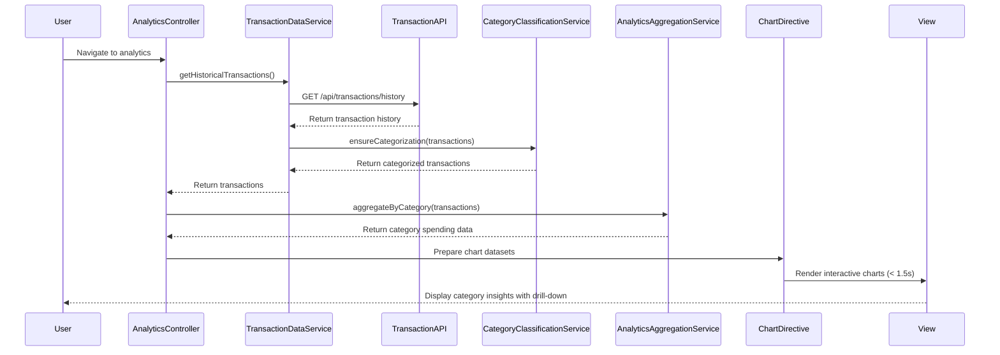

# Low-Level Design: Spending Analytics and Category Insights
**Epic ID:** QE-9166

## a. Architecture Mapping

- **AnalyticsModule** (AngularJS Module) - Main module for analytics functionality
- **AnalyticsController** (Controller) - Manages analytics view state, filter selections, and chart data preparation
- **TransactionDataService** (Service) - Interfaces with Transaction Data Service REST API for historical data
- **CategoryClassificationService** (Service) - Interfaces with Category Classification Engine or applies client-side categorization
- **AnalyticsAggregationService** (Factory) - Aggregates transaction data by category, card, and month
- **ChartVisualizationDirective** (Directive) - Renders interactive charts using Chart.js or D3.js with AngularJS binding
- **CategoryFilterDirective** (Directive) - Renders category filter controls

**Recommended Folder Structure:**
```
/app
  /modules
    /analytics
      /controllers
      /services
      /directives
      /views
      /models
```

## b. Component Specifications

| Component Name | Artifact Type | Responsibility | Key Dependencies |
|----------------|---------------|----------------|------------------|
| AnalyticsModule | Module | Root module for analytics feature | ngRoute, ngResource, chart.js |
| AnalyticsController | Controller | Manages filter state, triggers data aggregation, prepares chart datasets | TransactionDataService, AnalyticsAggregationService, $scope |
| TransactionDataService | Service | Fetches historical transaction data from REST API | $http, $q |
| CategoryClassificationService | Service | Retrieves or applies category classification to transactions | $http, $q |
| AnalyticsAggregationService | Factory | Aggregates spending by category, card, and month; supports drill-down | None (pure aggregation logic) |
| ChartVisualizationDirective | Directive | Renders responsive interactive charts (pie, bar, line) with Chart.js | AnalyticsController, Chart.js library |
| CategoryFilterDirective | Directive | Renders category checkboxes/dropdown for filtering | AnalyticsController |

## c. Data Model

**Transaction Model:**
```javascript
{
  transactionId: String,
  cardId: String,
  amount: Number,
  category: String, // One of 9 predefined categories
  transactionDate: Date,
  merchantName: String
}
```

**CategorySpending Model:**
```javascript
{
  category: String,
  totalAmount: Number,
  transactionCount: Number,
  percentage: Number
}
```

**MonthlyTrend Model:**
```javascript
{
  month: String, // YYYY-MM format
  totalSpend: Number,
  categoryBreakdown: Array<CategorySpending>
}
```

**Categories Enum:**
```javascript
['Food & Dining', 'Fuel', 'Shopping', 'Travel', 'Entertainment', 'Utilities', 'Healthcare', 'Education', 'Miscellaneous']
```

## d. Data Flow

User navigates to analytics view → AnalyticsController initializes and calls TransactionDataService.getHistoricalTransactions() → TransactionDataService sends GET request to Transaction Data Service API → CategoryClassificationService ensures all transactions have category assignments → AnalyticsAggregationService.aggregateByCategory(transactions) computes spending totals per category, card-wise breakdown, and monthly trends using ES6 reduce/map → AnalyticsController prepares chart datasets (labels, data arrays, colors) → ChartVisualizationDirective renders interactive pie chart for category spending, bar chart for card-wise analysis, and line chart for monthly trends using Chart.js → User applies category filter via CategoryFilterDirective → AnalyticsController updates chart data and triggers re-render within 1.5 seconds → User drills down into specific category to view transactions.

## e. Primary Sequence Diagram



## f. Implementation Notes

- Use AngularJS $http service with caching for historical transaction data to optimize repeated analytics loads
- Integrate Chart.js library via AngularJS directive with two-way data binding for responsive, interactive visualizations
- AnalyticsAggregationService uses ES6 Array methods (filter, map, reduce) for efficient client-side aggregation by category, card, and month
- Apply AngularJS $watch on filter selections to trigger chart updates reactively within 1.5-second NFR
- Use Bootstrap responsive grid and Chart.js responsive configuration to ensure charts adapt to desktop, tablet, and mobile viewports

## g. Error Handling

HTTP interceptor captures API errors and displays user-friendly notifications; client-side aggregation errors caught with try/catch and logged.

## h. Security Notes

Requires token-based auth via existing SSO; all API calls include Authorization header with bearer token.