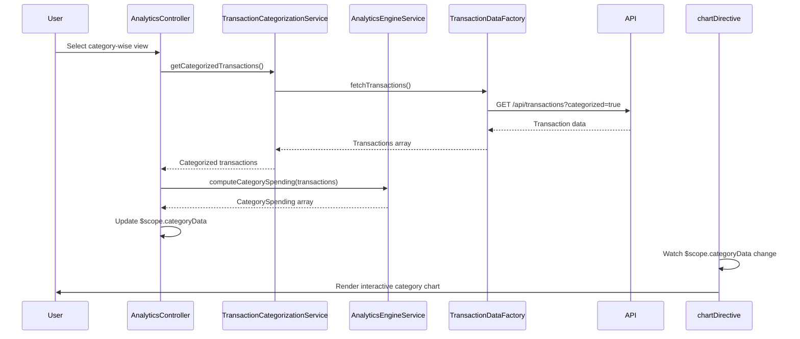

# Low-Level Design: QE-9167 - Analytics and Spending Insights

## a. Architecture Mapping

- **Analytics Module** → AngularJS Module (`app.analytics`)
- **User Interface** → AngularJS Controller (`AnalyticsController`) + HTML5/CSS3 Views
- **Transaction Categorization Service** → AngularJS Service (`TransactionCategorizationService`)
- **Data Analytics Engine** → AngularJS Service (`AnalyticsEngineService`)
- **Visualization Library** → AngularJS Directive (`chartDirective`) integrating Chart.js/D3.js
- **Transaction Data Store** → REST API integration via AngularJS Factory (`TransactionDataFactory`)

**Folder Structure:**
```
/app
  /modules
    /analytics
      analytics.module.js
      analytics.controller.js
      analytics.html
  /services
    transaction-categorization.service.js
    analytics-engine.service.js
  /directives
    chart.directive.js
  /factories
    transaction-data.factory.js
  /assets
    /css
      analytics.css
```

## b. Component Specifications

| Name | Artifact Type | Responsibility | Key Dependencies |
|------|---------------|----------------|------------------|
| AnalyticsModule | Module | Root module for analytics feature | app.core, ngRoute |
| AnalyticsController | Controller | Manages analytics view state and user interactions | AnalyticsEngineService, TransactionCategorizationService, $scope |
| TransactionCategorizationService | Service | Retrieves categorized transactions from API | TransactionDataFactory, $http |
| AnalyticsEngineService | Service | Computes aggregations, trends, and patterns | TransactionDataFactory, $q |
| chartDirective | Directive | Renders interactive charts and graphs | Chart.js/D3.js library, $window |
| TransactionDataFactory | Factory | Handles REST API calls for transaction data | $http, $q, API_CONFIG |

## c. Data Model

**Transaction Object:**
```javascript
{
  id: String,
  cardId: String,
  amount: Number,
  category: String, // One of: Food & Dining, Fuel, Shopping, Travel, Entertainment, Utilities, Healthcare, Education, Miscellaneous
  date: Date,
  description: String,
  merchantName: String
}
```

**CategorySpending Object:**
```javascript
{
  category: String,
  totalAmount: Number,
  transactionCount: Number,
  percentage: Number
}
```

**MonthlyTrend Object:**
```javascript
{
  month: String, // YYYY-MM format
  totalSpend: Number,
  categoryBreakdown: Array<CategorySpending>
}
```

## d. Data Flow

User selects analytics view (category-wise or trend) → AnalyticsController invokes TransactionCategorizationService to fetch categorized transactions via REST API → AnalyticsEngineService processes raw transaction data, computing category aggregations and monthly trends → Computed analytics data is bound to $scope → chartDirective watches scope changes and renders interactive visualizations using Chart.js → User interactions (drill-downs, filters) trigger controller methods that update scope, re-triggering chart rendering.

## e. Primary Sequence Diagram



## f. Implementation Notes

- Use AngularJS 1.x Dependency Injection for all services, controllers, and directives to ensure testability and modularity.
- Implement ES6 classes for services and controllers, transpiled via Babel for browser compatibility.
- Leverage $http interceptors for global error handling and authentication token injection.
- Use Chart.js for responsive, interactive visualizations with custom AngularJS directive wrapper for two-way data binding.
- Apply Bootstrap grid system and utility classes for responsive layout across desktop, tablet, and mobile viewports.

## g. Error Handling

HTTP interceptor captures API errors; user-friendly notifications displayed via Bootstrap alerts; try/catch blocks in analytics computations with fallback to empty state.

## h. Security Notes

Requires token-based auth via existing SSO; all API calls include Authorization header; standard input validation and secure API calls assumed.