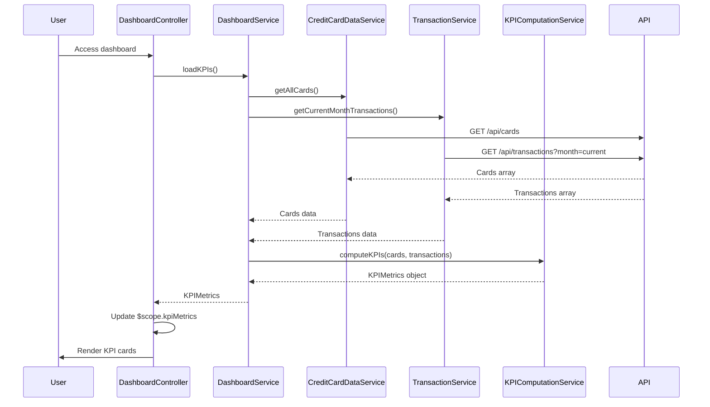

# Low-Level Design: QE-9168 - Dashboard and KPI Management

## a. Architecture Mapping

- **Dashboard Service** → AngularJS Service (`DashboardService`)
- **User Interface** → AngularJS Controller (`DashboardController`) + HTML5/CSS3 Views
- **Credit Card Data Service** → AngularJS Service (`CreditCardDataService`)
- **Transaction Service** → AngularJS Service (`TransactionService`)
- **KPI Computation Engine** → AngularJS Service (`KPIComputationService`)

**Folder Structure:**
```
/app
  /modules
    /dashboard
      dashboard.module.js
      dashboard.controller.js
      dashboard.html
  /services
    dashboard.service.js
    credit-card-data.service.js
    transaction.service.js
    kpi-computation.service.js
  /components
    kpi-card.component.js
    kpi-card.html
  /assets
    /css
      dashboard.css
```

## b. Component Specifications

| Name | Artifact Type | Responsibility | Key Dependencies |
|------|---------------|----------------|------------------|
| DashboardModule | Module | Root module for dashboard feature | app.core, ngRoute |
| DashboardController | Controller | Manages dashboard state and orchestrates KPI display | DashboardService, KPIComputationService, $scope, $interval |
| DashboardService | Service | Coordinates data retrieval from card and transaction services | CreditCardDataService, TransactionService, $q |
| CreditCardDataService | Service | Fetches credit card details and balances via REST API | $http, $q, API_CONFIG |
| TransactionService | Service | Retrieves transaction data for monthly spend calculation | $http, $q, API_CONFIG |
| KPIComputationService | Service | Computes Monthly Spend, Total Credit Limit, Available Credit, Outstanding Amount | None (pure computation) |
| kpiCardComponent | Component | Reusable UI component for displaying individual KPI metrics | None |

## c. Data Model

**CreditCard Object:**
```javascript
{
  id: String,
  cardNumber: String,
  cardType: String,
  creditLimit: Number,
  currentBalance: Number,
  availableCredit: Number,
  outstandingAmount: Number
}
```

**KPIMetrics Object:**
```javascript
{
  monthlySpend: Number,
  totalCreditLimit: Number,
  availableCredit: Number,
  outstandingAmount: Number
}
```

**Transaction Object:**
```javascript
{
  id: String,
  cardId: String,
  amount: Number,
  date: Date,
  status: String // posted, pending
}
```

## d. Data Flow

User accesses dashboard → DashboardController invokes DashboardService.loadKPIs() → DashboardService concurrently calls CreditCardDataService.getAllCards() and TransactionService.getCurrentMonthTransactions() via $q.all() → Both services make REST API calls → KPIComputationService receives card and transaction data, computes Monthly Spend (sum of current month transactions), Total Credit Limit (sum of all card limits), Available Credit (Total Limit - Outstanding), Outstanding Amount (sum of unpaid balances) → Computed KPIs bound to $scope.kpiMetrics → kpiCardComponent renders each KPI with Bootstrap styling → $interval triggers periodic refresh every 5 minutes.

## e. Primary Sequence Diagram



## f. Implementation Notes

- Use AngularJS 1.x with ES6 classes for all services and controllers, ensuring clean separation of concerns.
- Implement $q.all() for parallel API calls to minimize dashboard load time and meet 2-second NFR.
- Use $interval service for periodic data refresh (5-minute intervals) to achieve near-real-time updates.
- Apply Bootstrap 3.x grid system (col-md-3 for KPI cards) for responsive layout across devices.
- Leverage AngularJS component architecture for kpiCardComponent to promote reusability and maintainability.

## g. Error Handling

$http interceptor handles API failures; user notified via Bootstrap alert; failed KPIs display "N/A" with retry option.

## h. Security Notes

Requires token-based auth via existing SSO; all API calls secured with Authorization header; standard input validation and secure API calls assumed.