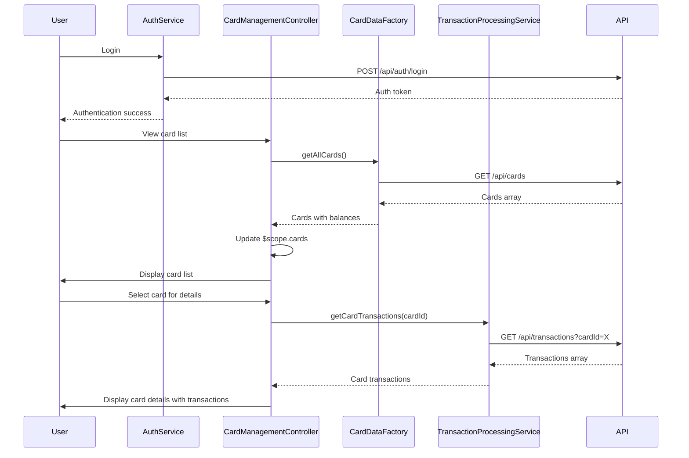

# Low-Level Design: QE-9169 - Credit Card Management and Monitoring

## a. Architecture Mapping

- **Card Management Module** → AngularJS Module (`app.cardManagement`)
- **User Interface** → AngularJS Controller (`CardManagementController`) + HTML5/CSS3 Views
- **Authentication Service** → AngularJS Service (`AuthService`)
- **Card Data Repository** → REST API integration via AngularJS Factory (`CardDataFactory`)
- **Transaction Processing Service** → AngularJS Service (`TransactionProcessingService`)

**Folder Structure:**
```
/app
  /modules
    /card-management
      card-management.module.js
      card-management.controller.js
      card-list.html
      card-detail.html
  /services
    auth.service.js
    transaction-processing.service.js
  /factories
    card-data.factory.js
  /components
    card-item.component.js
    card-item.html
  /assets
    /css
      card-management.css
```

## b. Component Specifications

| Name | Artifact Type | Responsibility | Key Dependencies |
|------|---------------|----------------|------------------|
| CardManagementModule | Module | Root module for card management feature | app.core, ngRoute, ui.router |
| CardManagementController | Controller | Manages card list and detail views, handles user interactions | CardDataFactory, TransactionProcessingService, AuthService, $scope, $state |
| AuthService | Service | Validates user authentication and manages session | $http, $window, AUTH_CONFIG |
| CardDataFactory | Factory | Handles REST API calls for card CRUD operations | $http, $q, API_CONFIG |
| TransactionProcessingService | Service | Retrieves and processes card-specific transaction history | $http, $q, API_CONFIG |
| cardItemComponent | Component | Reusable UI component for displaying individual card summary | None |

## c. Data Model

**CreditCard Object:**
```javascript
{
  id: String,
  userId: String,
  cardNumber: String, // masked format: XXXX-XXXX-XXXX-1234
  cardType: String, // Visa, MasterCard, Amex
  cardHolderName: String,
  expiryDate: String, // MM/YY
  creditLimit: Number,
  currentBalance: Number,
  availableCredit: Number,
  outstandingAmount: Number,
  utilizationPercentage: Number
}
```

**Transaction Object:**
```javascript
{
  id: String,
  cardId: String,
  amount: Number,
  date: Date,
  merchantName: String,
  category: String,
  status: String // posted, pending, declined
}
```

**CardUtilization Object:**
```javascript
{
  cardId: String,
  utilizationPercentage: Number,
  spendThisMonth: Number,
  transactionCount: Number
}
```

## d. Data Flow

User authenticates via AuthService → CardManagementController invokes CardDataFactory.getAllCards() → REST API returns array of credit cards → Controller binds cards to $scope.cards → cardItemComponent renders each card with utilization metrics → User selects card for details → $state.go('card-detail', {cardId}) transitions to detail view → CardManagementController fetches card-specific transactions via TransactionProcessingService.getCardTransactions(cardId) → Transaction history displayed with filtering and sorting options → User can view card-wise spend analysis and balance tracking.

## e. Primary Sequence Diagram



## f. Implementation Notes

- Use AngularJS 1.x with ui-router for state-based navigation between card list and detail views.
- Implement ES6 classes for services and controllers with Babel transpilation for browser support.
- Apply $http interceptor for automatic injection of Authorization token from AuthService.
- Use Bootstrap cards and tables for responsive card list and transaction history display.
- Implement client-side filtering and sorting using AngularJS filters for transaction history (no server round-trip).

## g. Error Handling

$http interceptor captures authentication and API errors; Bootstrap modals display user-friendly error messages; retry mechanism for failed API calls.

## h. Security Notes

Requires token-based auth via existing SSO; card numbers masked on client-side; encryption at rest and in transit enforced; standard input validation and secure API calls assumed.