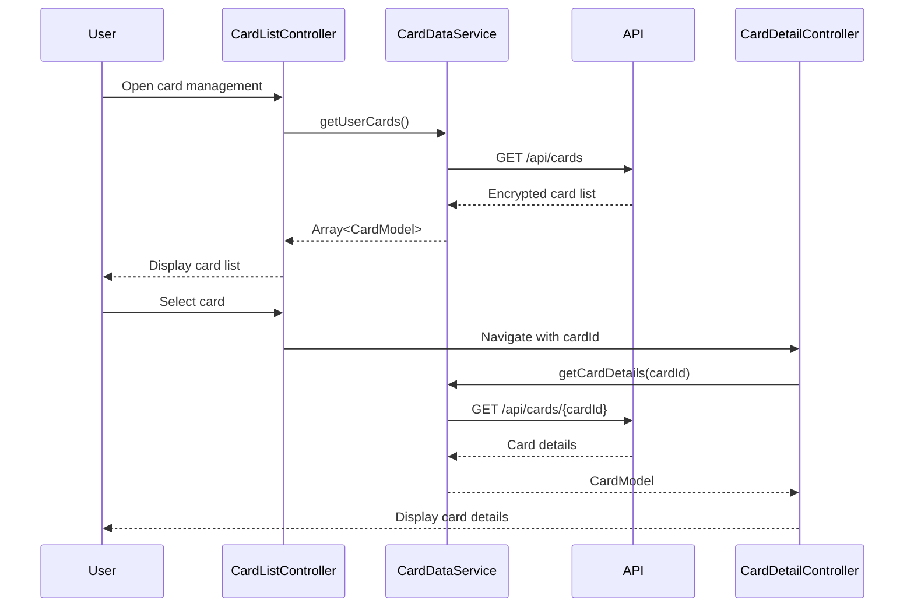

# Low-Level Design: Multiple Credit Card Management
**Epic ID:** QE-9170

## a. Architecture Mapping

- **cardManagementModule** (AngularJS Module) - Root module for card management feature
- **CardListController** (Controller) - Manages card list display and selection
- **CardDetailController** (Controller) - Handles individual card detail view
- **CardDataService** (Service) - Fetches card data from REST API
- **UserProfileService** (Service) - Validates card ownership
- **cardListDirective** (Directive) - Renders card list with switching capability
- **cardDetailDirective** (Directive) - Displays individual card details

**Folder Structure:**
```
/app
  /modules
    /card-management
      /controllers
      /services
      /directives
      /views
      /models
```

## b. Component Specifications

| Name | Artifact Type | Responsibility | Key Dependencies |
|------|---------------|----------------|------------------|
| cardManagementModule | Module | Bootstraps card management feature | ngRoute, ngResource |
| CardListController | Controller | Manages card list state and selection logic | CardDataService, $scope |
| CardDetailController | Controller | Manages single card detail view and comparison | CardDataService, $routeParams, $scope |
| CardDataService | Service | REST API calls for card data retrieval | $http, $q, API_CONFIG |
| UserProfileService | Service | Validates user-card associations | $http, AuthService |
| cardListDirective | Directive | Renders card list with fast switching UI | CardDataService |
| cardDetailDirective | Directive | Displays masked card number, limits, balances | - |
| CardModel | Factory | Card data model with validation | - |

## c. Data Model

**CardModel:**
```javascript
{
  cardId: String,
  cardNumberMasked: String,  // Last 4 digits only
  cardType: String,          // Visa, MasterCard, etc.
  creditLimit: Number,
  outstandingBalance: Number,
  availableCredit: Number,   // Calculated: creditLimit - outstandingBalance
  status: String,            // Active, Blocked, Expired
  expiryDate: String,
  cardHolderName: String
}
```

**UserCardList:**
```javascript
{
  userId: String,
  cards: Array<CardModel>,
  selectedCardId: String
}
```

## d. Data Flow

User opens card management view → CardListController initializes and calls CardDataService.getUserCards() → Service makes GET /api/cards REST call → UserProfileService validates ownership → API returns encrypted card list → Service decrypts and maps to CardModel array → Controller updates $scope.cards → cardListDirective renders card tiles → User clicks card → Client-side navigation updates selectedCardId → CardDetailController fetches detailed data via CardDataService.getCardDetails(cardId) (cached, <500ms) → cardDetailDirective displays full card information with comparison metrics.

## e. Primary Sequence Diagram



## f. Implementation Notes

- Use AngularJS $http service with interceptors for API calls; implement response caching for sub-500ms card switching
- Apply AngularJS Dependency Injection for all services and controllers; use ES6 classes for service definitions
- Implement client-side card selection state management; server-side fetch only for detailed data
- Use Bootstrap grid for responsive card tiles; CSS3 animations for smooth card switching transitions
- REST API endpoints: GET /api/cards (list), GET /api/cards/{id} (details); token-based auth via headers

## g. Error Handling

HTTP interceptor captures API errors; display user-friendly notifications via toastr; retry logic for network failures with exponential backoff.

## h. Security Notes

Requires token-based auth via existing SSO; card numbers always masked (last 4 digits); encrypted data transmission over HTTPS.