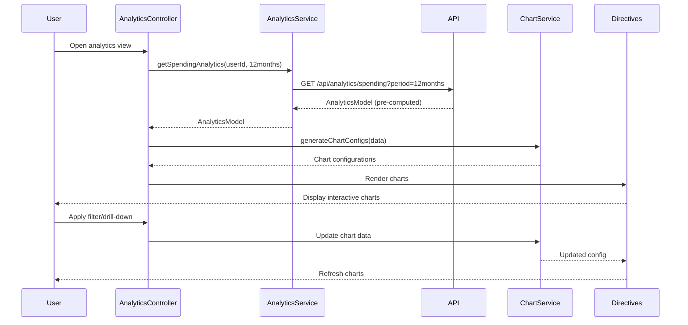

# Low-Level Design: Spending Analytics and Transaction Insights
**Epic ID:** QE-9171

## a. Architecture Mapping

- **analyticsModule** (AngularJS Module) - Root module for analytics feature
- **AnalyticsController** (Controller) - Manages analytics view and filters
- **AnalyticsService** (Service) - Fetches transaction and analytics data from REST API
- **ChartService** (Service) - Generates chart configurations for visualization libraries
- **categoryChartDirective** (Directive) - Renders category-wise pie chart
- **trendChartDirective** (Directive) - Renders monthly trend line chart
- **cardSpendChartDirective** (Directive) - Renders card-wise bar chart

**Folder Structure:**
```
/app
  /modules
    /analytics
      /controllers
      /services
      /directives
      /views
      /models
```

## b. Component Specifications

| Name | Artifact Type | Responsibility | Key Dependencies |
|------|---------------|----------------|------------------|
| analyticsModule | Module | Bootstraps analytics feature | ngRoute, chart.js |
| AnalyticsController | Controller | Manages analytics state, filters, and drill-down | AnalyticsService, ChartService, $scope |
| AnalyticsService | Service | REST API calls for transaction and analytics data | $http, $q, API_CONFIG |
| ChartService | Service | Transforms analytics data into chart configurations | - |
| categoryChartDirective | Directive | Renders interactive pie chart for 9 categories | ChartService, chart.js |
| trendChartDirective | Directive | Renders line chart for monthly spend trends | ChartService, chart.js |
| cardSpendChartDirective | Directive | Renders bar chart for card-wise comparison | ChartService, chart.js |
| TransactionModel | Factory | Transaction data model | - |
| AnalyticsModel | Factory | Aggregated analytics data model | - |

## c. Data Model

**TransactionModel:**
```javascript
{
  transactionId: String,
  cardId: String,
  amount: Number,
  category: String,  // One of 9 predefined categories
  merchantName: String,
  transactionDate: Date,
  description: String
}
```

**AnalyticsModel:**
```javascript
{
  userId: String,
  period: String,  // Month/Year
  categorySpend: {
    "Food & Dining": Number,
    "Fuel": Number,
    "Shopping": Number,
    "Travel": Number,
    "Entertainment": Number,
    "Utilities": Number,
    "Healthcare": Number,
    "Education": Number,
    "Miscellaneous": Number
  },
  monthlyTrend: Array<{month: String, totalSpend: Number}>,
  cardWiseSpend: Array<{cardId: String, totalSpend: Number}>
}
```

## d. Data Flow

User navigates to analytics view → AnalyticsController calls AnalyticsService.getSpendingAnalytics(userId, period) → Service makes GET /api/analytics/spending REST call with 12-month filter → API retrieves transactions from Transaction Database → Categorization Engine classifies transactions → Analytics Processing Service aggregates data (category totals, monthly trends, card breakdown) → API returns pre-computed AnalyticsModel → Controller passes data to ChartService → ChartService generates chart configurations → categoryChartDirective, trendChartDirective, cardSpendChartDirective render interactive charts → User applies filters or drills down → Controller updates chart data dynamically without API call.

## e. Primary Sequence Diagram



## f. Implementation Notes

- Use Chart.js library integrated via AngularJS directives for interactive visualizations; implement drill-down via click event handlers
- AnalyticsService caches pre-computed analytics data; refresh daily or on-demand via cache invalidation
- Apply AngularJS filters for client-side data filtering (date range, card selection); no server round-trip for UI interactions
- Use Bootstrap responsive grid for chart layout; CSS3 for smooth transitions during filter updates
- REST API endpoints: GET /api/analytics/spending (aggregated data), GET /api/transactions (raw data if needed)

## g. Error Handling

HTTP interceptor with try/catch blocks; display error toasts for API failures; graceful degradation with "No data available" message if analytics unavailable.

## h. Security Notes

Standard input validation and secure API calls assumed; token-based authentication for all API requests.