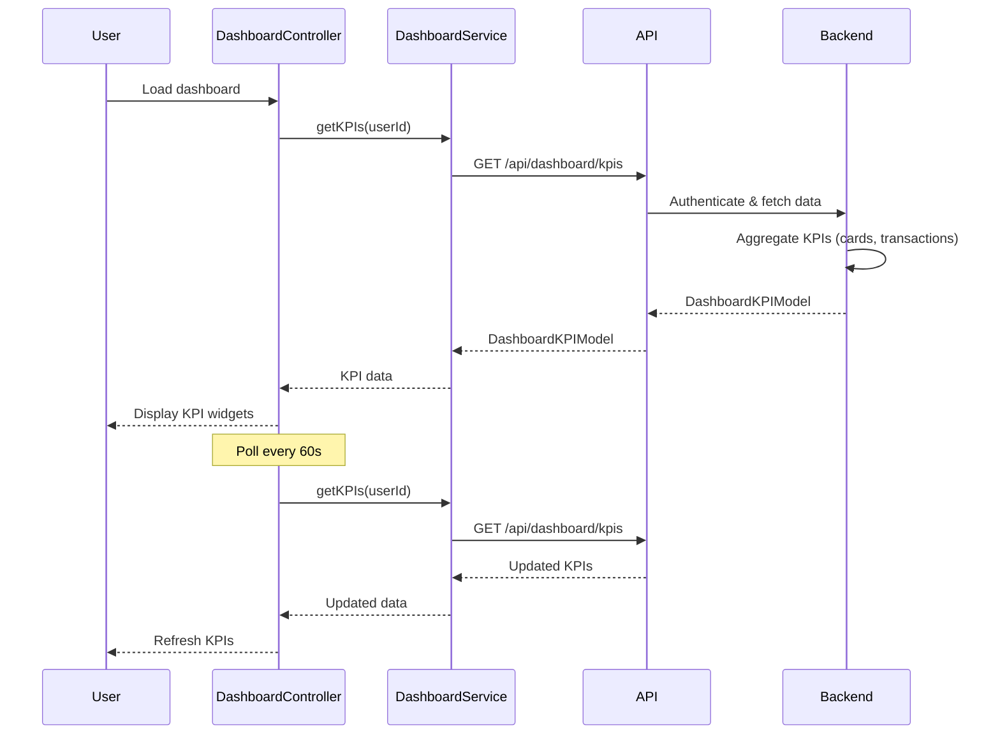

# Low-Level Design: Dashboard KPIs and Credit Card Overview
**Epic ID:** QE-9172

## a. Architecture Mapping

- **dashboardModule** (AngularJS Module) - Root module for dashboard feature
- **DashboardController** (Controller) - Manages dashboard state and KPI aggregation
- **DashboardService** (Service) - Fetches aggregated KPI data from REST API
- **CardDataService** (Service) - Retrieves credit card details
- **TransactionService** (Service) - Fetches monthly spend data
- **kpiWidgetDirective** (Directive) - Renders individual KPI widget
- **dashboardSummaryDirective** (Directive) - Renders consolidated dashboard view

**Folder Structure:**
```
/app
  /modules
    /dashboard
      /controllers
      /services
      /directives
      /views
      /models
```

## b. Component Specifications

| Name | Artifact Type | Responsibility | Key Dependencies |
|------|---------------|----------------|------------------|
| dashboardModule | Module | Bootstraps dashboard feature | ngRoute, ngResource |
| DashboardController | Controller | Aggregates and manages KPI data display | DashboardService, $scope, $interval |
| DashboardService | Service | REST API calls for KPI data | $http, $q, API_CONFIG |
| CardDataService | Service | Fetches credit card limits and balances | $http |
| TransactionService | Service | Fetches monthly spend calculations | $http |
| kpiWidgetDirective | Directive | Renders single KPI tile (spend, limit, available, outstanding) | - |
| dashboardSummaryDirective | Directive | Renders consolidated multi-card dashboard | DashboardService |
| DashboardKPIModel | Factory | KPI data model with aggregation logic | - |

## c. Data Model

**DashboardKPIModel:**
```javascript
{
  userId: String,
  totalCreditLimit: Number,
  totalOutstanding: Number,
  totalAvailableCredit: Number,  // Calculated: totalCreditLimit - totalOutstanding
  monthlySpend: Number,
  lastUpdated: Date,
  cards: Array<{
    cardId: String,
    creditLimit: Number,
    outstanding: Number,
    availableCredit: Number
  }>
}
```

## d. Data Flow

User logs in and lands on dashboard → DashboardController initializes and calls DashboardService.getKPIs(userId) → Service makes GET /api/dashboard/kpis REST call → API Gateway authenticates via User Authentication Service → Dashboard Service backend fetches card list from Credit Card Data Service → Retrieves balances and limits from Database → Fetches monthly spend from Transaction Processing System → Aggregates metrics server-side (sum of limits, sum of outstanding, calculation of available credit) → Returns DashboardKPIModel to client → Controller updates $scope.kpis → dashboardSummaryDirective renders responsive KPI widgets → $interval polls API every 60 seconds for real-time refresh → UI updates dynamically.

## e. Primary Sequence Diagram



## f. Implementation Notes

- Use AngularJS $interval for 60-second polling to achieve real-time refresh; implement $scope.$on('$destroy') to cancel interval on route change
- Server-side KPI aggregation ensures data accuracy; client only displays pre-calculated values
- Apply AngularJS Dependency Injection for services; use ES6 arrow functions and template literals for cleaner code
- Bootstrap grid with responsive breakpoints for mobile/desktop; CSS3 flexbox for KPI widget layout
- REST API endpoint: GET /api/dashboard/kpis (returns aggregated DashboardKPIModel); token in Authorization header

## g. Error Handling

HTTP interceptor captures API errors; display error notification via AngularJS toastr; retry failed requests with exponential backoff.

## h. Security Notes

Requires token-based auth via existing SSO; all financial calculations performed server-side to prevent client-side tampering.