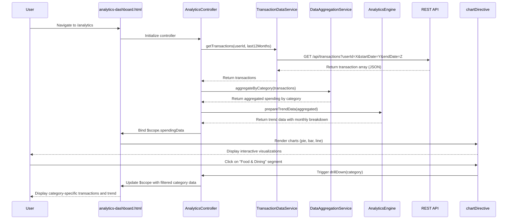

# Low-Level Design: QE-9173 - Spending Analytics and Category Insights

## a. Architecture Mapping

**HLD Component → AngularJS Artifact Mapping:**
- User Interface Analytics Dashboard → AngularJS Module (`analyticsModule`) + View Template (`analytics-dashboard.html`)
- Analytics Controller → AngularJS Controller (`AnalyticsController`)
- Transaction Data Service → AngularJS Service (`TransactionDataService`)
- Data Aggregation Service → AngularJS Service (`DataAggregationService`)
- Analytics Engine → AngularJS Factory (`AnalyticsEngine`)
- Visualization Library → Third-party Directive Integration (Chart.js/D3.js via `chartDirective`)

**Recommended Folder Structure:**
```
app/
├── modules/
│   └── analytics/
│       ├── analytics.module.js
│       ├── controllers/
│       │   └── analytics.controller.js
│       ├── services/
│       │   ├── transaction-data.service.js
│       │   └── data-aggregation.service.js
│       ├── factories/
│       │   └── analytics-engine.factory.js
│       ├── directives/
│       │   └── chart.directive.js
│       └── views/
│           └── analytics-dashboard.html
└── assets/
    └── css/
        └── analytics.css
```

---

## b. Component Specifications

| Component Name | Artifact Type | Responsibility | Key Dependencies |
|----------------|---------------|----------------|------------------|
| `analyticsModule` | Module | Registers all analytics components and configures routing to `/analytics` | `ngRoute`, `chart.js` |
| `AnalyticsController` | Controller | Manages analytics dashboard state, fetches aggregated data, handles user interactions (filter, drill-down) | `TransactionDataService`, `DataAggregationService`, `AnalyticsEngine`, `$scope` |
| `TransactionDataService` | Service | Fetches raw transaction data from REST API (`/api/transactions`) with date range and user filters | `$http`, `$q` |
| `DataAggregationService` | Service | Aggregates transactions by category and month, calculates totals and percentages | `TransactionDataService` |
| `AnalyticsEngine` | Factory | Performs trend analysis, pattern recognition, and prepares data for visualization | None |
| `chartDirective` | Directive | Wraps Chart.js to render interactive pie/bar/line charts with drill-down capability | `AnalyticsEngine`, Chart.js library |
| `analytics-dashboard.html` | View | Displays category filters, date range selector, and chart containers with responsive Bootstrap grid | Bootstrap CSS |

---

## c. Data Model

**Transaction Model:**
```javascript
class Transaction {
  constructor() {
    this.id = '';                // String - Unique transaction ID
    this.userId = '';            // String - User identifier
    this.cardId = '';            // String - Credit card identifier
    this.amount = 0.0;           // Number - Transaction amount
    this.category = '';          // String - One of 9 predefined categories
    this.date = null;            // Date - Transaction date
    this.description = '';       // String - Transaction description
  }
}
```

**Aggregated Spending Model:**
```javascript
class AggregatedSpending {
  constructor() {
    this.category = '';          // String - Category name
    this.totalAmount = 0.0;      // Number - Total spent in category
    this.percentage = 0.0;       // Number - Percentage of total spend
    this.transactionCount = 0;   // Number - Count of transactions
    this.monthlyTrend = [];      // Array<{month: String, amount: Number}>
  }
}
```

**Categories Enum:**
```javascript
const SPENDING_CATEGORIES = [
  'Food & Dining', 'Fuel', 'Shopping', 'Travel', 'Entertainment',
  'Utilities', 'Healthcare', 'Education', 'Miscellaneous'
];
```

---

## d. Data Flow

User navigates to `/analytics` route → `AnalyticsController` initializes and calls `TransactionDataService.getTransactions(userId, dateRange)` → Service makes GET request to `/api/transactions?userId={id}&startDate={start}&endDate={end}` → Raw transaction array returned → `DataAggregationService.aggregateByCategory(transactions)` groups and sums by category → `AnalyticsEngine.prepareTrendData(aggregated)` calculates monthly trends and percentages → Controller binds aggregated data to `$scope.spendingData` → `chartDirective` watches scope and renders interactive Chart.js visualizations → User clicks chart segment to drill down → Controller filters transactions by selected category and updates view → UI displays filtered category details with updated chart.

---

## e. Primary Sequence Diagram



---

## f. Implementation Notes

- **MVC Pattern:** Use AngularJS MVC with controller managing business logic, services handling API calls, and directives for reusable chart components.
- **Dependency Injection:** Inject all services and factories via AngularJS DI (`$inject` annotation or inline array syntax for minification safety).
- **API Integration:** Use `$http` service with promise-based error handling; implement response transformation for date parsing.
- **Caching Strategy:** Leverage `$http` cache or implement custom cache in `TransactionDataService` to avoid redundant API calls within session.
- **Chart Interactivity:** Bind Chart.js click events to controller methods via directive scope for drill-down functionality; use `$scope.$apply()` if needed.

---

## g. Error Handling

HTTP interceptor captures API errors; controller displays user-friendly error messages via Bootstrap alerts; failed requests retry once with exponential backoff.

---

## h. Security Notes

Requires token-based authentication via existing SSO; all API calls include JWT in Authorization header; input validation on date ranges to prevent injection attacks.