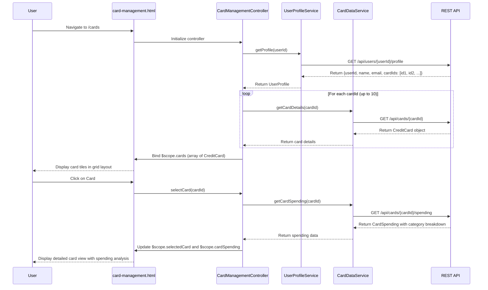

# Low-Level Design: QE-9174 - Multiple Credit Card Management

## a. Architecture Mapping

**HLD Component → AngularJS Artifact Mapping:**
- User Interface → AngularJS Module (`cardManagementModule`) + View Template (`card-management.html`)
- Card Management Controller → AngularJS Controller (`CardManagementController`)
- User Profile Service → AngularJS Service (`UserProfileService`)
- Credit Card Data Repository → Backend REST API (accessed via `CardDataService`)
- Card Information Service → AngularJS Service (`CardDataService`)

**Recommended Folder Structure:**
```
app/
├── modules/
│   └── card-management/
│       ├── card-management.module.js
│       ├── controllers/
│       │   └── card-management.controller.js
│       ├── services/
│       │   ├── user-profile.service.js
│       │   └── card-data.service.js
│       ├── directives/
│       │   └── card-tile.directive.js
│       └── views/
│           ├── card-management.html
│           └── card-detail.html
└── assets/
    └── css/
        └── card-management.css
```

---

## b. Component Specifications

| Component Name | Artifact Type | Responsibility | Key Dependencies |
|----------------|---------------|----------------|------------------|
| `cardManagementModule` | Module | Registers card management components and configures routing to `/cards` | `ngRoute` |
| `CardManagementController` | Controller | Manages card list state, handles card selection/switching, fetches card details and spending data | `UserProfileService`, `CardDataService`, `$scope`, `$routeParams` |
| `UserProfileService` | Service | Fetches user profile and associated card IDs from `/api/users/{userId}/profile` | `$http`, `$q` |
| `CardDataService` | Service | Retrieves card details, limits, balances, and spending analysis from `/api/cards/{cardId}` and `/api/cards` | `$http`, `$q`, `$cacheFactory` |
| `cardTileDirective` | Directive | Renders individual card tile with card number (masked), limit, balance, and click handler for selection | `CardDataService` |
| `card-management.html` | View | Displays grid of card tiles using Bootstrap responsive layout with card selection state | Bootstrap CSS |
| `card-detail.html` | View | Shows detailed view of selected card including spending breakdown and transaction history | Bootstrap CSS |

---

## c. Data Model

**CreditCard Model:**
```javascript
class CreditCard {
  constructor() {
    this.cardId = '';              // String - Unique card identifier
    this.userId = '';              // String - Owner user ID
    this.cardNumber = '';          // String - Masked card number (e.g., "**** **** **** 1234")
    this.cardType = '';            // String - Visa, MasterCard, Amex, etc.
    this.cardHolderName = '';      // String - Name on card
    this.expiryDate = '';          // String - MM/YY format
    this.creditLimit = 0.0;        // Number - Total credit limit
    this.availableCredit = 0.0;    // Number - Remaining available credit
    this.outstandingBalance = 0.0; // Number - Current outstanding amount
    this.monthlySpend = 0.0;       // Number - Current month spending
    this.isActive = true;          // Boolean - Card active status
  }
}
```

**UserProfile Model:**
```javascript
class UserProfile {
  constructor() {
    this.userId = '';              // String - User identifier
    this.name = '';                // String - User full name
    this.email = '';               // String - User email
    this.cardIds = [];             // Array<String> - Associated card IDs (max 10)
  }
}
```

**CardSpending Model:**
```javascript
class CardSpending {
  constructor() {
    this.cardId = '';              // String - Card identifier
    this.totalSpend = 0.0;         // Number - Total spending on card
    this.categoryBreakdown = [];   // Array<{category: String, amount: Number}>
  }
}
```

---

## d. Data Flow

User navigates to `/cards` route → `CardManagementController` initializes and calls `UserProfileService.getProfile(userId)` → Service fetches user profile with associated `cardIds` array from `/api/users/{userId}/profile` → Controller iterates through `cardIds` and calls `CardDataService.getCardDetails(cardId)` for each (parallel requests) → Service retrieves card details from `/api/cards/{cardId}` with <500ms latency per card → Controller binds array of `CreditCard` objects to `$scope.cards` → View renders card tiles via `ng-repeat` and `cardTileDirective` → User clicks on a card tile → Controller updates `$scope.selectedCard` and fetches detailed spending via `CardDataService.getCardSpending(cardId)` → Service calls `/api/cards/{cardId}/spending` → Controller binds spending data to scope → View displays detailed card information and spending breakdown.

---

## e. Primary Sequence Diagram



---

## f. Implementation Notes

- **MVC Pattern:** Controller orchestrates data flow between services and view; services encapsulate all API communication with promise-based responses.
- **Dependency Injection:** Use explicit `$inject` annotations for all controllers and services to ensure minification compatibility.
- **API Integration:** Implement parallel card detail fetching using `$q.all()` to meet <500ms latency requirement; use `$http` with caching enabled for repeated requests.
- **Card Security:** Always display masked card numbers in UI; never expose full card numbers in client-side code or logs.
- **Responsive Design:** Use Bootstrap grid system (`col-md-4`, `col-sm-6`, `col-xs-12`) for card tiles to support mobile and desktop layouts.

---

## g. Error Handling

HTTP interceptor handles API failures; controller displays inline error messages for failed card loads; retry logic implemented for transient network errors.

---

## h. Security Notes

Requires token-based auth via existing SSO; card data encrypted in transit (HTTPS); masked card numbers only displayed; secure storage assumed at API layer.