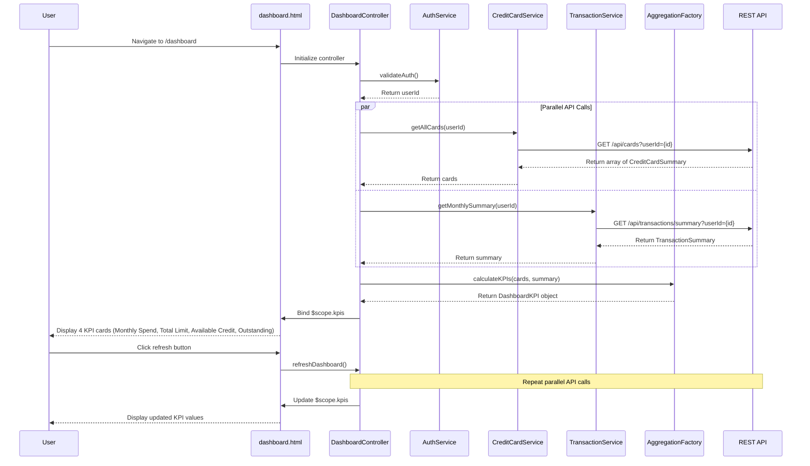

# Low-Level Design: QE-9175 - Dashboard KPIs and Financial Overview

## a. Architecture Mapping

**HLD Component → AngularJS Artifact Mapping:**
- User Interface Dashboard → AngularJS Module (`dashboardModule`) + View Template (`dashboard.html`)
- Authentication Service → Existing SSO Service (integrated via `AuthService`)
- Dashboard Controller → AngularJS Controller (`DashboardController`)
- Credit Card Data Service → AngularJS Service (`CreditCardService`)
- Transaction Processing System → Backend REST API (accessed via `TransactionService`)
- Data Aggregation Engine → AngularJS Factory (`AggregationFactory`)

**Recommended Folder Structure:**
```
app/
├── modules/
│   └── dashboard/
│       ├── dashboard.module.js
│       ├── controllers/
│       │   └── dashboard.controller.js
│       ├── services/
│       │   ├── credit-card.service.js
│       │   └── transaction.service.js
│       ├── factories/
│       │   └── aggregation.factory.js
│       ├── directives/
│       │   └── kpi-card.directive.js
│       └── views/
│           └── dashboard.html
└── assets/
    └── css/
        └── dashboard.css
```

---

## b. Component Specifications

| Component Name | Artifact Type | Responsibility | Key Dependencies |
|----------------|---------------|----------------|------------------|
| `dashboardModule` | Module | Registers dashboard components and configures routing to `/dashboard` | `ngRoute`, `authModule` |
| `DashboardController` | Controller | Orchestrates KPI data fetching, aggregation, and binding to view; manages dashboard state and refresh | `CreditCardService`, `TransactionService`, `AggregationFactory`, `AuthService`, `$scope`, `$interval` |
| `AuthService` | Service | Validates user authentication status and retrieves authenticated user ID | `$http`, `$window` (for token storage) |
| `CreditCardService` | Service | Fetches all user credit cards and their limits/balances from `/api/cards?userId={id}` | `$http`, `$q` |
| `TransactionService` | Service | Retrieves monthly transactions and outstanding amounts from `/api/transactions/summary?userId={id}` | `$http`, `$q` |
| `AggregationFactory` | Factory | Aggregates card data to calculate total credit limit, available credit, monthly spend, and outstanding amount | None |
| `kpiCardDirective` | Directive | Renders individual KPI metric card with icon, label, value, and optional trend indicator | None |
| `dashboard.html` | View | Displays 4 KPI cards in responsive Bootstrap grid layout with refresh button | Bootstrap CSS |

---

## c. Data Model

**DashboardKPI Model:**
```javascript
class DashboardKPI {
  constructor() {
    this.monthlySpend = 0.0;        // Number - Total spending in current month
    this.totalCreditLimit = 0.0;    // Number - Sum of all card credit limits
    this.availableCredit = 0.0;     // Number - Sum of available credit across cards
    this.outstandingAmount = 0.0;   // Number - Total outstanding balance
    this.lastUpdated = null;        // Date - Last data refresh timestamp
  }
}
```

**CreditCardSummary Model:**
```javascript
class CreditCardSummary {
  constructor() {
    this.cardId = '';               // String - Card identifier
    this.creditLimit = 0.0;         // Number - Card credit limit
    this.availableCredit = 0.0;     // Number - Available credit on card
    this.outstandingBalance = 0.0;  // Number - Outstanding balance
  }
}
```

**TransactionSummary Model:**
```javascript
class TransactionSummary {
  constructor() {
    this.userId = '';               // String - User identifier
    this.monthlySpend = 0.0;        // Number - Current month total spending
    this.totalOutstanding = 0.0;    // Number - Total outstanding across all cards
  }
}
```

---

## d. Data Flow

User navigates to `/dashboard` route → `AuthService` validates authentication and retrieves `userId` → `DashboardController` initializes and calls `CreditCardService.getAllCards(userId)` and `TransactionService.getMonthlySummary(userId)` in parallel → Services make GET requests to `/api/cards?userId={id}` and `/api/transactions/summary?userId={id}` respectively → Both services return data within 2-second combined load time (leveraging cached aggregated data from backend) → `AggregationFactory.calculateKPIs(cards, transactions)` computes total credit limit (sum of all card limits), available credit (sum of available on each card), monthly spend (from transaction summary), and outstanding amount (sum of balances) → Controller binds `DashboardKPI` object to `$scope.kpis` → View renders 4 KPI cards via `kpiCardDirective` using `ng-repeat` → Controller sets up `$interval` to auto-refresh data every 5 minutes → User clicks refresh button → Controller re-fetches data and updates view.

---

## e. Primary Sequence Diagram



---

## f. Implementation Notes

- **MVC Pattern:** Controller manages orchestration and state; services handle all API interactions; factory performs pure calculation logic for KPI aggregation.
- **Dependency Injection:** Use AngularJS DI with explicit `$inject` array notation for minification safety across all controllers, services, and factories.
- **API Integration:** Use `$q.all()` to parallelize card and transaction API calls for faster load time; implement `$http` caching with 5-minute TTL to reduce backend load.
- **Responsive Design:** Use Bootstrap grid (`col-lg-3`, `col-md-6`, `col-sm-6`, `col-xs-12`) for KPI cards to ensure mobile-first responsive layout.
- **Real-time Refresh:** Implement `$interval` service for periodic data refresh (every 5 minutes) to maintain "real-time" visibility without overwhelming the backend.

---

## g. Error Handling

HTTP interceptor captures API errors globally; controller displays user-friendly error banner using Bootstrap alerts; failed requests retry once with 2-second delay.

---

## h. Security Notes

Requires token-based auth via existing SSO; JWT token included in Authorization header for all API calls; standard input validation and secure API calls assumed.