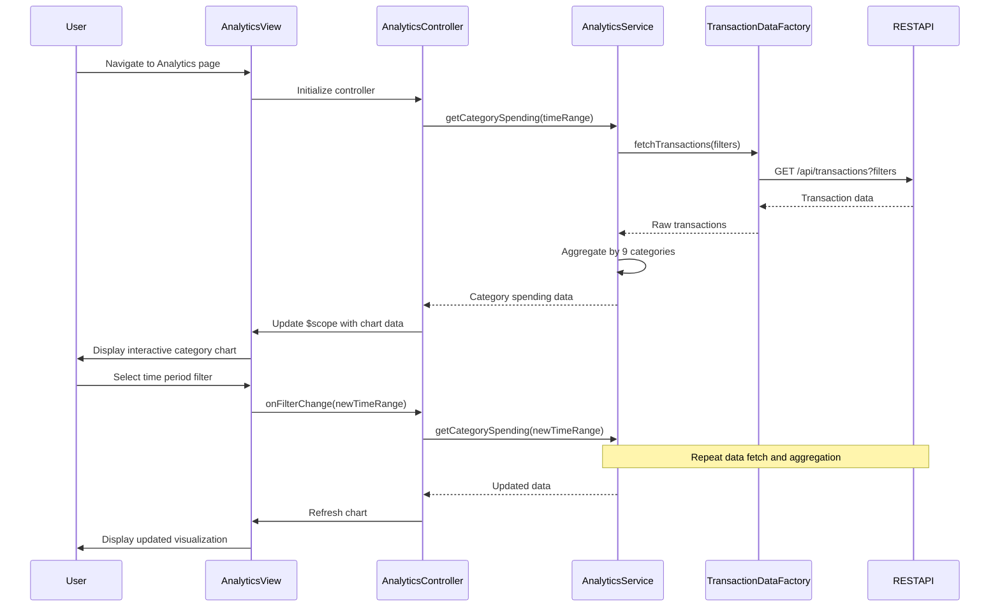

# Low-Level Design: QE-9176 - Spending Analytics and Insights

## a. Architecture Mapping

- **Analytics UI** → AngularJS Module (`app.analytics`) with Controller (`AnalyticsController`)
- **Visualization Engine** → AngularJS Directive (`chartVisualization`) wrapping Chart.js library
- **Analytics Service** → AngularJS Service (`AnalyticsService`) for data aggregation and computation
- **Transaction Data Source** → AngularJS Factory (`TransactionDataFactory`) for REST API calls
- **Dashboard KPI Service** → AngularJS Service (`KPIService`) for aggregated metrics

**Recommended Folder Structure:**
```
app/
├── modules/
│   └── analytics/
│       ├── analytics.module.js
│       ├── controllers/
│       │   └── analytics.controller.js
│       ├── services/
│       │   ├── analytics.service.js
│       │   └── kpi.service.js
│       ├── directives/
│       │   └── chart-visualization.directive.js
│       ├── factories/
│       │   └── transaction-data.factory.js
│       └── views/
│           └── analytics.html
└── assets/
    └── css/
        └── analytics.css
```

## b. Component Specifications

| Component Name | Artifact Type | Responsibility | Key Dependencies |
|---|---|---|---|
| AnalyticsModule | Module | Register analytics feature components and routing | angular, ui.router |
| AnalyticsController | Controller | Manage analytics view state, user interactions, and data binding | AnalyticsService, KPIService, $scope |
| AnalyticsService | Service | Aggregate transaction data by category, time period, and card | TransactionDataFactory, $q, $http |
| KPIService | Service | Provide aggregated financial metrics for analytics context | $http, $q |
| TransactionDataFactory | Factory | Fetch transaction data from REST API with filtering support | $http, $log |
| chartVisualization | Directive | Render interactive charts using Chart.js with responsive behavior | Chart.js, $window |

## c. Data Model

```javascript
// SpendingAnalytics Model
const SpendingAnalytics = {
  categorySpending: [
    {
      category: String,        // e.g., "Food & Dining", "Fuel", "Shopping"
      amount: Number,          // Total spend in category
      percentage: Number,      // Percentage of total spend
      transactionCount: Number // Number of transactions
    }
  ],
  monthlyTrend: [
    {
      month: String,           // e.g., "2026-01"
      totalSpend: Number,      // Total spend for the month
      categoryBreakdown: Object // Key-value pairs of category: amount
    }
  ],
  cardWiseSpend: [
    {
      cardId: String,          // Credit card identifier
      cardName: String,        // Display name of card
      totalSpend: Number,      // Total spend on this card
      categoryBreakdown: Object // Key-value pairs of category: amount
    }
  ]
};

// ChartConfig Model
const ChartConfig = {
  type: String,                // "pie", "bar", "line"
  data: Object,                // Chart.js data object
  options: Object              // Chart.js options object
};
```

## d. Data Flow

User navigates to Analytics view → AnalyticsController initializes and requests data from AnalyticsService → AnalyticsService calls TransactionDataFactory to fetch transaction data and KPIService for aggregated metrics via REST APIs → Service aggregates data by category (9 predefined categories), month, and card → Processed data is returned to Controller and bound to $scope → chartVisualization directive receives data and renders interactive Chart.js visualizations → User interactions (filter by time period, select card) trigger Controller methods that re-query AnalyticsService and update visualizations in real-time.

## e. Primary Sequence Diagram



## f. Implementation Notes

- Use AngularJS DI to inject AnalyticsService, KPIService, and TransactionDataFactory into AnalyticsController for testability and modularity.
- Implement Chart.js integration via custom directive with isolated scope and two-way data binding for dynamic chart updates.
- Cache aggregated analytics data in AnalyticsService using $cacheFactory with 5-minute TTL to meet 2-second rendering NFR.
- Use ES6 arrow functions and const/let for service methods; leverage Array.reduce() for category aggregation logic.
- Implement REST API calls with $http service using promise chaining; return $q.all() for parallel data fetching from multiple endpoints.

## g. Error Handling

HTTP interceptor captures API errors; AnalyticsService wraps calls in try/catch blocks and displays user-friendly error notifications via toast/modal component.

## h. Security Notes

Requires token-based authentication via existing SSO; all API calls include Authorization header with JWT token.