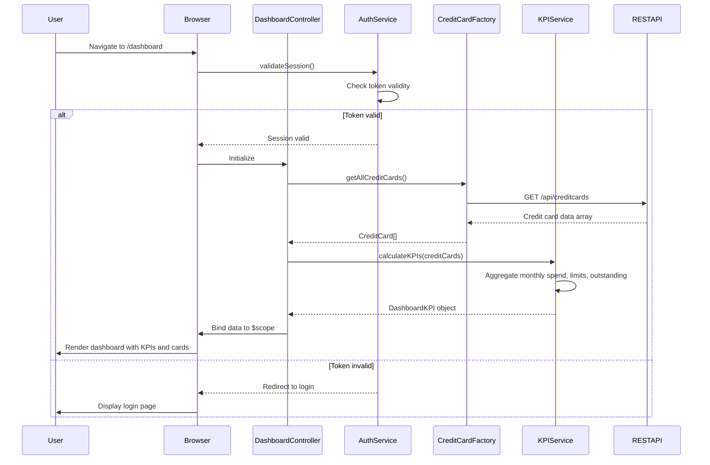

# Low-Level Design: QE-9177 - Credit Card Portfolio and KPI Dashboard

## a. Architecture Mapping

- **User Browser** → AngularJS SPA entry point with routing configuration
- **Authentication Service** → AngularJS Service (`AuthService`) for session management and token validation
- **Dashboard UI Component** → AngularJS Module (`app.dashboard`) with Controller (`DashboardController`) and View template
- **KPI Calculation Engine** → AngularJS Service (`KPIService`) for computing financial metrics
- **Credit Card Data Repository** → AngularJS Factory (`CreditCardFactory`) for REST API integration

**Recommended Folder Structure:**
```
app/
├── modules/
│   └── dashboard/
│       ├── dashboard.module.js
│       ├── controllers/
│       │   └── dashboard.controller.js
│       ├── services/
│       │   ├── auth.service.js
│       │   └── kpi.service.js
│       ├── factories/
│       │   └── credit-card.factory.js
│       └── views/
│           └── dashboard.html
├── shared/
│   └── components/
│       └── card-summary/
│           ├── card-summary.directive.js
│           └── card-summary.html
└── assets/
    └── css/
        └── dashboard.css
```

## b. Component Specifications

| Component Name | Artifact Type | Responsibility | Key Dependencies |
|---|---|---|---|
| DashboardModule | Module | Register dashboard components, configure routing, and define dependencies | angular, ui.router, ngAnimate |
| DashboardController | Controller | Orchestrate dashboard view, manage card list, and bind KPI data to UI | KPIService, CreditCardFactory, $scope |
| AuthService | Service | Validate user session, manage authentication tokens, and enforce access control | $http, $window, $q |
| KPIService | Service | Calculate monthly spend, total credit limit, available credit, and outstanding amounts | CreditCardFactory, $q |
| CreditCardFactory | Factory | Fetch credit card data from REST API and provide data transformation utilities | $http, $log |
| cardSummary | Directive | Display individual credit card details with KPIs in reusable component | None (isolated scope) |

## c. Data Model

```javascript
// CreditCard Model
const CreditCard = {
  cardId: String,              // Unique identifier
  cardNumber: String,          // Masked card number (e.g., "**** **** **** 1234")
  cardType: String,            // "Visa", "MasterCard", "Amex"
  cardHolderName: String,      // Name on card
  creditLimit: Number,         // Total credit limit
  outstandingAmount: Number,   // Current outstanding balance
  availableCredit: Number,     // Calculated: creditLimit - outstandingAmount
  expiryDate: String,          // Format: "MM/YY"
  isActive: Boolean            // Card status
};

// DashboardKPI Model
const DashboardKPI = {
  monthlySpend: Number,        // Total spend across all cards in current month
  totalCreditLimit: Number,    // Sum of credit limits across all cards
  totalAvailableCredit: Number,// Sum of available credit across all cards
  totalOutstanding: Number     // Sum of outstanding amounts across all cards
};
```

## d. Data Flow

User accesses dashboard URL → AuthService validates session and redirects to login if invalid → On successful authentication, DashboardController initializes → Controller calls CreditCardFactory to fetch all user credit cards via REST API → Factory returns array of CreditCard objects → Controller invokes KPIService.calculateKPIs() with card data → KPIService computes aggregated metrics (monthly spend, total limits, available credit, outstanding) → Computed KPIs and card list are bound to $scope → View renders responsive dashboard with KPI summary cards and individual credit card components → UI updates complete within 2 seconds per NFR.

## e. Primary Sequence Diagram



## f. Implementation Notes

- Use AngularJS $routeProvider or ui-router to configure dashboard route with authentication guard (resolve block calling AuthService).
- Implement KPIService as singleton with pure functions for KPI calculations; use Array.reduce() for aggregating card data.
- CreditCardFactory uses $http.get() with promise-based error handling; implement response interceptor for token refresh on 401 errors.
- Leverage Bootstrap grid system (col-md-3, col-sm-6, col-xs-12) for responsive card layout; use ng-repeat for rendering multiple cards.
- Cache credit card data in CreditCardFactory using $cacheFactory with 5-minute expiration to optimize load time.

## g. Error Handling

HTTP interceptor-based approach with global error handler; API failures display toast notifications and log errors to console.

## h. Security Notes

Requires token-based auth via existing SSO; AuthService stores JWT in sessionStorage and includes Authorization header in all API requests.