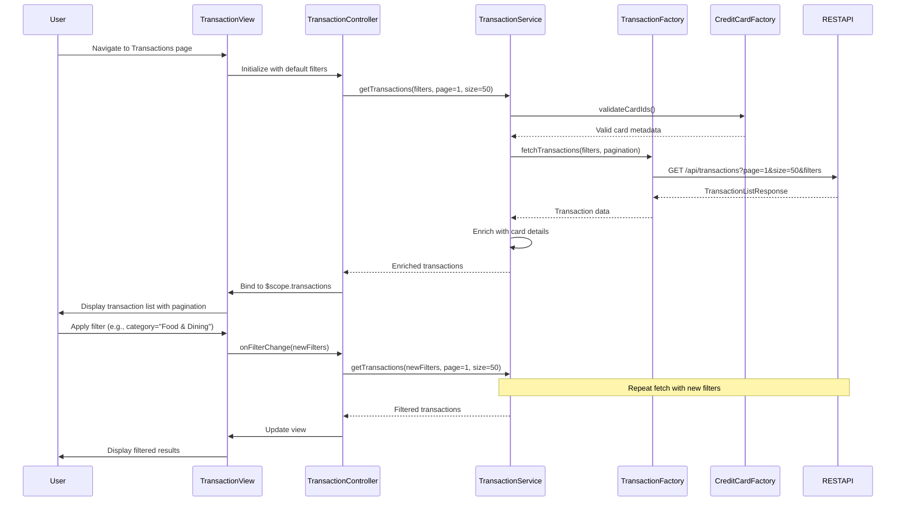

# Low-Level Design: QE-9178 - Transaction Management and Viewing

## a. Architecture Mapping

- **User Interface** → AngularJS Module (`app.transactions`) with Controller (`TransactionController`) and View template
- **Transaction Service** → AngularJS Service (`TransactionService`) for business logic and data orchestration
- **Search and Filter Module** → AngularJS Filter (`transactionFilter`) and Controller methods for filtering logic
- **Transaction Data Repository** → AngularJS Factory (`TransactionFactory`) for REST API calls
- **Credit Card Data Source** → AngularJS Factory (`CreditCardFactory`) for card validation and metadata

**Recommended Folder Structure:**
```
app/
├── modules/
│   └── transactions/
│       ├── transactions.module.js
│       ├── controllers/
│       │   └── transaction.controller.js
│       ├── services/
│       │   └── transaction.service.js
│       ├── factories/
│       │   └── transaction.factory.js
│       ├── filters/
│       │   └── transaction.filter.js
│       └── views/
│           ├── transaction-list.html
│           └── transaction-detail.html
└── assets/
    └── css/
        └── transactions.css
```

## b. Component Specifications

| Component Name | Artifact Type | Responsibility | Key Dependencies |
|---|---|---|---|
| TransactionsModule | Module | Register transaction components and configure routing for list and detail views | angular, ui.router |
| TransactionController | Controller | Manage transaction list state, pagination, filtering, and user interactions | TransactionService, $scope, $stateParams |
| TransactionService | Service | Orchestrate transaction retrieval, apply business rules, and coordinate with factories | TransactionFactory, CreditCardFactory, $q |
| TransactionFactory | Factory | Execute REST API calls for transaction data with pagination and filtering support | $http, $log |
| CreditCardFactory | Factory | Fetch credit card metadata for transaction validation and display enrichment | $http |
| transactionFilter | Filter | Client-side filtering of transactions by date range, amount, merchant, and category | None |

## c. Data Model

```javascript
// Transaction Model
const Transaction = {
  transactionId: String,       // Unique identifier
  cardId: String,              // Associated credit card ID
  date: String,                // ISO 8601 format (e.g., "2026-01-15T10:30:00Z")
  merchant: String,            // Merchant name
  category: String,            // One of 9 predefined categories
  amount: Number,              // Transaction amount (positive for purchases)
  currency: String,            // "USD", "EUR", etc.
  status: String,              // "Posted", "Pending", "Declined"
  description: String          // Additional details
};

// TransactionListRequest Model
const TransactionListRequest = {
  cardId: String,              // Optional: filter by specific card
  startDate: String,           // Optional: date range start
  endDate: String,             // Optional: date range end
  category: String,            // Optional: filter by category
  pageNumber: Number,          // Pagination: default 1
  pageSize: Number             // Pagination: default 50
};

// TransactionListResponse Model
const TransactionListResponse = {
  transactions: Array,         // Array of Transaction objects
  totalCount: Number,          // Total number of transactions matching filters
  pageNumber: Number,          // Current page
  pageSize: Number             // Items per page
};
```

## d. Data Flow

User navigates to Transactions view → TransactionController initializes with default pagination (page 1, size 50) → Controller calls TransactionService.getTransactions() with optional filters → TransactionService validates card IDs via CreditCardFactory and calls TransactionFactory.fetchTransactions() → Factory executes REST API call GET /api/transactions with query parameters → API returns paginated TransactionListResponse → Service enriches transaction data with card metadata and returns to Controller → Controller binds data to $scope and renders transaction list in table format → User applies search/filter (date, merchant, category) → Controller updates filter parameters and re-invokes TransactionService → Updated results display within 3 seconds per NFR.

## e. Primary Sequence Diagram



## f. Implementation Notes

- Use AngularJS ui-router for transaction list and detail views with state parameters for transactionId in detail route.
- Implement pagination using AngularJS directives (e.g., ui-bootstrap pagination) with server-side pagination via REST API query params.
- TransactionFactory uses $http with promise chaining; implement request cancellation using $http timeout for abandoned filter operations.
- Leverage AngularJS custom filters for client-side search on already-loaded transactions to reduce API calls for minor filtering.
- Use ng-table or custom directive for sortable, scannable transaction table with responsive design (Bootstrap table-responsive class).

## g. Error Handling

HTTP interceptor captures API errors; TransactionService wraps calls in try/catch and displays user-friendly error messages via notification service.

## h. Security Notes

Requires token-based auth via existing SSO; all transaction API calls include Authorization header with JWT token for user-specific data access.