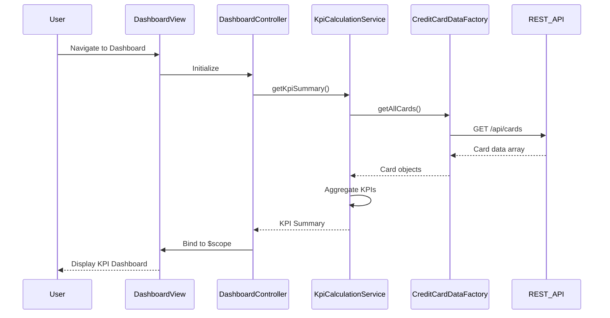

# Low-Level Design: Dashboard and KPI Overview
**Epic ID:** QE-9179

## a. Architecture Mapping

- **User Interface Dashboard** → AngularJS Module: `dashboard.module.js` + Controller: `DashboardController` + View: `dashboard.html`
- **KPI Calculation Service** → AngularJS Service: `KpiCalculationService` (handles aggregation logic)
- **Credit Card Data Source** → AngularJS Factory: `CreditCardDataFactory` (REST API integration)
- **Aggregation Engine** → Service method within `KpiCalculationService.aggregateCardData()`
- **Responsive Layout Renderer** → Bootstrap grid + CSS3 media queries in `dashboard.css`

**Recommended Folder Structure:**
```
app/
├── modules/
│   └── dashboard/
│       ├── dashboard.module.js
│       ├── dashboard.controller.js
│       ├── dashboard.html
│       └── dashboard.css
├── services/
│   ├── kpi-calculation.service.js
│   └── creditcard-data.factory.js
└── assets/css/
    └── responsive.css
```

## b. Component Specifications

| Name | Artifact Type | Responsibility | Key Dependencies |
|------|---------------|----------------|------------------|
| DashboardModule | AngularJS Module | Encapsulates dashboard feature, registers controllers/services | angular, ui.router, ngAnimate |
| DashboardController | Controller | Manages dashboard view state, fetches KPIs, handles user interactions | KpiCalculationService, CreditCardDataFactory, $scope |
| KpiCalculationService | Service | Computes monthly spend, total limit, available credit, outstanding amount | CreditCardDataFactory, $q |
| CreditCardDataFactory | Factory | Fetches card data from REST API, caches responses | $http, $q |
| DashboardView | HTML5 View | Displays KPI cards, multi-card summary, responsive layout | Bootstrap grid, AngularJS directives |

## c. Data Model

**CreditCard Object:**
```javascript
{
  cardId: String,
  cardNumber: String,  // masked
  issuer: String,
  creditLimit: Number,
  currentBalance: Number,
  availableCredit: Number,
  outstandingAmount: Number,
  monthlySpend: Number
}
```

**KPI Summary Object:**
```javascript
{
  totalMonthlySpend: Number,
  totalCreditLimit: Number,
  totalAvailableCredit: Number,
  totalOutstanding: Number,
  cardCount: Number
}
```

## d. Data Flow

User navigates to dashboard → DashboardView loads → DashboardController invokes KpiCalculationService.getKpiSummary() → Service calls CreditCardDataFactory.getAllCards() which makes REST API call to /api/cards → Factory returns card array → KpiCalculationService aggregates data (sums limits, balances, calculates monthly spend from transaction summaries) → KPI summary object returned to controller → Controller binds data to $scope → View renders KPI cards using Bootstrap responsive grid → User sees consolidated multi-card dashboard with all KPIs displayed.

## e. Primary Sequence Diagram



## f. Implementation Notes

- Use AngularJS dependency injection to inject KpiCalculationService and CreditCardDataFactory into DashboardController.
- Implement promise-based API calls using $http and $q for asynchronous data fetching.
- Use ES6 classes for services and arrow functions for callbacks to maintain lexical scope.
- Leverage Bootstrap grid system (col-xs, col-sm, col-md, col-lg) for responsive KPI card layout.
- Cache card data in factory using simple in-memory object to reduce redundant API calls and meet 2-second load time requirement.

## g. Error Handling

HTTP interceptor captures API errors; controller displays user-friendly error message using Bootstrap alert component; retry logic in factory for transient failures.

## h. Security Notes

Requires token-based auth via existing SSO; card numbers masked on client; secure HTTPS API calls assumed.