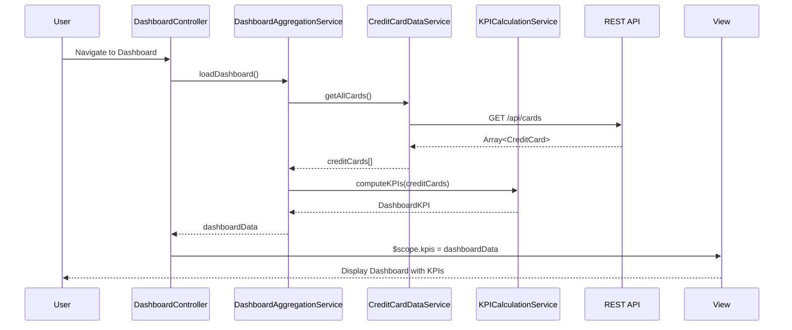

# Low-Level Design: QE-9180 - Dashboard and Key Performance Indicators

## a. Architecture Mapping

- **AngularJS Module**: `creditCard.dashboard` - Main module for dashboard feature
- **Controller**: `DashboardController` - Manages dashboard view state and KPI display logic
- **Service**: `DashboardAggregationService` - Aggregates credit card data and computes KPIs
- **Service**: `CreditCardDataService` - Fetches card balances, limits, and transaction data from REST API
- **Service**: `KPICalculationService` - Computes consolidated metrics (total limit, available credit, outstanding, monthly spend)
- **Service**: `DataRefreshService` - Handles real-time data refresh with configurable intervals
- **Directive**: `kpiWidget` - Reusable component for displaying individual KPI metrics
- **Directive**: `responsiveDashboard` - Handles responsive layout adaptation for mobile/desktop

**Recommended Folder Structure**:
```
/app
  /modules
    /dashboard
      dashboard.module.js
      dashboard.controller.js
      dashboard.html
      /services
        dashboard-aggregation.service.js
        kpi-calculation.service.js
        data-refresh.service.js
      /directives
        kpi-widget.directive.js
        responsive-dashboard.directive.js
  /shared
    /services
      credit-card-data.service.js
```

## b. Component Specifications

| Component Name | Artifact Type | Responsibility | Key Dependencies |
|----------------|---------------|----------------|------------------|
| creditCard.dashboard | Module | Root module for dashboard feature | angular, ngRoute, creditCard.shared |
| DashboardController | Controller | Manages view state, initiates data load, handles user interactions | DashboardAggregationService, $scope, $interval |
| DashboardAggregationService | Service/Factory | Orchestrates data fetching and KPI computation for all cards | CreditCardDataService, KPICalculationService, $q |
| CreditCardDataService | Service/Factory | Fetches card data from REST API endpoint /api/cards | $http, $q |
| KPICalculationService | Service/Factory | Computes total credit limit, available credit, outstanding, monthly spend | None (pure computation) |
| DataRefreshService | Service/Factory | Polls for data updates at configurable intervals (default 30s) | $interval, $rootScope |
| kpiWidget | Directive | Displays individual KPI with label, value, and trend indicator | None |
| responsiveDashboard | Directive | Applies responsive grid layout based on viewport size | $window |

## c. Data Model

**CreditCard Model** (JavaScript ES6 class or plain object):
```javascript
{
  cardId: String,
  cardNumber: String,        // masked, e.g., "****1234"
  cardName: String,
  creditLimit: Number,
  currentBalance: Number,
  availableCredit: Number,
  outstandingAmount: Number,
  lastUpdated: Date
}
```

**DashboardKPI Model**:
```javascript
{
  monthlySpend: Number,
  totalCreditLimit: Number,
  totalAvailableCredit: Number,
  totalOutstanding: Number,
  cardCount: Number,
  lastRefreshed: Date
}
```

## d. Data Flow

User navigates to dashboard → DashboardController initializes and calls DashboardAggregationService.loadDashboard() → DashboardAggregationService requests all cards via CreditCardDataService.getAllCards() which calls REST API GET /api/cards → API returns array of CreditCard objects → KPICalculationService computes consolidated metrics by summing limits, balances, and filtering current month transactions → DataRefreshService starts polling interval to refresh data every 30 seconds → Computed DashboardKPI model is bound to $scope → View renders KPIs using kpiWidget directives with responsive layout → User sees real-time consolidated financial metrics across all cards.

## e. Primary Sequence Diagram



## f. Implementation Notes

- Use AngularJS Dependency Injection for all services and controllers; register services as factories using `angular.module().factory()`
- Implement ES6 classes for service logic where appropriate; use arrow functions for callbacks to preserve context
- Use `$http` service with promise chaining for REST API calls; handle responses with `.then()` and `.catch()`
- Apply `$interval` service for periodic data refresh; ensure proper cleanup in controller `$destroy` event to prevent memory leaks
- Use Bootstrap grid system (col-xs, col-sm, col-md, col-lg) in responsive-dashboard directive for adaptive layout across devices

## g. Error Handling

HTTP interceptor-based error handling with user-friendly notifications via toastr or custom alert service; all API failures caught in service layer and propagated to controller for UI feedback.

## h. Security Notes

Standard input validation and secure API calls assumed; sensitive card data masked on client-side; HTTPS enforced for all API communication.