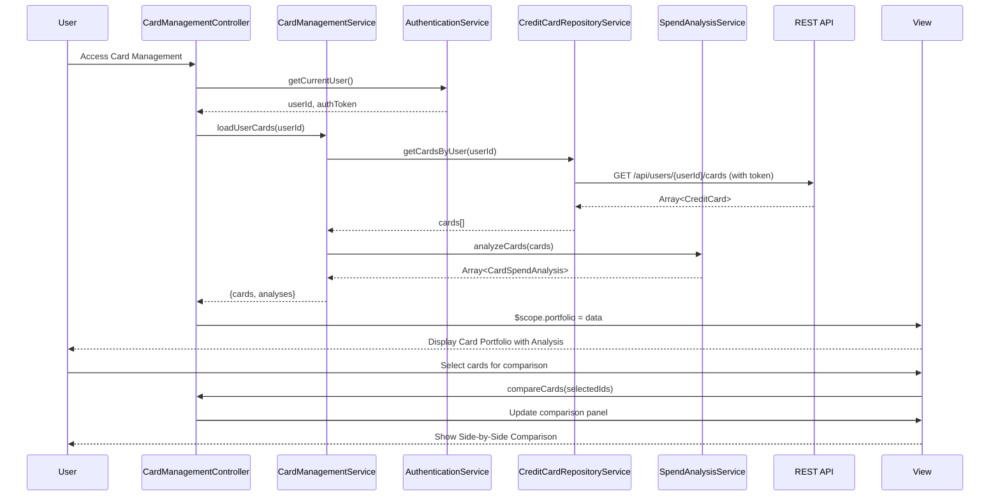

# Low-Level Design: QE-9181 - Multiple Credit Card Management

## a. Architecture Mapping

- **AngularJS Module**: `creditCard.management` - Main module for card management feature
- **Controller**: `CardManagementController` - Manages card portfolio view and user interactions
- **Service**: `CardManagementService` - Orchestrates card retrieval, comparison, and analysis operations
- **Service**: `CreditCardRepositoryService` - CRUD operations for credit card data via REST API
- **Service**: `SpendAnalysisService` - Computes card-wise spending, utilization rates, and comparison metrics
- **Service**: `AuthenticationService` - Handles user authentication and session management
- **Directive**: `cardTile` - Displays individual card summary with key metrics
- **Directive**: `cardComparison` - Side-by-side comparison view for multiple cards
- **Filter**: `cardMask` - Masks sensitive card number information for display

**Recommended Folder Structure**:
```
/app
  /modules
    /card-management
      card-management.module.js
      card-management.controller.js
      card-management.html
      /services
        card-management.service.js
        spend-analysis.service.js
        credit-card-repository.service.js
      /directives
        card-tile.directive.js
        card-comparison.directive.js
      /filters
        card-mask.filter.js
  /shared
    /services
      authentication.service.js
```

## b. Component Specifications

| Component Name | Artifact Type | Responsibility | Key Dependencies |
|----------------|---------------|----------------|------------------|
| creditCard.management | Module | Root module for card management feature | angular, ngRoute, creditCard.shared |
| CardManagementController | Controller | Manages card portfolio view, handles card selection and comparison | CardManagementService, AuthenticationService, $scope |
| CardManagementService | Service/Factory | Orchestrates card operations and coordinates between repository and analysis services | CreditCardRepositoryService, SpendAnalysisService, $q |
| CreditCardRepositoryService | Service/Factory | Fetches and manages card data via REST API /api/users/{userId}/cards | $http, $q, AuthenticationService |
| SpendAnalysisService | Service/Factory | Calculates card-wise spending, utilization percentage, and generates comparison data | None (computation logic) |
| AuthenticationService | Service/Factory | Provides authenticated user context and token for secure API calls | $http, $window.localStorage |
| cardTile | Directive | Renders individual card summary with limit, balance, utilization in tile format | cardMask filter |
| cardComparison | Directive | Displays side-by-side comparison table for selected cards | SpendAnalysisService |
| cardMask | Filter | Masks card number to show only last 4 digits (e.g., ****1234) | None |

## c. Data Model

**CreditCard Model**:
```javascript
{
  cardId: String,
  userId: String,
  cardNumber: String,           // full number, masked in UI via filter
  cardHolderName: String,
  cardType: String,             // Visa, Mastercard, Amex, etc.
  creditLimit: Number,
  currentBalance: Number,
  availableCredit: Number,
  utilizationRate: Number,      // percentage (0-100)
  lastTransactionDate: Date,
  isActive: Boolean
}
```

**CardSpendAnalysis Model**:
```javascript
{
  cardId: String,
  monthlySpend: Number,
  transactionCount: Number,
  averageTransactionAmount: Number,
  utilizationPercentage: Number,
  comparisonRank: Number        // rank among user's cards by spend
}
```

**CardComparison Model** (for comparison view):
```javascript
{
  cards: Array<CreditCard>,
  analyses: Array<CardSpendAnalysis>,
  comparisonMetrics: {
    highestSpend: String,       // cardId
    lowestUtilization: String,  // cardId
    mostTransactions: String    // cardId
  }
}
```

## d. Data Flow

User authenticates via AuthenticationService → CardManagementController initializes and calls CardManagementService.loadUserCards() → CardManagementService retrieves authenticated userId and calls CreditCardRepositoryService.getCardsByUser(userId) → Repository service makes REST API call GET /api/users/{userId}/cards with auth token → API returns array of CreditCard objects → SpendAnalysisService.analyzeCards() computes utilization rates, monthly spend, and ranking for each card → CardManagementService returns enriched card data with analysis to controller → Controller binds data to $scope → View renders card portfolio using cardTile directives with masked card numbers → User selects multiple cards for comparison → cardComparison directive displays side-by-side metrics and highlights best/worst performers.

## e. Primary Sequence Diagram



## f. Implementation Notes

- Use AngularJS factory pattern for all services with constructor functions or ES6 classes for better encapsulation
- Implement authentication token injection via HTTP interceptor; attach token to Authorization header for all API requests
- Use `$q.all()` for parallel loading if card data and transaction data come from separate endpoints
- Apply Bootstrap card component styling for cardTile directive; use ng-repeat with track by cardId for performance
- Implement client-side caching in CreditCardRepositoryService using $cacheFactory to meet 1-second retrieval NFR

## g. Error Handling

HTTP interceptor captures 401/403 errors and redirects to login; service-layer try/catch with promise rejection propagates errors to controller for user notification via modal or toast.

## h. Security Notes

Requires token-based auth via existing SSO; card data isolated per authenticated user; sensitive card numbers masked in UI using cardMask filter; all API calls over HTTPS.