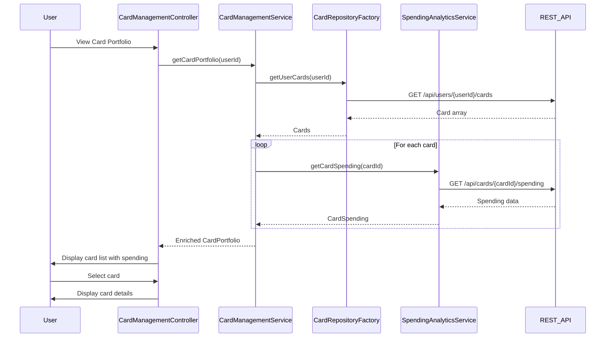

# Low-Level Design: Credit Card Management and Monitoring
**Epic ID:** QE-9182

## a. Architecture Mapping

- **User Interface** → AngularJS Module: `cardManagement.module.js` + Controller: `CardManagementController` + View: `card-management.html`
- **Card Management Service** → AngularJS Service: `CardManagementService` (orchestrates card operations)
- **User Authentication Service** → AngularJS Factory: `AuthFactory` (integrates with enterprise SSO)
- **Card Data Repository** → AngularJS Factory: `CardRepositoryFactory` (REST API for card CRUD)
- **Spending Analytics Module** → AngularJS Service: `SpendingAnalyticsService` (card-wise spend tracking)

**Recommended Folder Structure:**
```
app/
├── modules/
│   └── card-management/
│       ├── card-management.module.js
│       ├── card-management.controller.js
│       ├── card-management.html
│       └── card-detail.directive.js
├── services/
│   ├── card-management.service.js
│   ├── spending-analytics.service.js
│   ├── auth.factory.js
│   └── card-repository.factory.js
└── components/
    └── card-list/
        ├── card-list.component.js
        └── card-list.html
```

## b. Component Specifications

| Name | Artifact Type | Responsibility | Key Dependencies |
|------|---------------|----------------|------------------|
| CardManagementModule | AngularJS Module | Encapsulates card management feature, registers all artifacts | angular, ui.router |
| CardManagementController | Controller | Manages card list/detail views, handles card selection/switching | CardManagementService, SpendingAnalyticsService, $scope |
| CardManagementService | Service | Orchestrates card retrieval, aggregation, and portfolio operations | CardRepositoryFactory, AuthFactory, $q |
| CardRepositoryFactory | Factory | Fetches card data from REST API (/api/cards), handles CRUD | $http, $q |
| SpendingAnalyticsService | Service | Retrieves card-specific spending data and trends | $http, $q |
| CardDetailDirective | Directive | Reusable component for displaying individual card details | None |
| AuthFactory | Factory | Manages authentication tokens, validates user session | $http, $window |

## c. Data Model

**Card Object:**
```javascript
{
  cardId: String,
  userId: String,
  cardNumber: String,  // masked
  cardType: String,  // Visa, MasterCard, etc.
  issuer: String,
  creditLimit: Number,
  currentBalance: Number,
  availableCredit: Number,
  expiryDate: String,
  status: String  // active, blocked, expired
}
```

**CardSpending Object:**
```javascript
{
  cardId: String,
  monthlySpend: Number,
  lastTransactionDate: String,
  transactionCount: Number
}
```

**CardPortfolio Object:**
```javascript
{
  userId: String,
  cards: Array<Card>,
  totalCards: Number,
  activeCards: Number
}
```

## d. Data Flow

User authenticates via AuthFactory → CardManagementController initializes and calls CardManagementService.getCardPortfolio() → Service fetches user cards via CardRepositoryFactory.getUserCards() which calls REST API /api/users/{userId}/cards → Card array returned → Service enriches each card with spending data by calling SpendingAnalyticsService.getCardSpending(cardId) → Enriched card portfolio returned to controller → Controller binds to $scope and displays card list → User clicks card to view details → Controller updates selectedCard in scope → CardDetailDirective renders individual card details with balance, limit, and spending info.

## e. Primary Sequence Diagram



## f. Implementation Notes

- Use AngularJS DI to inject CardManagementService, SpendingAnalyticsService, and AuthFactory into controller.
- Implement parallel API calls using $q.all() to fetch spending data for multiple cards simultaneously and meet 3-second refresh requirement.
- Use ES6 Promise chaining for sequential operations (auth → fetch cards → enrich with spending).
- Implement card switching using ng-click and scope variable binding; no page reload required.
- Use isolate scope in CardDetailDirective with two-way binding for selectedCard object.

## g. Error Handling

HTTP interceptor with token refresh logic; controller displays error notifications using toastr or Bootstrap alerts; graceful degradation if spending data unavailable.

## h. Security Notes

Requires token-based auth via existing SSO; all API calls include Authorization header; card data encrypted in transit (HTTPS); sensitive card details masked.