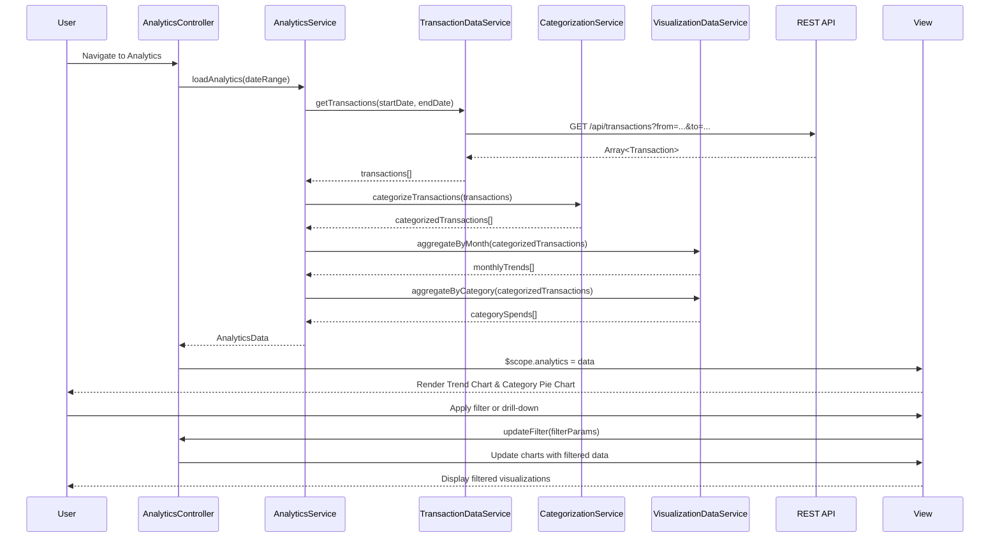

# Low-Level Design: QE-9183 - Spending Analytics and Insights

## a. Architecture Mapping

- **AngularJS Module**: `creditCard.analytics` - Main module for analytics and insights feature
- **Controller**: `AnalyticsController` - Manages analytics dashboard state, filters, and drill-down interactions
- **Service**: `AnalyticsService` - Orchestrates data fetching, categorization, and aggregation for visualizations
- **Service**: `TransactionDataService` - Fetches historical transaction records from REST API
- **Service**: `CategorizationService` - Classifies transactions into 9 predefined categories
- **Service**: `VisualizationDataService` - Transforms categorized data into chart-ready formats
- **Directive**: `spendTrendChart` - Renders monthly spend trend line chart using Chart.js or D3.js
- **Directive**: `categoryPieChart` - Renders category-wise spending pie chart
- **Directive**: `analyticsFilter` - Provides date range and category filter controls
- **Factory**: `ChartConfigFactory` - Centralized chart configuration and theming

**Recommended Folder Structure**:
```
/app
  /modules
    /analytics
      analytics.module.js
      analytics.controller.js
      analytics.html
      /services
        analytics.service.js
        transaction-data.service.js
        categorization.service.js
        visualization-data.service.js
      /directives
        spend-trend-chart.directive.js
        category-pie-chart.directive.js
        analytics-filter.directive.js
      /factories
        chart-config.factory.js
```

## b. Component Specifications

| Component Name | Artifact Type | Responsibility | Key Dependencies |
|----------------|---------------|----------------|------------------|
| creditCard.analytics | Module | Root module for analytics feature | angular, ngRoute, chart.js or angular-chart.js |
| AnalyticsController | Controller | Manages analytics view state, applies filters, handles drill-down events | AnalyticsService, $scope, $filter |
| AnalyticsService | Service/Factory | Orchestrates transaction fetching, categorization, and aggregation pipeline | TransactionDataService, CategorizationService, VisualizationDataService, $q |
| TransactionDataService | Service/Factory | Fetches up to 12 months of transaction history via REST API /api/transactions | $http, $q |
| CategorizationService | Service/Factory | Classifies each transaction into one of 9 categories using rule-based or ML logic | None (internal rules engine) |
| VisualizationDataService | Service/Factory | Aggregates categorized data by month and category; formats for chart libraries | None (data transformation) |
| spendTrendChart | Directive | Renders interactive line chart showing monthly spend trends over time | Chart.js, ChartConfigFactory |
| categoryPieChart | Directive | Renders pie chart displaying category-wise spending distribution | Chart.js, ChartConfigFactory |
| analyticsFilter | Directive | Provides UI controls for date range selection and category filtering | $filter |
| ChartConfigFactory | Factory | Provides reusable chart configuration objects (colors, tooltips, legends) | None |

## c. Data Model

**Transaction Model**:
```javascript
{
  transactionId: String,
  cardId: String,
  amount: Number,
  currency: String,
  merchantName: String,
  transactionDate: Date,
  category: String,              // one of 9 predefined categories
  description: String
}
```

**CategorySpend Model**:
```javascript
{
  category: String,              // Food & Dining, Fuel, Shopping, Travel, Entertainment, Utilities, Healthcare, Education, Miscellaneous
  totalSpend: Number,
  transactionCount: Number,
  percentage: Number             // percentage of total spend
}
```

**MonthlyTrend Model**:
```javascript
{
  month: String,                 // YYYY-MM format
  totalSpend: Number,
  categoryBreakdown: Array<CategorySpend>
}
```

**AnalyticsData Model** (aggregated for view):
```javascript
{
  monthlyTrends: Array<MonthlyTrend>,
  categorySpends: Array<CategorySpend>,
  dateRange: { startDate: Date, endDate: Date },
  totalTransactions: Number,
  totalSpend: Number
}
```

## d. Data Flow

User navigates to analytics dashboard → AnalyticsController calls AnalyticsService.loadAnalytics(dateRange) with default 12-month range → AnalyticsService requests TransactionDataService.getTransactions(startDate, endDate) → REST API GET /api/transactions?from={startDate}&to={endDate} returns transaction array → CategorizationService.categorizeTransactions() processes each transaction and assigns one of 9 categories based on merchant/description rules → VisualizationDataService.aggregateByMonth() and .aggregateByCategory() transform categorized data into chart-ready formats → AnalyticsService returns AnalyticsData model to controller → Controller binds to $scope → spendTrendChart and categoryPieChart directives render interactive visualizations → User applies filters or drills down → Controller updates data subset and charts re-render with filtered data.

## e. Primary Sequence Diagram



## f. Implementation Notes

- Use Chart.js library integrated via angular-chart.js directive wrapper for declarative chart rendering in templates
- Implement CategorizationService with keyword-based rules (e.g., merchant name contains "restaurant" → Food & Dining); consider caching categorization results
- Use AngularJS $filter service for client-side date range filtering to avoid repeated API calls during drill-down
- Apply lazy loading for transaction data; fetch only visible date range initially and load additional months on demand
- Use $q.defer() for asynchronous categorization if processing large transaction volumes; show loading spinner during computation

## g. Error Handling

HTTP interceptor-based error handling for API failures; categorization errors logged and transactions assigned to "Miscellaneous" category; user notified via toast on data load failures.

## h. Security Notes

Standard input validation and secure API calls assumed; transaction data filtered by authenticated user context on server-side; no PII exposed in client-side logs.